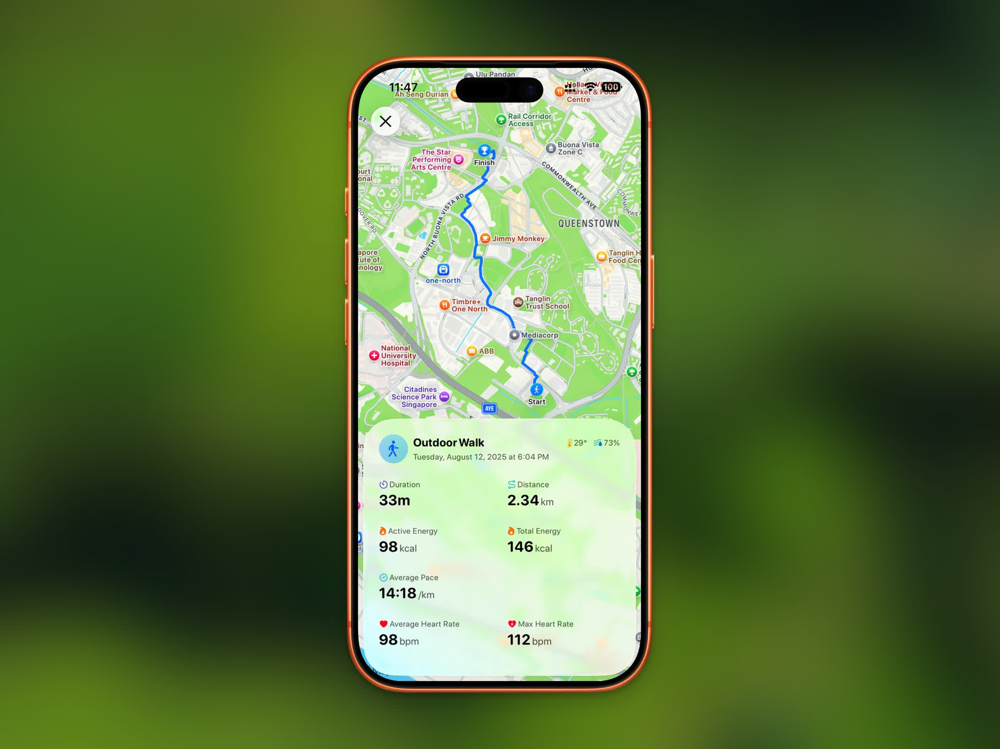
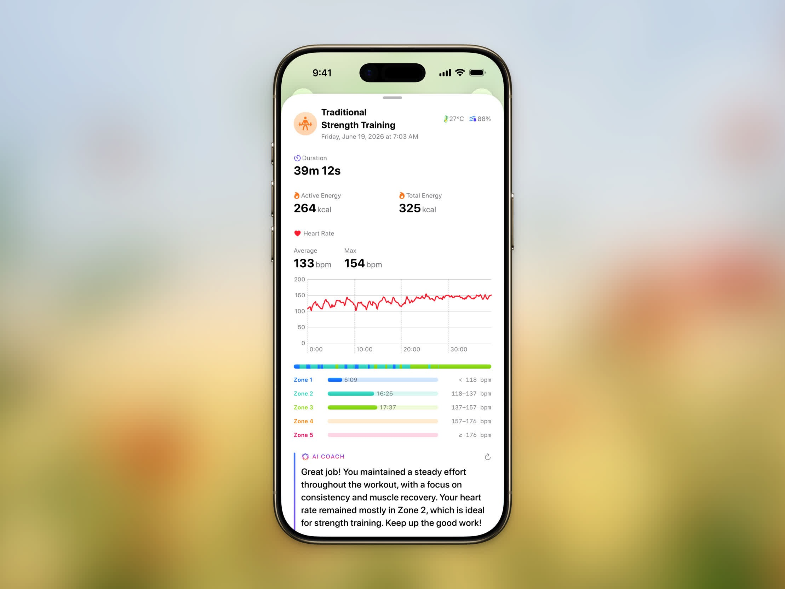
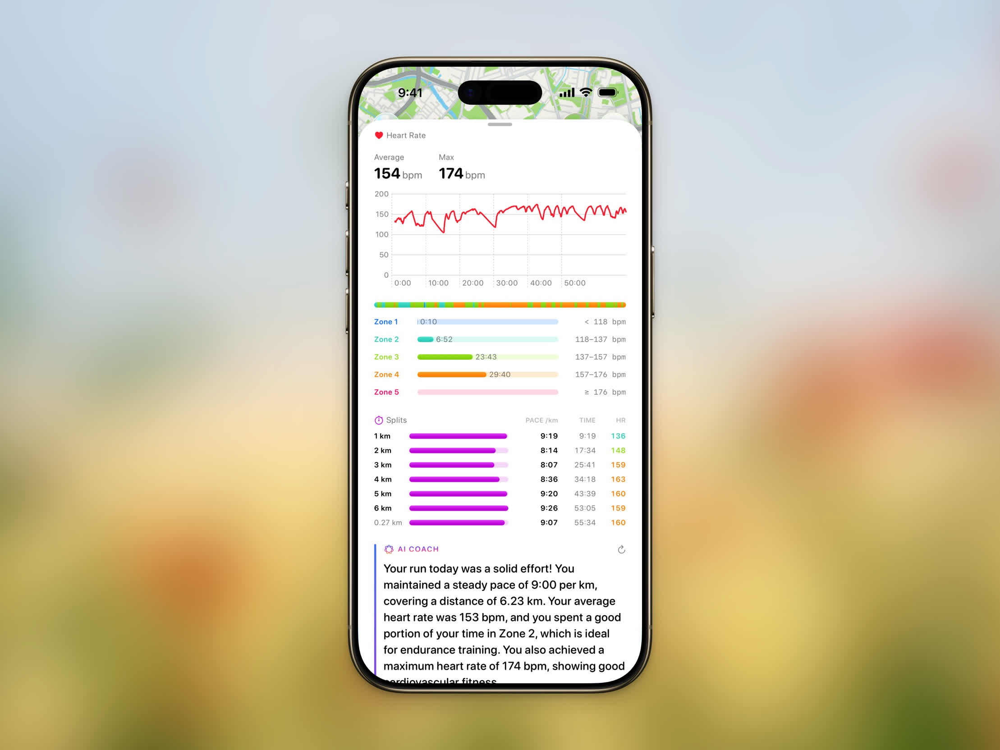
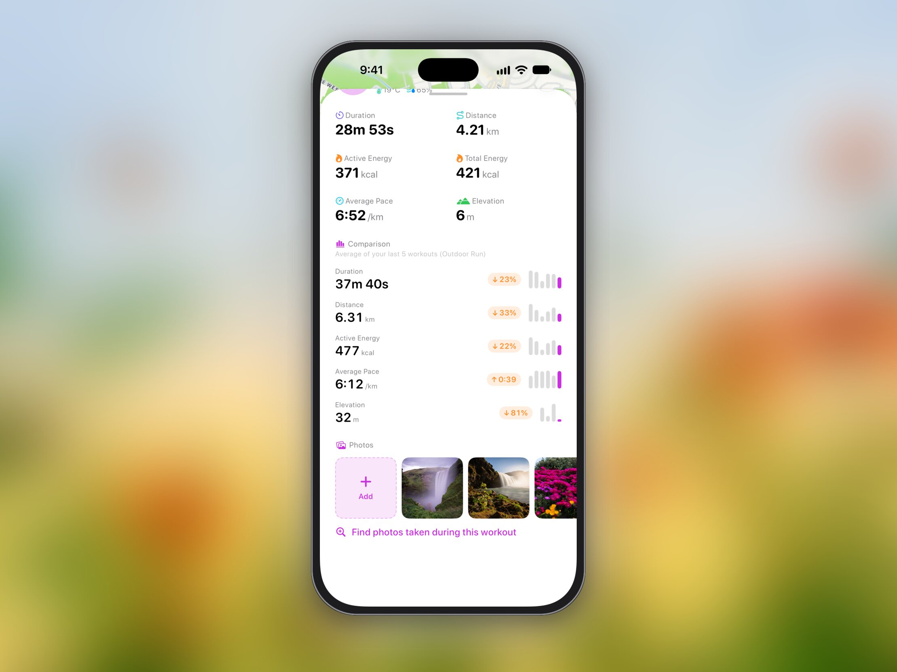
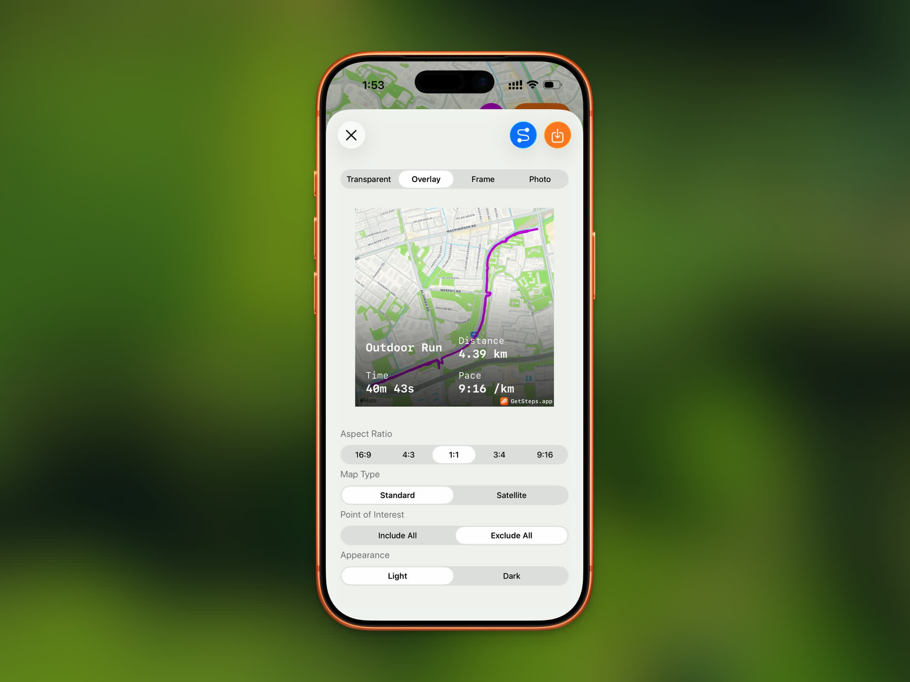
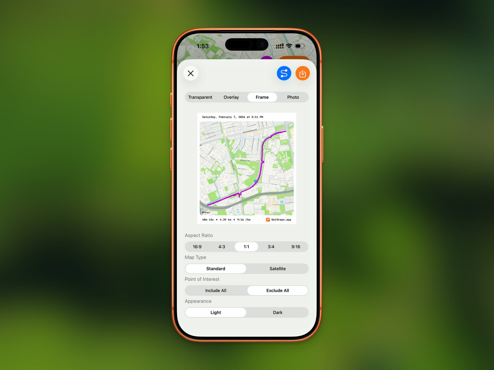
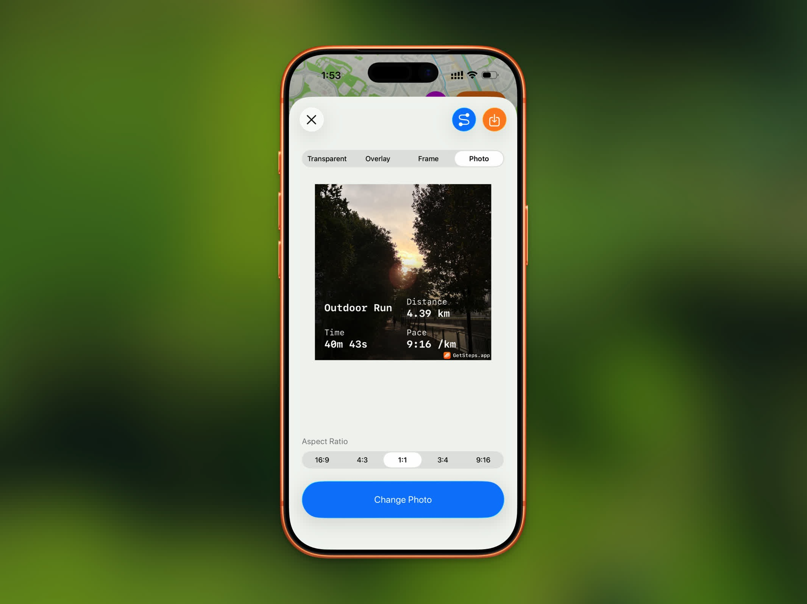

Die Aktivitätsdetailansicht bietet dir eine vollständige Aufschlüsselung eines beliebigen aufgezeichneten Workouts, einschließlich deiner Route, Statistiken, Fotos und Teilen-Optionen.

## Routenkarte

<Frame caption="Aktivitätsdetailansicht mit GPS-Routenkarte und Workout-Statistiken">
  
</Frame>

Für Outdoor-Workouts zeigt eine Karte deine GPS-Route in der Farbe des Workouts an. Du kannst zwischen folgenden Ansichten wechseln:

- **Standard**-Kartenansicht
- **Satellit**-Bildansicht

## Workout-Statistiken

Jede Workout-Detailansicht zeigt:

- **Dauer** - Gesamte Workout-Zeit
- **Distanz** - Zurückgelegte Gesamtdistanz
- **Tempo** - Durchschnittstempo (für Gehen und Laufen)
- **Höhengewinn** - Gesamter Anstieg während des Workouts
- **Herzfrequenz** - Durchschnittliche und maximale Herzfrequenz
- **Kalorien** - Aktiv verbrannte Energie
- **Wetter** - Temperatur und Luftfeuchtigkeit während des Workouts

Die Fußzeile des Statistikblatts nennt das Gerät, das das Workout aufgezeichnet hat, zum Beispiel dein iPhone oder deine Apple Watch. Workouts mit einem Ort, aber ohne gezeichneter Route zeigen trotzdem eine Stecknadel auf der Karte.

## Vergleich

Wenn du mindestens zwei frühere Workouts desselben Typs hast, zeigt der Bereich **Vergleich**, wie dieses gegenüber dem Durchschnitt deiner letzten Einheiten abschneidet. Indoor- und Outdoor-Sitzungen werden getrennt verglichen. Jede Zeile zeigt den aktuellen Durchschnitt, wie sich dieses Workout unterscheidet, und einen kleinen Trend, bei dem der letzte Balken diese Sitzung ist.

Verglichene Metriken können Dauer, Distanz, aktive Energie, Tempo, durchschnittliche Herzfrequenz und [Anstrengung](#anstrengung) umfassen. Der Bereich blendet sich aus, wenn es nicht genug Verlauf für einen Durchschnitt gibt.

## Anstrengung

Bewerte, wie anstrengend sich das Workout angefühlt hat, auf einer Skala von **1 bis 10**. Die Bewertung wird in Apple Health gespeichert und bleibt so mit der Fitness-App synchron. Die Stufen entsprechen den Namen von Apple:

| Bewertung | Stufe |
|-----------|-------|
| **1–3** | Easy |
| **4–6** | Moderate |
| **7–8** | Hard |
| **9–10** | All Out |

<Note>Anstrengungsbewertungen erfordern iOS 18 oder neuer, und Steps braucht die Berechtigung, Effort in der Health-App zu aktualisieren. Wenn eine andere App die Bewertung bereits besitzt, ändere sie dort oder in Health.</Note>

## Herzfrequenz & Zonen

<Frame caption="Herzfrequenz-Diagramm mit der Aufschlüsselung „Zeit in Zonen“">
  
</Frame>

Wenn ein Workout Herzfrequenzdaten enthält, zeigt der Bereich **Herzfrequenz** deinen Durchschnitts- und Maximalwert zusammen mit einem Diagramm deiner Herzfrequenz über die Sitzung hinweg. Die Spur ist nach deinen Herzfrequenzzonen aus Apple Health eingefärbt. Während eines Workouts auf der Apple Watch aktualisieren sich diese Zonen live.

Unter dem Diagramm zeigt die Aufschlüsselung **Zeit in Zonen**, wie lange du dich in jeder der fünf Herzfrequenzzonen aufgehalten hast, von leichter Anstrengung bis zur maximalen Anstrengung:

| Zone | Anstrengung |
|------|-------------|
| **Zone 1** | Sehr leicht |
| **Zone 2** | Leicht |
| **Zone 3** | Moderat |
| **Zone 4** | Hart |
| **Zone 5** | Maximal |

Jede Zone zeigt die darin verbrachte Zeit und ihren Herzfrequenzbereich in bpm.

## Splits

<Frame caption="Aufschlüsselung pro Split mit Tempo, Zeit und durchschnittlicher Herzfrequenz">
  
</Frame>

Für distanzbasierte Workouts schlüsselt die **Splits**-Tabelle dein Workout nach Distanz auf — eine Zeile pro Kilometer oder Meile, je nach deiner Einheiteneinstellung. Jeder Split zeigt:

- **Tempo** (oder **Geschwindigkeit** beim Radfahren)
- **Zeit** — Kumulierte verstrichene Zeit am Ende des Splits
- **HF** — Durchschnittliche Herzfrequenz für den Split, sofern verfügbar

Ein Balken neben jedem Split macht es leicht, deine schnellsten und langsamsten Segmente auf einen Blick zu vergleichen.

## Routen-Wiedergabe

<Note>Routen-Wiedergabe ist eine Pro-Funktion.</Note>

<Frame caption="3D-Routen-Wiedergabe, die der Route mit einer cineastischen Kamera folgt">
  <video
    autoPlay
    muted
    loop
    playsInline
    className="w-full aspect-video rounded-xl"
    src="/videos/route-3d.mp4"
  ></video>
</Frame>

Spiele deine Workout-Route in 3D ab, um nachzuerleben, wie du dich durch deine Sitzung bewegt hast. Eine cineastische Verfolgungskamera schwenkt heran und gleitet dann entlang deines Weges, wobei sie jede Kurve geschmeidig durchläuft, während sie deiner Position folgt.

Öffne **Karteneinstellungen**, um die Wiedergabe anzupassen:

- **Kartenstil** — wechsle zwischen **Standard** und **Satellit**. Beide zeigen während der Wiedergabe eine realistische Höhendarstellung für eine echte 3D-Ansicht.
- **Routenfarbe** — wähle die Farbe des Pfads.
- **Wiedergabedauer** — von **15 bis 180 Sekunden**. Steps wählt einen sinnvollen Standardwert basierend auf der Distanz deines Workouts.
- **Norden oben** — lass die Karte während der gesamten Wiedergabe nach Norden zeigen, oder lass die Kamera der Richtung folgen, in die du dich bewegt hast.

## Fotos

<Frame caption="An ein Workout angehängte Fotos am Ende der Statistikansicht">
  
</Frame>

Füge jedem Workout die Fotos hinzu, die du unterwegs gemacht hast. Der Abschnitt **Fotos** befindet sich am Ende der Statistikansicht.

- **Hinzufügen** — wähle beliebige Fotos aus deiner Mediathek, bis zu 20 auf einmal
- **Während dieses Trainings aufgenommene Fotos suchen** — Steps durchsucht deine Mediathek nach Fotos, die zwischen Start und Ende des Workouts aufgenommen wurden. Vorschläge erscheinen unter **Während dieses Trainings aufgenommen**; tippe auf eines, um es anzuhängen, oder tippe auf **Alle hinzufügen**

Angehängte Fotos erscheinen außerdem als Pins auf der Routenkarte, platziert danach, wann (oder wo) du sie aufgenommen hast, und tauchen während der [Routen-Wiedergabe](#routen-wiedergabe) auf, sobald die Markierung sie erreicht. Tippe auf ein Foto, um es im Vollbild anzusehen.

Um ein Foto zu entfernen, halte es gedrückt und wähle **Foto entfernen**. Steps speichert eine eigene Kopie jedes Fotos, daher wird durch das Entfernen aus einem Workout nie das Original in deiner Mediathek gelöscht.

<Note>Für die Suche nach Fotos, die während eines Workouts aufgenommen wurden, braucht Steps Zugriff auf deine Fotomediathek. Wenn du ihn nicht erlaubt hast, zeigt Steps eine Schaltfläche zum Öffnen der Einstellungen. Das Hinzufügen von Fotos über **Hinzufügen** funktioniert auch ohne vollen Zugriff auf die Mediathek.</Note>

## Workout teilen

Teile dein Workout als gestaltetes Bild. Steps bietet vier Teilen-Stile:

<Tabs>
  <Tab title="Transparent">
    <Frame>
      
    </Frame>
  </Tab>
  <Tab title="Overlay">
    <Frame>
      
    </Frame>
  </Tab>
  <Tab title="Rahmen">
    <Frame>
      
    </Frame>
  </Tab>
  <Tab title="Foto">
    <Frame>
      
    </Frame>
  </Tab>
</Tabs>

| Stil | Beschreibung |
|------|--------------|
| **Transparent** | Statistiken auf einem transparenten Hintergrund |
| **Overlay** | Statistiken über deine Routenkarte gelegt |
| **Rahmen** | Routenkarte mit einem umrandeten Statistikrahmen |
| **Foto** | Statistiken über ein Foto aus deiner Bibliothek gelegt |

**Overlay** und **Rahmen** funktionieren für eine gezeichnete GPS-Route und auch für ein Workout, das nur einen gespeicherten Ort hat. Die transparente Vorschau zeigt ein Schachbrettmuster, damit du siehst, was durchscheinend bleibt.

Du kannst auch aus fünf Seitenverhältnissen wählen: 16:9, 4:3, 1:1, 3:4 und 9:16.

Für kartenbasierte Stile stehen zusätzliche Optionen zur Verfügung: Kartendarstellung (hell/dunkel), Sichtbarkeit von Sehenswürdigkeiten und Höhenstil.

Weitere Informationen findest du unter [Teilen](/de/features/sharing).

## GPX-Export

<Note>GPX-Export ist eine Pro-Funktion.</Note>

Exportiere deine Workout-Route als `.gpx`-Datei zur Verwendung in anderen Fitness-Apps oder Kartierungstools. Tippe auf die Teilen-Schaltfläche und wähle GPX-Export, um die Datei zu speichern oder zu senden.

## Ein Workout löschen

Um ein Workout zu entfernen, tippe auf die Menü-Taste (⋯) in der oberen rechten Ecke und wähle **Löschen**. Du wirst zur Bestätigung aufgefordert, da dies das Workout sowohl aus Steps als auch aus Apple Health entfernt.

<Warning>Das Löschen eines Workouts entfernt es auch aus Apple Health und kann nicht rückgängig gemacht werden.</Warning>
