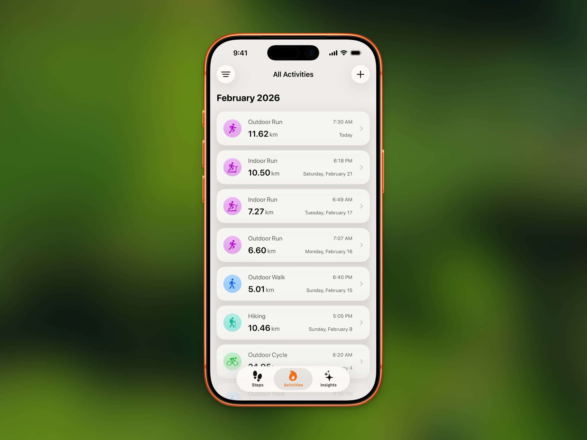

Die Aktivitätsliste zeigt alle deine aufgezeichneten Workouts an einem Ort, nach Monat geordnet für einfaches Durchsuchen.

## Workouts anzeigen

<Frame caption="Aktivitätsliste mit nach Monat gruppierten Workouts">
  
</Frame>

Deine Workouts sind nach Monat gruppiert, mit dem neuesten oben. Jeder Monat hat eine Zusammenfassung der Trainingstage und Gesamtwerte. In einem breiten Layout bleibt diese Zusammenfassung stehen, während die Karten scrollen. Jeder Eintrag zeigt:

- Workout-Typ und Symbol
- Dauer
- Datum und Uhrzeit
- Distanz (für Outdoor-Workouts)

In einer breiten dreispaltigen Liste steht das Datum unter dem Workout-Namen.

## Suche

Das Suchfeld oben in Aktivität nimmt einen Satz entgegen, nicht nur ein Stichwort. Steps wandelt die Phrase mit Apple Intelligence in Filter um. Der Platzhalter wechselt durch Beispiele wie **Morgenläufe**, **Läufe über 5k**, **Lange Fahrten diesen Monat** und **Meine längsten Workouts**.

Eine Klartextzeile unter dem Feld liest dir die Filter vor, damit du siehst, was die Suche verstanden hat. Unter iOS 27 kann die Auswertung Private Cloud Compute nutzen, wenn verfügbar, und Siri kann diese Suche für dich öffnen. Siehe [Siri-Kurzbefehle](/de/features/siri-shortcuts).

## Filtern

Tippe auf die Filter-Schaltfläche in der Symbolleiste, um die Liste einzugrenzen:

- **Trainingsart** — zeige nur bestimmte Typen an, einschließlich Gehen, Laufen, Radfahren, Wandern, Krafttraining, Yoga, HIIT und die anderen Typen, die Steps aus Apple Health liest
- **Jahr** — zeige nur Workouts aus einem einzelnen Jahr an

Dies hilft dir, ein bestimmtes Workout schnell zu finden, wenn du einen langen Verlauf hast. Suche und Filter arbeiten zusammen: Eine Suche setzt die passenden Filter, und du kannst sie weiterhin manuell über das Filtermenü anpassen.

## Verlaufsbeschränkungen

| Plan | Verlaufszugriff |
|------|-----------------|
| **Kostenlos** | Letzte 3 Monate |
| **Pro** | Unbegrenzter Verlauf |

<Note>Upgrade auf Steps Pro, um auf deinen vollständigen Workout-Verlauf über die letzten 3 Monate hinaus zuzugreifen.</Note>

## Workout-Details

Tippe auf ein beliebiges Workout in der Liste, um seine [Aktivitätsdetail](/de/features/activity-detail)-Ansicht mit vollständigen Statistiken, Routenkarte und Teilen-Optionen zu öffnen.
