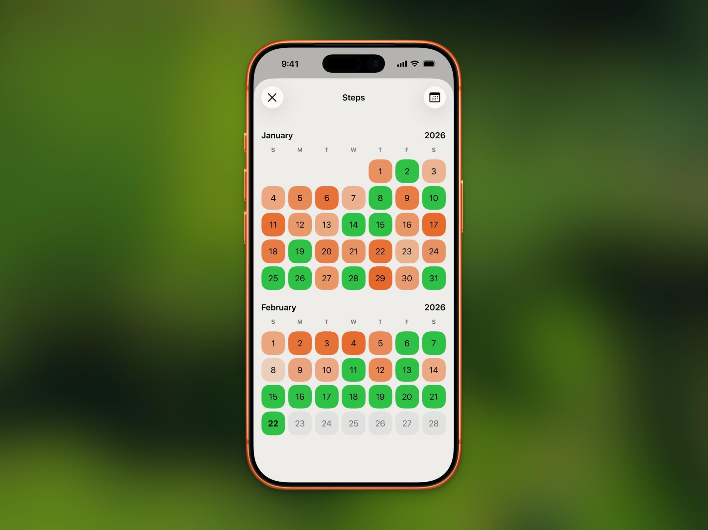
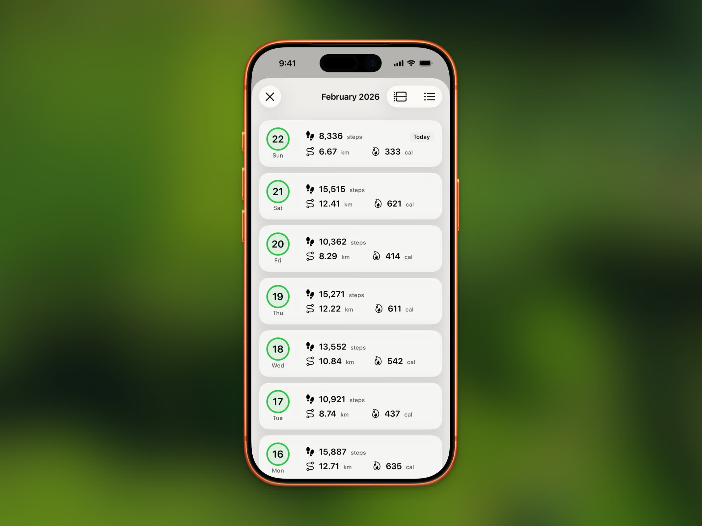

Im Verlauf kannst du deine täglichen Schritt-Aufzeichnungen im Laufe der Zeit mithilfe einer Kalenderansicht oder einer chronologischen Liste durchsuchen. Ab iOS 26 öffnest du ihn über die Kalender-Schaltfläche oben auf der Startseite; in früheren iOS-Versionen hat er einen eigenen Tab.

## Kalenderansicht

<Frame caption="Verlauf-Kalenderansicht mit täglichem Zielabschluss">
  
</Frame>

Jeder Tag zeigt deine Schrittzahl und eine Farbe dafür, wie nah du deinem Ziel gekommen bist:

- **Ziel erreicht** - In deiner abgeschlossenen Themenfarbe hervorgehoben
- **Teilfortschritt** - Hellerer Farbton basierend auf dem abgeschlossenen Prozentsatz
- **Keine Daten** - Keine Hervorhebung

Workout-Symbole sitzen unter der Schrittzahl an Tagen, an denen du trainiert hast. Zukünftige Tage sind markiert, damit sie nicht wie leerer Verlauf aussehen.

Navigiere zwischen Monaten mit den Pfeilschaltflächen oben im Kalender. Auf einem aufgeklappten iPhone Duo kann die Verlaufs-Spalte neben der Startseite eine Woche oder einen Monat zeigen.

## Listenansicht

<Frame caption="Verlauf-Listenansicht mit Schrittzahlen und Zielindikatoren">
  
</Frame>

Wechsle zur Listenansicht, um deine täglichen Aufzeichnungen in einer scrollbaren Liste zu sehen, die Folgendes anzeigt:

- Datum
- Schrittzahl
- Distanz
- Ob du dein Ziel erreicht hast

## Monatsnavigation

Verwende die Monatsnavigation, um zwischen Monaten zu springen. Jeder Monat zeigt eine Zusammenfassung deiner Aktivität für diesen Zeitraum.

## Verlaufsbeschränkungen

| Plan | Verlaufszugriff |
|------|-----------------|
| **Kostenlos** | Letzte 3 Monate |
| **Pro** | Unbegrenzter Verlauf |

<Note>Upgrade auf Steps Pro, um deinen vollständigen Schrittverlauf über die letzten 3 Monate hinaus zu durchsuchen.</Note>

## Ansichten wechseln

Unter iOS 26 und älter verwende die Menü-Taste in der oberen rechten Ecke, um zwischen den beiden Layouts zu wechseln:

- **Kalender** - Monatliches Raster mit täglichen Schrittzahlen, Zielfarben und Workout-Symbolen
- **Liste** - Chronologische Liste deiner täglichen Aufzeichnungen

Unter iOS 27 ist der Verlauf nur noch der Kalender. Eine Listen-Präferenz aus einer älteren Version bleibt erhalten, wenn du zurückgehst, wird aber nicht angezeigt.
