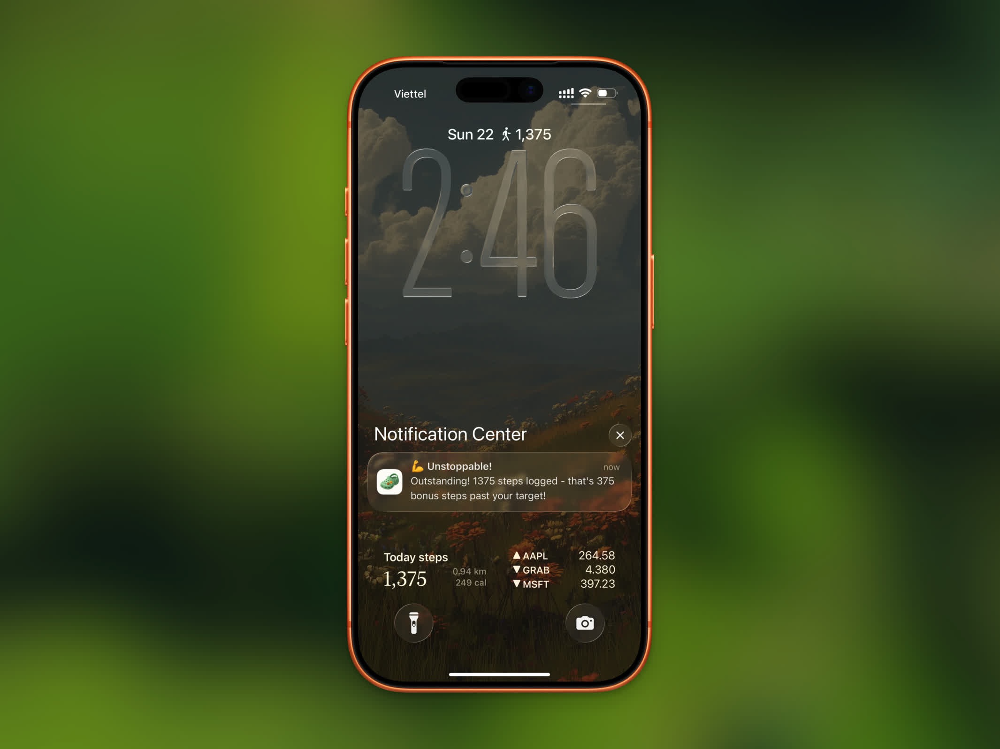

Steps sendet Benachrichtigungen, um deinen Fortschritt zu feiern und dich den ganzen Tag über motiviert zu halten.

## Benachrichtigungstypen

Jeder Typ kann unabhängig in **Einstellungen → Benachrichtigungen** ein- oder ausgeschaltet werden.

<Frame caption="Steps Ziel-Erreichungs-Benachrichtigung">
  
</Frame>

### Ziel erreicht

Wird ausgelöst, wenn deine Schrittzahl dein Tagesziel erreicht – eine Glückwunschnachricht mit deiner Leistung. Diese Einstellung sendet außerdem ein Fortschritts-Update, während du dich deinem Ziel näherst, und zeigt deinen aktuellen Prozentsatz sowie wie viele Schritte noch fehlen. Jede wird höchstens einmal pro Tag gesendet.

### Workout abgeschlossen

Wird gesendet, nachdem du eine Workout-Sitzung beendet hast. Enthält deine Workout-Dauer und die zurückgelegte Distanz. Die Nachricht variiert je nach Workout-Typ (Gehen, Laufen oder Radfahren).

### App-Entsperrung

Wenn du [App-Sperre](/de/features/app-lock) verwendest, erhältst du eine Benachrichtigung, wenn dein Schrittziel erreicht ist und deine gesperrten Apps entsperrt werden. Wird höchstens einmal pro Tag gesendet.

### Tägliche Erinnerungen

Optionale Anstöße am Morgen, Nachmittag und Abend, die dich in Bewegung halten und auf dein Ziel hinarbeiten lassen.

## Humor

Auf dem Benachrichtigungsbildschirm legt ein **Humor**-Schieberegler den Ton der Texte fest, die Apple Intelligence für dich schreibt. Ziehe ihn von warm bis theatralisch:

| Stufe | Ton |
|-------|-----|
| **Kind** | Warm, ohne Sarkasmus |
| **Gentle** | Freundlich, leichte Persönlichkeit |
| **Witty** | Trocken und clever |
| **Snarky** | Verspielter Sarkasmus |
| **Extra** | Theatralisch |

Eine Vorschau auf der Karte zeigt einen Beispieltitel und -text für die gewählte Stufe.

## Benachrichtigungen aktivieren

1. Öffne **Einstellungen** in Steps
2. Tippe auf **Benachrichtigungen**
3. Aktiviere die gewünschten Benachrichtigungstypen — Ziel erreicht, Workout abgeschlossen, App-Entsperrung und Tägliche Erinnerungen
4. Erlaube Benachrichtigungen, wenn iOS dazu auffordert

## Benachrichtigungen deaktivieren

Öffne **Einstellungen > Benachrichtigungen** in Steps und schalte jeden Typ aus, den du nicht möchtest. Du kannst Steps-Benachrichtigungen auch auf deinem iPhone unter **Einstellungen > Mitteilungen > Steps** verwalten.
