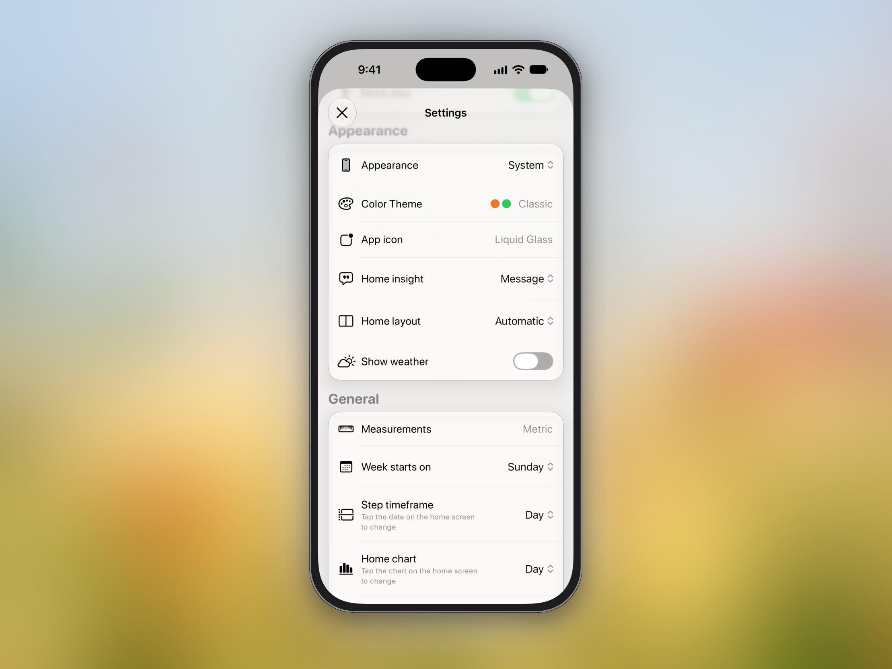

Der Einstellungsbildschirm ermöglicht es dir, das Aussehen und die Funktionsweise von Steps anzupassen. Öffne ihn über die Schaltfläche in der oberen rechten Ecke der Startseite — ein Zahnrad-Symbol oder, sobald du angemeldet bist, dein Profilbild.

## Profil

Deine Profilkarte wird oben in den Einstellungen angezeigt. Tippe darauf, um deinen Anzeigenamen, dein Profilbild und dein Land zu bearbeiten. Wenn du nicht angemeldet bist, siehst du eine Aufforderung zum **Mit Apple anmelden**.

Pro-Abonnenten sehen ein **Pro**-Abzeichen auf ihrer Profilkarte.

## Darstellung

<Frame caption="Darstellungseinstellungen">
  
</Frame>

| Einstellung | Optionen | Hinweise |
|-------------|----------|----------|
| **Darstellung** | System, Hell, Dunkel | Folgt deinem Gerät oder manuell einstellen |
| **Farbthema** | 12 Voreinstellungen + Benutzerdefiniert | Pro-Funktion. Siehe [Farbthemen](/de/features/color-themes) |
| **App-Icon** | 17 Icons | Siehe [App-Icon](/de/features/app-icon-selector) |
| **Startseiten-Einblick** | Aus, Nachricht, Durchschnitt, Jahresziel | Was unter deiner Schrittzahl angezeigt wird |
| **Durchschnitts-Baseline** | Letzte 30 Tage, Letzte 3 Monate, Dieses Jahr, Letztes Jahr, Gesamte Zeit | Wird angezeigt, wenn Startseiten-Einblick auf Durchschnitt steht |
| **Startseiten-Layout** | Automatisch, Karte, Dashboard | iOS 26 und neuer. Siehe [Startseite](/de/features/home-dashboard#startseiten-layout) |
| **Wetter anzeigen** | Ein, Aus | Temperatur und Wetterbedingungen anzeigen |

## Allgemein

| Einstellung | Optionen | Hinweise |
|-------------|----------|----------|
| **Maßeinheiten** | Einheiten & Temperatur | Öffnet eine eigene Seite (siehe unten) |
| **Woche beginnt am** | Sonntag, Montag | Ändert Kalender- und Wochenansichten |
| **Schrittzeitraum** | Tag, Woche, Monat | Woche und Monat sind Pro-Funktionen. Du kannst auch auf das Datum auf der Startseite tippen |
| **Start-Diagramm** | Tag, Woche, Monat | Wird angezeigt, wenn Schrittzeitraum auf Tag steht. Woche und Monat sind Pro-Funktionen. Du kannst auch auf das Diagramm auf der Startseite tippen |
| **Tagesziel** | 1.000 - 20.000 | Siehe [Tagesziel](/de/features/daily-goal) |
| **Jahresziel** | 500.000 - 10.000.000 | Siehe [Jahresziel](/de/features/yearly-goal) |
| **Benachrichtigungen** | Öffnet einen Detailbildschirm | Zeigt an, ob Benachrichtigungen aktiviert sind. Siehe [Benachrichtigungen](/de/features/notifications) |
| **App-Sperre** | Ein, Aus | Pro-Funktion. Siehe [App-Sperre](/de/features/app-lock) |
| **App-Sprache** | 10 Sprachen | Öffnet die Spracheinstellungen deines Geräts |

### Maßeinheiten

Die Seite **Maßeinheiten** (der erste Eintrag unter Allgemein) steuert die in der gesamten App verwendeten Einheiten:

- **Einheitensystem** — **Metrisch** (km, °C) oder **Imperial** (Meilen, °F)
- **Temperatur** — **Automatisch** (folgt deinem Einheitensystem), **Celsius** oder **Fahrenheit**

Änderungen gelten in der gesamten App und werden automatisch mit deiner Apple Watch synchronisiert.

### Benachrichtigungs-Untereinstellungen

Durch Tippen auf Benachrichtigungen öffnet sich ein Detailbildschirm mit einem Schalter für jeden Typ:

- **Zielerreichung** — Ziel erreicht und Meilensteine
- **Trainingsabschluss** — Wenn ein Training beendet wird
- **App-Entsperrung** — Wenn Apps entsperrt werden
- **Tägliche Erinnerungen** — Morgens, nachmittags und abends
- **Humor** — Wie verspielt generierte Benachrichtigungstexte klingen sollen (iOS 26 und neuer). Siehe [Benachrichtigungen](/de/features/notifications#humor)

### Unterstützte Sprachen

Steps ist verfügbar in English, Deutsch, Español, Français, Italiano, 日本語, 한국어, Português (Brasil), Русский und 简体中文.

## Widgets und Daten

- **Startbildschirm-Widgets** — Einrichtungsanleitung zum Hinzufügen von Widgets. Siehe [Widgets](/de/features/widgets)
- **Apple Health-Daten neu synchronisieren** — Aktivitätsdaten von Apple Health aktualisieren
- **Einrichtung neu starten** — Den Einrichtungsablauf erneut durchlaufen

## Support

- **Feedback-Board** — Funktionswünsche einreichen und Ideen bewerten
- **Bewertung hinterlassen** — Steps im App Store bewerten
- **Hilfe und Dokumentation** — [getsteps.app/docs](https://getsteps.app/docs)
- **Abonnement verwalten** — Pro-Plan ändern oder kündigen (nur Pro-Nutzer)
- **Nutzungsbedingungen** — [getsteps.app/terms](https://getsteps.app/terms)
- **Datenschutzrichtlinie** — [getsteps.app/privacy](https://getsteps.app/privacy)
- **Fitness-Tools** — [getsteps.app/tools](https://getsteps.app/tools)

## Über

- **Neuigkeiten** — Die neuesten Änderungen und Updates ansehen
- **Eine Notiz von Hieu** — Warum Steps existiert, plus eine Möglichkeit, eine Bewertung zu hinterlassen oder zurückzuschreiben
- **Danksagungen** — Die Menschen hinter Steps
- **Steps teilen** — Die App per QR-Code mit Freunden teilen
- **Auf X folgen** — [@hieudinh_](https://x.com/hieudinh_)
- **Blog** — [getsteps.app/blog](https://getsteps.app/blog)
