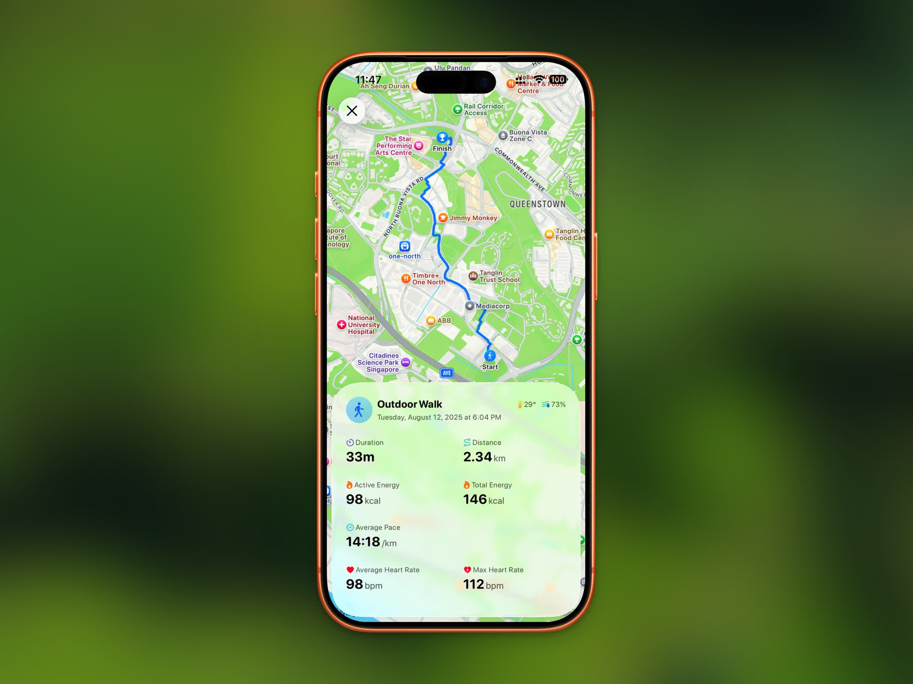
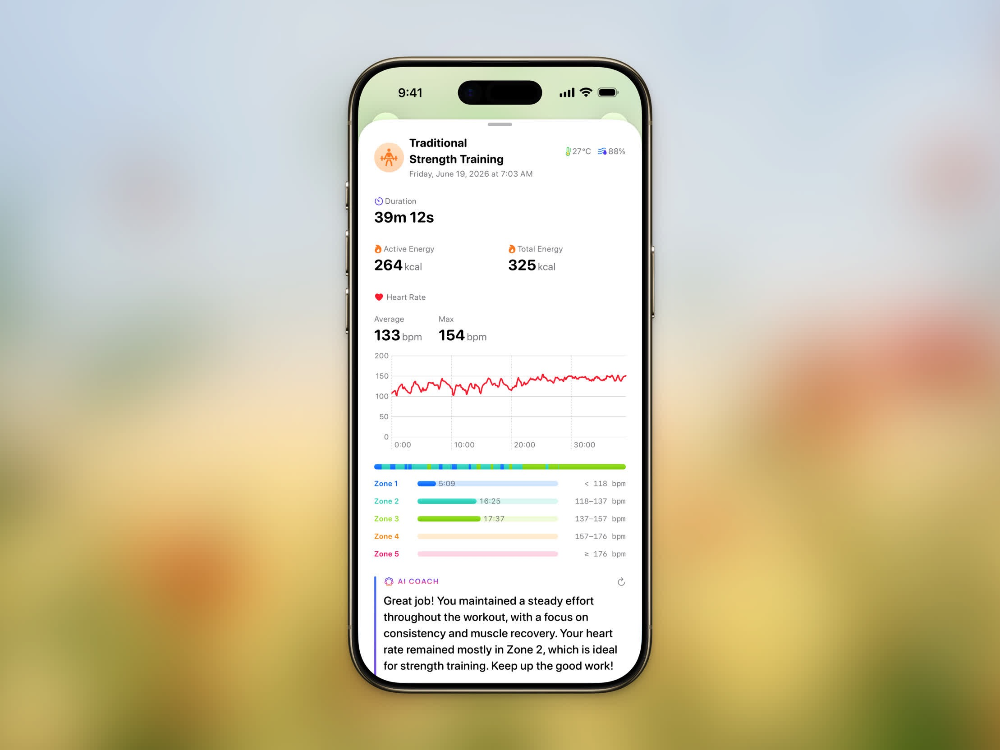
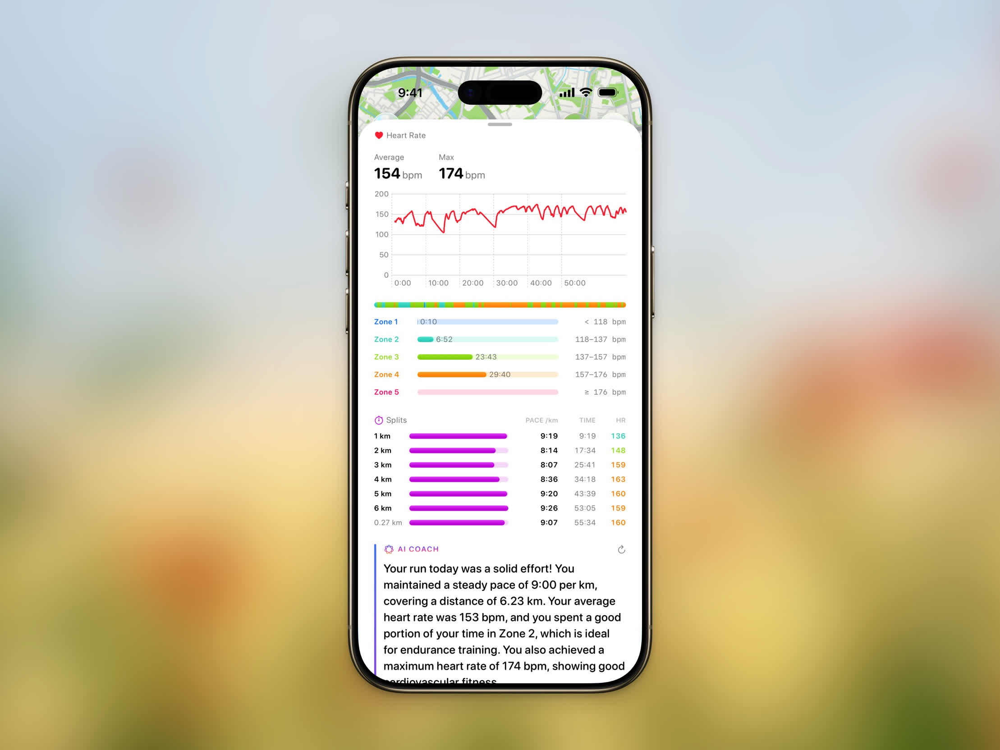
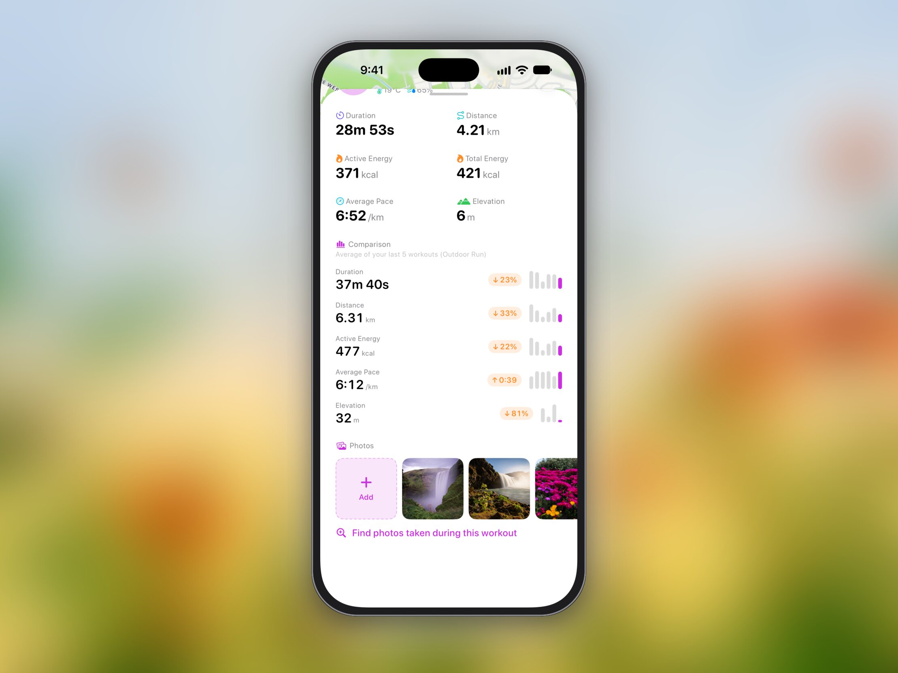
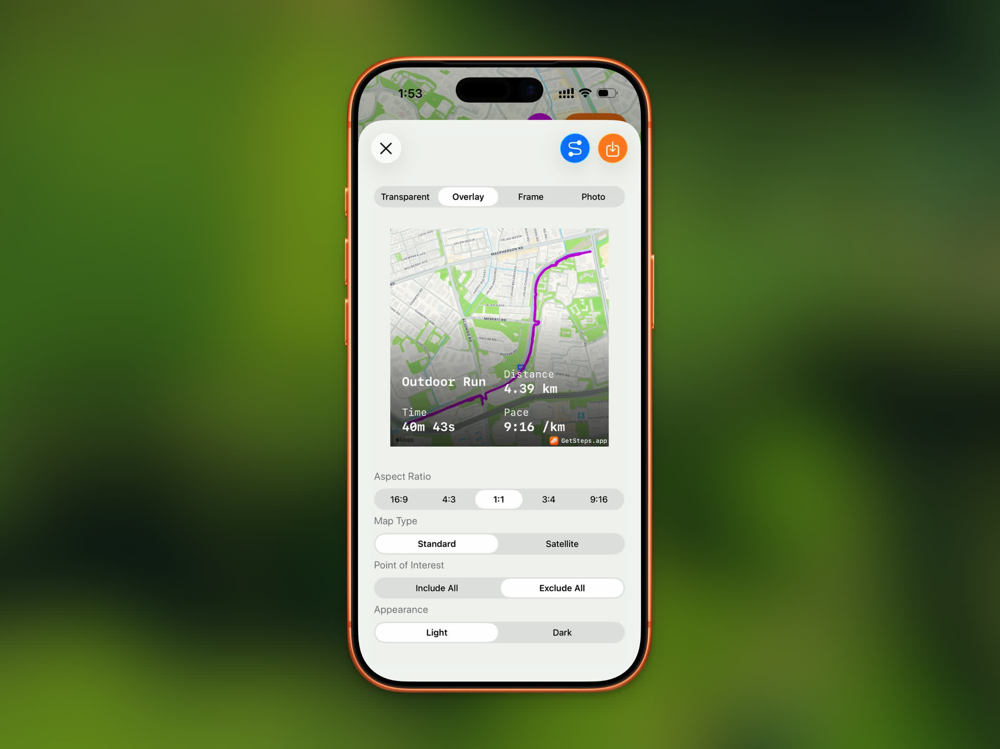
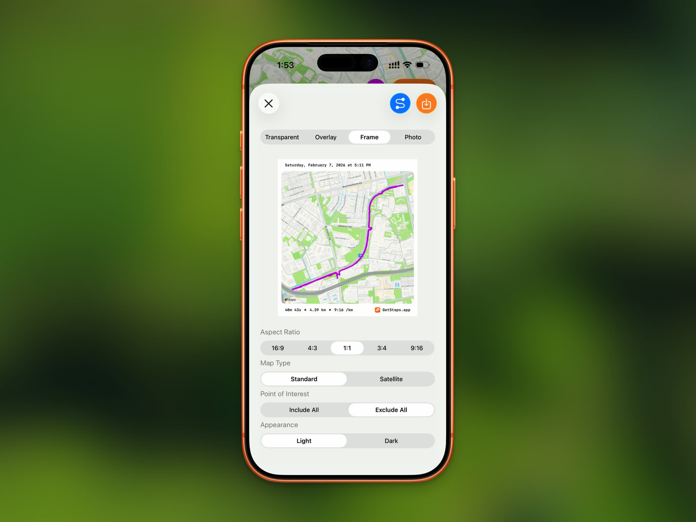
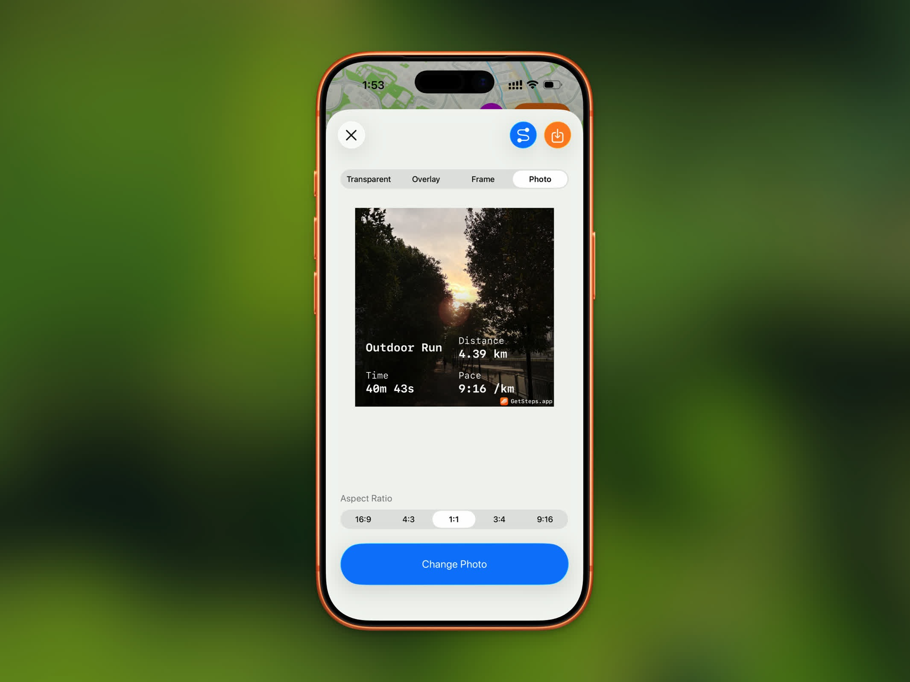

La vista de Detalle de actividad te ofrece un desglose completo de cualquier entrenamiento registrado, incluyendo tu ruta, estadísticas, fotos y opciones para compartir.

## Mapa de ruta

<Frame caption="Vista de detalle de actividad con mapa de ruta GPS y estadísticas del entrenamiento">
  
</Frame>

Para los entrenamientos al aire libre, un mapa muestra tu ruta GPS dibujada con el color del entrenamiento. Puedes alternar entre:

- Vista de mapa **Estándar**
- Vista de **Satélite**

## Estadísticas del entrenamiento

Cada vista de detalle de entrenamiento muestra:

- **Duración** - Tiempo total del entrenamiento
- **Distancia** - Distancia total recorrida
- **Ritmo** - Ritmo promedio (para caminar y correr)
- **Desnivel acumulado** - Subida total durante el entrenamiento
- **Frecuencia cardíaca** - Frecuencia cardíaca promedio y máxima
- **Calorías** - Energía activa quemada
- **Clima** - Temperatura y humedad durante el entrenamiento

El pie de la hoja de estadísticas nombra el dispositivo que registró el entrenamiento, como tu iPhone o Apple Watch. Los entrenamientos que tienen un lugar pero no una ruta trazada aún muestran un pin en el mapa.

## Comparación

Cuando tienes al menos dos entrenamientos anteriores del mismo tipo, la sección **Comparación** muestra cómo se posiciona este frente al promedio de tus últimos. Las sesiones de interior y exterior se comparan por separado. Cada fila muestra el promedio reciente, cuánto difiere este entrenamiento y una pequeña tendencia donde la última barra es esta sesión.

Las métricas comparadas pueden incluir duración, distancia, energía activa, ritmo, frecuencia cardíaca promedio y [esfuerzo](#esfuerzo). La sección se oculta cuando no hay suficiente historial para calcular un promedio.

## Esfuerzo

Califica qué tan duro se sintió el entrenamiento en una escala de **1 a 10**. La puntuación se guarda en Apple Health, así que se mantiene sincronizada con la app Fitness. Los rangos coinciden con los nombres de Apple:

| Puntuación | Rango |
|------------|-------|
| **1–3** | Fácil |
| **4–6** | Moderado |
| **7–8** | Intenso |
| **9–10** | Al máximo |

<Note>Las calificaciones de esfuerzo requieren iOS 18 o posterior, y Steps necesita permiso para actualizar el Esfuerzo en la app Salud. Si otra app ya posee la calificación, cámbiala allí o en Salud.</Note>

## Frecuencia cardíaca y zonas

<Frame caption="Gráfico de frecuencia cardíaca con el desglose de Tiempo en zonas">
  
</Frame>

Cuando un entrenamiento tiene datos de frecuencia cardíaca, la sección **Frecuencia cardíaca** muestra tu promedio y máxima junto con un gráfico de tu frecuencia cardíaca durante la sesión. El trazo se colorea según tus zonas de frecuencia cardíaca de Apple Health. Durante un entrenamiento en Apple Watch, esas zonas se actualizan en vivo.

Debajo del gráfico, el desglose de **Tiempo en zonas** muestra cuánto tiempo pasaste en cada una de las cinco zonas de frecuencia cardíaca, desde un esfuerzo suave hasta un esfuerzo máximo:

| Zona | Esfuerzo |
|------|----------|
| **Zona 1** | Muy ligero |
| **Zona 2** | Ligero |
| **Zona 3** | Moderado |
| **Zona 4** | Intenso |
| **Zona 5** | Máximo |

Cada zona muestra el tiempo que pasaste en ella y su rango de frecuencia cardíaca en ppm.

## Parciales

<Frame caption="Desglose por parcial con ritmo, tiempo y frecuencia cardíaca promedio">
  
</Frame>

Para los entrenamientos basados en distancia, la tabla de **Parciales** desglosa tu entrenamiento por distancia: una fila por kilómetro o milla, según tu configuración de unidades. Cada parcial muestra:

- **Ritmo** (o **Velocidad** para el ciclismo)
- **Tiempo** — Tiempo transcurrido acumulado al final del parcial
- **FC** — Frecuencia cardíaca promedio del parcial, cuando está disponible

Una barra junto a cada parcial facilita comparar de un vistazo tus segmentos más rápidos y más lentos.

## Reproducción de ruta

<Note>La reproducción de ruta es una función Pro.</Note>

<Frame caption="Reproducción de ruta en 3D siguiendo el recorrido con una cámara cinematográfica">
  <video
    autoPlay
    muted
    loop
    playsInline
    className="w-full aspect-video rounded-xl"
    src="/videos/route-3d.mp4"
  ></video>
</Frame>

Reproduce tu ruta de entrenamiento en 3D para revivir cómo te moviste durante tu sesión. Una cámara cinematográfica de seguimiento se acerca y luego se desliza a lo largo de tu recorrido, suavizando cada giro mientras sigue tu posición.

Abre **Ajustes del mapa** para personalizar la reproducción:

- **Estilo de mapa** — alterna entre **Estándar** y **Satélite**. Ambos muestran una elevación realista durante la reproducción para una verdadera vista en 3D.
- **Color de la ruta** — elige el color del recorrido.
- **Duración de la reproducción** — de **15 a 180 segundos**. Steps elige un valor predeterminado adecuado según la distancia de tu entrenamiento.
- **Norte arriba** — deja el mapa apuntando al norte durante toda la reproducción, o deja que la cámara siga la dirección en la que te movías.

## Fotos

<Frame caption="Fotos añadidas a un entrenamiento, al final de la hoja de estadísticas">
  
</Frame>

Añade a cualquier entrenamiento las fotos que tomaste por el camino. La sección **Fotos** está al final de la hoja de estadísticas.

- **Añadir** — elige cualquier foto de tu fototeca, hasta 20 a la vez
- **Buscar fotos tomadas durante este entrenamiento** — Steps busca en tu fototeca las fotos capturadas entre la hora de inicio y la de fin del entrenamiento. Las sugerencias aparecen en **Tomadas durante este entrenamiento**; toca una para añadirla, o toca **Añadir todas**

Las fotos añadidas también aparecen como marcadores en el mapa de ruta, colocadas según cuándo (o dónde) las tomaste, y aparecen a lo largo del camino cuando el marcador las alcanza durante la [reproducción de ruta](#reproducción-de-ruta). Toca una foto para verla a pantalla completa.

Para quitar una foto, mantenla pulsada y elige **Eliminar foto**. Steps guarda su propia copia de cada foto, así que quitarla de un entrenamiento nunca borra el original de tu fototeca.

<Note>Para buscar fotos tomadas durante un entrenamiento, Steps necesita acceso a tu fototeca. Si no lo has permitido, Steps muestra un botón para abrir Ajustes. Añadir fotos con **Añadir** funciona sin acceso completo a la fototeca.</Note>

## Compartir tu entrenamiento

Comparte tu entrenamiento como una imagen con estilo. Steps ofrece cuatro estilos para compartir:

<Tabs>
  <Tab title="Transparente">
    <Frame>
      
    </Frame>
  </Tab>
  <Tab title="Superposición">
    <Frame>
      
    </Frame>
  </Tab>
  <Tab title="Marco">
    <Frame>
      
    </Frame>
  </Tab>
  <Tab title="Foto">
    <Frame>
      
    </Frame>
  </Tab>
</Tabs>

| Estilo | Descripción |
|--------|-------------|
| **Transparente** | Estadísticas sobre fondo transparente |
| **Superposición** | Estadísticas superpuestas sobre el mapa de ruta |
| **Marco** | Mapa de ruta con un marco de estadísticas con borde |
| **Foto** | Estadísticas superpuestas sobre una foto de tu biblioteca |

**Superposición** y **Marco** funcionan con una ruta GPS trazada, y también con un entrenamiento que solo tenga un lugar guardado. La vista previa transparente muestra un tablero de ajedrez para que veas qué se mantendrá transparente.

También puedes elegir entre cinco proporciones: 16:9, 4:3, 1:1, 3:4 y 9:16.

Para los estilos basados en mapa, las opciones adicionales incluyen apariencia del mapa (claro/oscuro), visibilidad de puntos de interés y estilo de elevación.

Consulta [Compartir](/es/features/sharing) para más detalles.

## Exportación GPX

<Note>La exportación GPX es una función Pro.</Note>

Exporta tu ruta de entrenamiento como archivo `.gpx` para usarlo en otras apps de actividad física o herramientas de mapeo. Toca el botón de compartir y selecciona exportar GPX para guardar o enviar el archivo.

## Eliminar un entrenamiento

Para quitar un entrenamiento, toca el botón de menú (⋯) en la esquina superior derecha y elige **Eliminar**. Se te pedirá confirmación, ya que esto quita el entrenamiento tanto de Steps como de Apple Health.

<Warning>Eliminar un entrenamiento también lo quita de Apple Health, y no se puede deshacer.</Warning>
