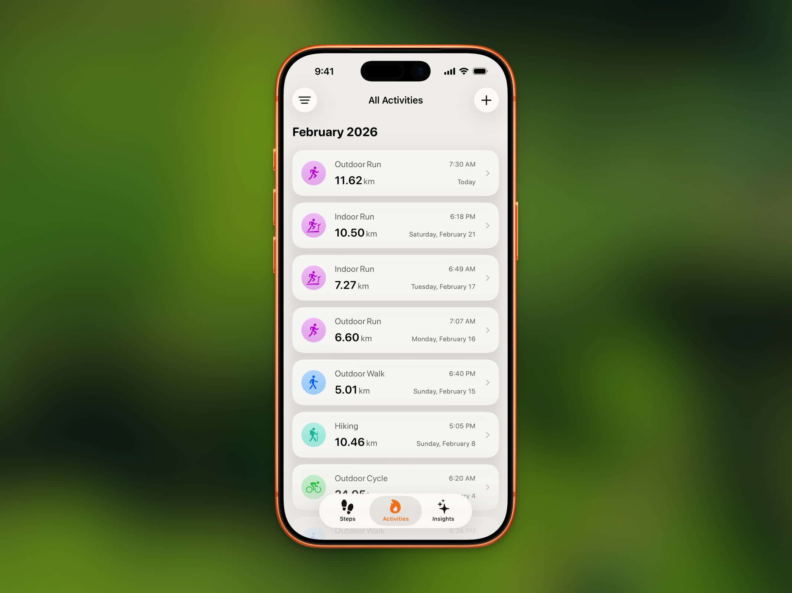

La Lista de actividades muestra todos tus entrenamientos registrados en un solo lugar, organizados por mes para facilitar la navegación.

## Ver tus entrenamientos

<Frame caption="Lista de actividades con entrenamientos agrupados por mes">
  
</Frame>

Tus entrenamientos están agrupados por mes, con los más recientes en la parte superior. Cada mes tiene un resumen de días entrenados y totales. En un diseño ancho, ese resumen se queda fijo mientras las tarjetas se desplazan. Cada entrada muestra:

- Tipo de entrenamiento e ícono
- Duración
- Fecha y hora
- Distancia (para entrenamientos al aire libre)

En una lista de tres columnas en pantallas anchas, la fecha queda debajo del nombre del entrenamiento.

## Buscar

El campo de búsqueda en la parte superior de Actividad acepta una frase, no solo una palabra clave. Steps convierte la frase en filtros con Apple Intelligence. El marcador de posición alterna ejemplos como **Carreras matutinas**, **Carreras de más de 5k**, **Paseos largos este mes** y **Mis entrenamientos más largos**.

Una línea en lenguaje natural debajo del campo te lee los filtros de vuelta, para que veas qué entendió la búsqueda. En iOS 27, el análisis puede usar Private Cloud Compute cuando está disponible, y Siri puede abrir esta búsqueda por ti. Consulta [Atajos de Siri](/es/features/siri-shortcuts).

## Filtrar

Toca el botón de filtro en la barra de herramientas para acotar la lista:

- **Tipo de ejercicio** — muestra solo tipos específicos, incluyendo caminar, correr, ciclismo, senderismo, entrenamiento de fuerza, yoga, HIIT y los demás tipos que Steps lee de Apple Health
- **Año** — muestra los entrenamientos de un solo año

Esto te ayuda a encontrar rápidamente un entrenamiento específico cuando tienes un historial extenso. La búsqueda y los filtros funcionan juntos: una búsqueda establece los filtros coincidentes, y aún puedes ajustarlos a mano desde el menú de filtros.

## Límites del historial

| Plan | Acceso al historial |
|------|---------------------|
| **Gratuito** | Últimos 3 meses |
| **Pro** | Historial ilimitado |

<Note>Actualiza a Steps Pro para acceder a tu historial completo de entrenamientos más allá de los últimos 3 meses.</Note>

## Detalles del entrenamiento

Toca cualquier entrenamiento de la lista para abrir su vista de [Detalle de actividad](/es/features/activity-detail) con estadísticas completas, mapa de ruta y opciones para compartir.
