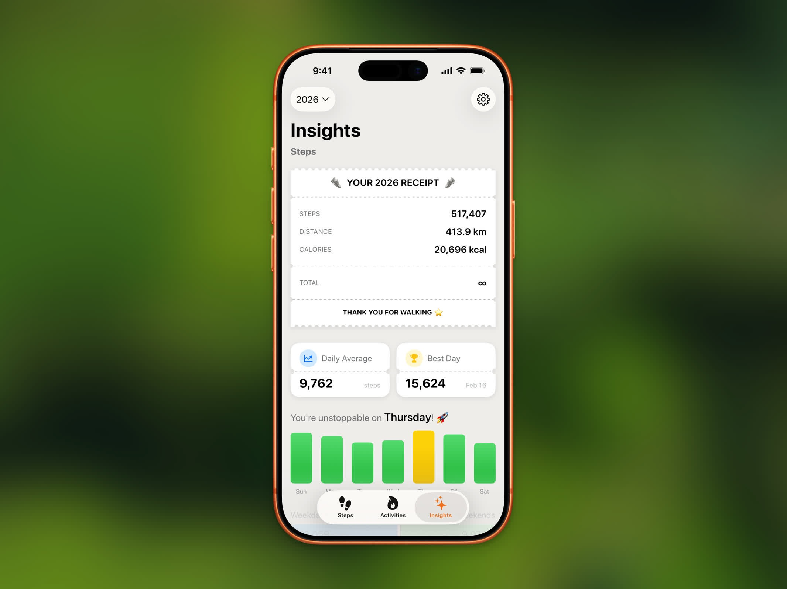

Estadísticas te ofrece un resumen anual — o de un solo mes — de tus datos de pasos y entrenamientos con cifras, récords y comparaciones divertidas.

## Análisis de pasos

<Frame caption="Recibo anual de Estadísticas con pasos totales, distancia y calorías">
  
</Frame>

Tu resumen anual de pasos incluye:

- **Recibo anual** - Pasos totales, distancia y calorías del año
- **Promedio diario** - Tu promedio de pasos por día
- **Mejor día** - Tu conteo de pasos más alto en un día y la fecha
- **Mejor mes** - El mes con más pasos en total
- **Hora pico** - La hora del día en que eres más activo
- **Desglose por día de la semana** - Gráfico que compara pasos por día de la semana, con promedios entre semana y fin de semana
- **Metas alcanzadas** - Total de días en que alcanzaste tu meta de pasos
- **Mejor racha** - Tu racha consecutiva más larga en días

## Año tras año

Un gráfico de líneas compara tus totales mensuales a lo largo de los años, para que veas si este año vas por delante del anterior. Cambia el gráfico entre **Total de pasos** y **Distancia total**, y usa los botones **−** y **+** para mostrar menos o más años. Cuando estás viendo un solo mes, el gráfico pasa a ser, por ejemplo, **Septiembre a lo largo de los años** y compara ese mes día a día.

## Meta anual de pasos

<Frame caption="Tarjeta de meta anual de pasos con barra de progreso y total proyectado">
  
</Frame>

Si has establecido una [meta anual de pasos](/es/features/yearly-goal), una tarjeta de progreso muestra tus pasos hasta ahora este año, una barra de progreso con degradado y si vas por buen camino. Para el año en curso, también proyecta tu total para fin de año según tu ritmo; para años anteriores, muestra el porcentaje de la meta que alcanzaste y tu promedio diario. La tarjeta se oculta cuando estás viendo un solo mes.

## Equivalencias divertidas

<Frame caption="Equivalencias del mundo real para tus datos anuales de pasos">
  
</Frame>

Steps convierte tus totales anuales en comparaciones divertidas del mundo real para distancia, calorías, CO2 ahorrado y más. Descubre cómo se compara tu caminata con actividades cotidianas.

## Análisis de entrenamientos

Si has registrado entrenamientos, también verás:

- **Boleto de vuelo de entrenamiento** - Total de entrenamientos, tiempo de entrenamiento, distancia y calorías
- **Desglose de entrenamientos** - Tipo de entrenamiento más común, recuentos de exterior vs. interior, actividad entre semana vs. fin de semana

## Récords personales

<Frame caption="Cuadrícula de récords personales con los mejores de todos los tiempos">
  
</Frame>

Una cuadrícula desplazable muestra tus 8 récords personales del año o mes que estás viendo:

| Récord | Qué registra |
|--------|--------------|
| **Más rápido** | Mejor ritmo |
| **Más calorías** | Más calorías en un solo entrenamiento |
| **Más temprano** | Hora de inicio de entrenamiento más temprana |
| **Más desnivel** | Mayor desnivel acumulado |
| **Más largo** | Mayor duración de entrenamiento |
| **Más lejos** | Mayor distancia de entrenamiento |
| **Más tarde** | Hora de inicio de entrenamiento más tardía |
| **FC máxima** | Frecuencia cardíaca más alta registrada |

Toca un récord para resaltar ese entrenamiento en un mapa debajo de la cuadrícula y luego toca la tarjeta para abrir el detalle completo del entrenamiento.

## Reloj de entrenamiento

<Frame caption="Reloj de entrenamiento mostrando cuándo sueles empezar a entrenar">
  
</Frame>

El reloj de entrenamiento mapea tus horas de inicio de entrenamiento a lo largo de la semana, una fila por día de la semana y columnas por hora. Nombra el patrón — madrugador, movido matutino, atleta de la hora del almuerzo, atleta después del trabajo u búho nocturno — a partir de las horas en que realmente entrenas.

## Período

El menú de la barra de herramientas alterna entre **Todo el año** y cualquier mes individual de ese año. El año en curso solo ofrece meses hasta el mes actual. Un mes reemplaza **Mejor mes** por **Mejor semana**.

Usa el mismo menú para cambiar entre años y comparar tu actividad a lo largo del tiempo.
