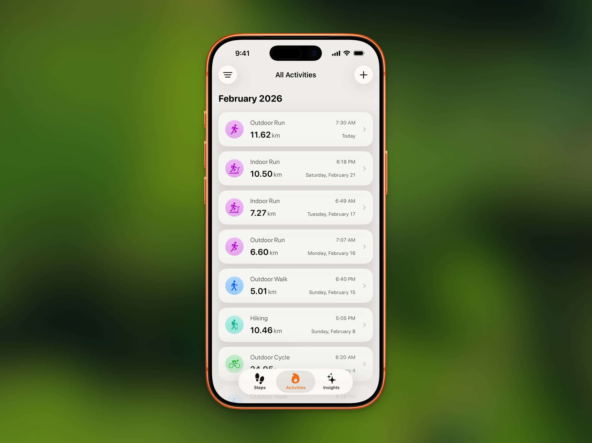

The Activity List shows all your recorded workouts in one place, organized by month for easy browsing.

## Viewing Your Workouts

<Frame caption="Activity list showing workouts grouped by month">
  
</Frame>

Your workouts are grouped by month, with the most recent at the top. Each month has a summary of trained days and totals. On a wide layout, that summary stays put while the cards scroll. Each entry shows:

- Workout type and icon
- Duration
- Date and time
- Distance (for outdoor workouts)

In a wide three-column list, the date sits under the workout name.

## Search

The search field at the top of Activity takes a sentence, not just a keyword. Steps turns the phrase into filters with Apple Intelligence. The placeholder cycles through examples such as **Morning runs**, **Runs over 5k**, **Long rides this month**, and **My longest workouts**.

A plain-language line under the field reads the filters back to you, so you can see what the search understood. On iOS 27, parsing can use Private Cloud Compute when it is available, and Siri can open this search for you. See [Siri Shortcuts](/features/siri-shortcuts).

## Filtering

Tap the filter button in the toolbar to narrow the list:

- **Workout Type** — show only specific types, including walking, running, cycling, hiking, strength training, yoga, HIIT, and the other types Steps reads from Apple Health
- **Year** — show workouts from a single year

This helps you quickly find a specific workout when you have a long history. Search and filters work together: a search settles the matching filters, and you can still adjust them by hand from the filter menu.

## History Limits

| Plan | History Access |
|------|---------------|
| **Free** | Last 3 months |
| **Pro** | Unlimited history |

<Note>Upgrade to Steps Pro to access your complete workout history beyond the last 3 months.</Note>

## Workout Details

Tap any workout in the list to open its [Activity Detail](/features/activity-detail) view with full stats, route map, and sharing options.
