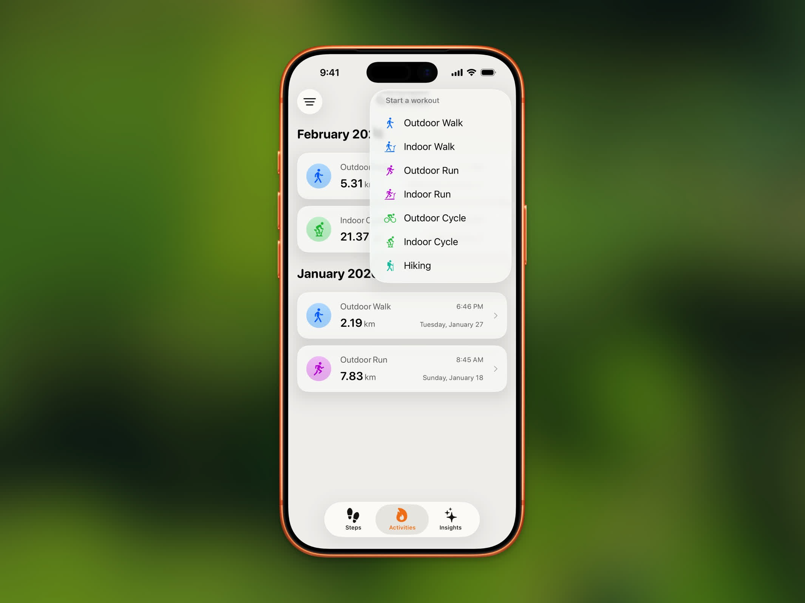
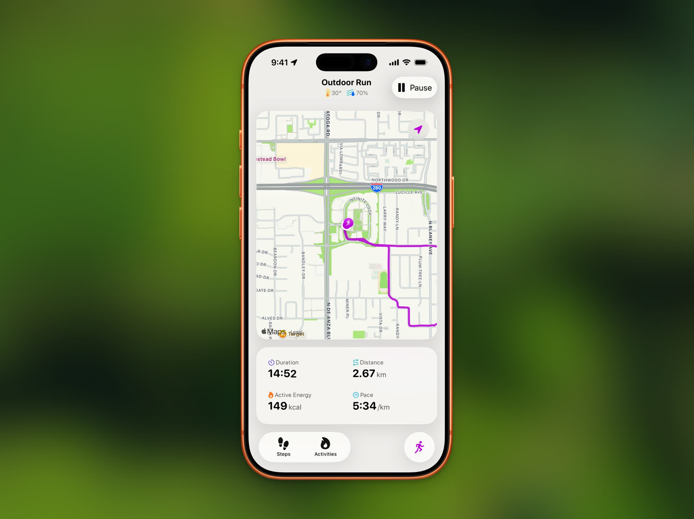
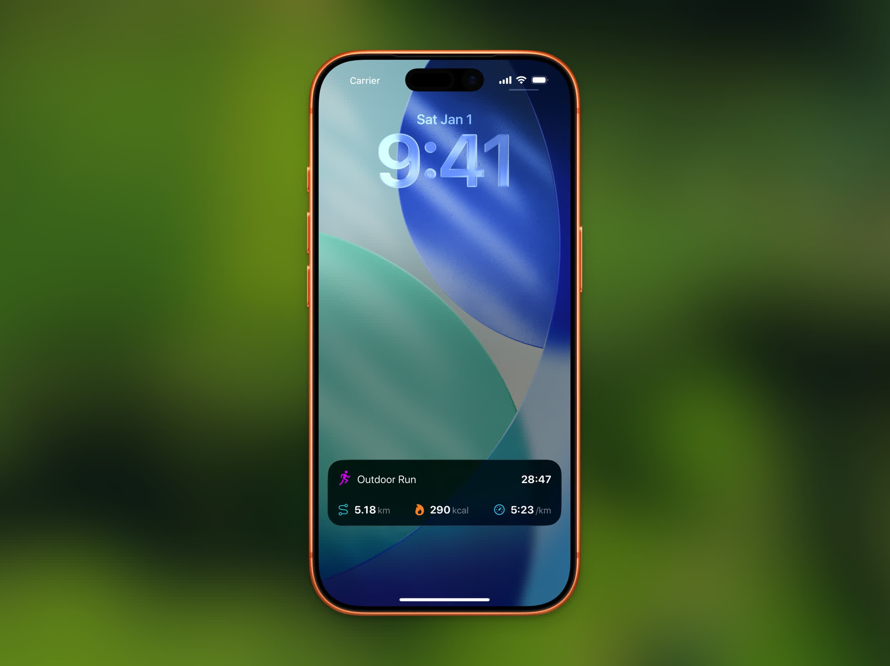

Steps lets you record workouts with live tracking, GPS route mapping, and real-time stats directly from your iPhone.

## Workout Types

You can start 15 workout types from your iPhone, Apple Watch, or the [Start Workout widget](/features/widgets#start-workout-widget). Walking, running, and cycling each have an indoor and an outdoor variant. The rest are a single type:

| Type | Variants |
|------|----------|
| **Walking** | Outdoor Walk, Indoor Walk |
| **Running** | Outdoor Run, Indoor Run |
| **Cycling** | Outdoor Cycle, Indoor Cycle |
| **Hiking** | Outdoor only |
| **Functional Strength Training** | — |
| **Traditional Strength Training** | — |
| **Mixed Cardio** | — |
| **Soccer** | — |
| **Elliptical** | — |
| **HIIT** | — |
| **Jump Rope** | — |
| **Yoga** | — |

<Tip>Outdoor workouts record your GPS route on a map. Indoor workouts track duration, calories, heart rate, and steps without GPS.</Tip>

## Starting a Workout

<Frame caption="Workout type selection with walking, running, cycling, and hiking options">
  
</Frame>

1. Tap the **+** button at the top of the [Activities](/features/activity-list) tab, or use a [Start Workout widget](/features/widgets#start-workout-widget)
2. Select your workout type and variant
3. A countdown appears before tracking begins
4. Start moving!

## Live Tracking

<Frame caption="Active outdoor workout with live map, distance, pace, and calories">
  
</Frame>

During an outdoor workout, you'll see:

- **Live Map** - Your route drawn in real-time with the workout's color
- **Duration** - Elapsed time
- **Distance** - Total distance covered
- **Steps** - Your step count, updating live on iPhone and Apple Watch
- **Calories** - Active energy burned
- **Pace or Speed** - Walking/Running shows pace; Cycling shows speed; Hiking shows heart rate

On a wide window, such as an unfolded iPhone Duo, the stats sit in a panel beside the map so the route can use the rest of the display.

Current weather (temperature and humidity) is displayed in the toolbar.

## Pause, Resume, and End

- Tap **Pause** to temporarily stop tracking
- Tap **Resume** to continue your workout
- Tap **End** (available when paused) to finish and save

## Live Activity

<Frame caption="Workout Live Activity in Dynamic Island and Lock Screen">
  
</Frame>

On iOS 26+, an active workout appears in the **Dynamic Island** and on your **Lock Screen**:

- The Dynamic Island cycles between calories, distance, and elapsed time every 30 seconds
- The expanded view shows distance, active energy, pace, and elapsed time

<Note>Live Activity for workouts requires iOS 26 or later. On iOS 27, an active workout also appears in the landscape Dynamic Island and in StandBy.</Note>

## Auto-Detected Workouts

Steps also reads workouts recorded by Apple Health from other apps and your Apple Watch. These appear in your Activity List automatically, including types like swimming, yoga, HIIT, strength training, and more.
