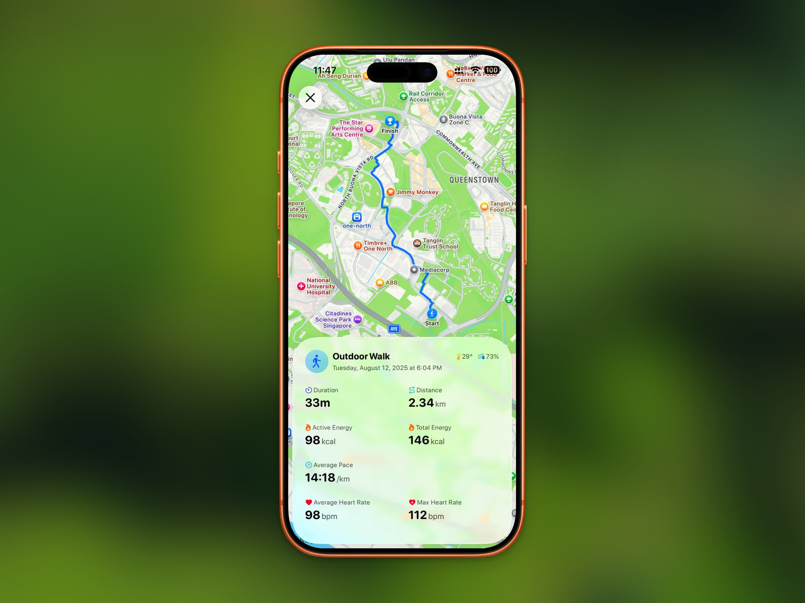
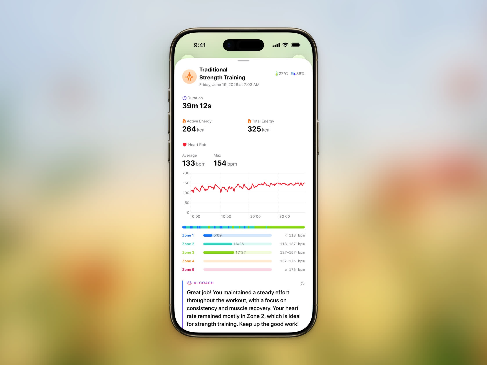
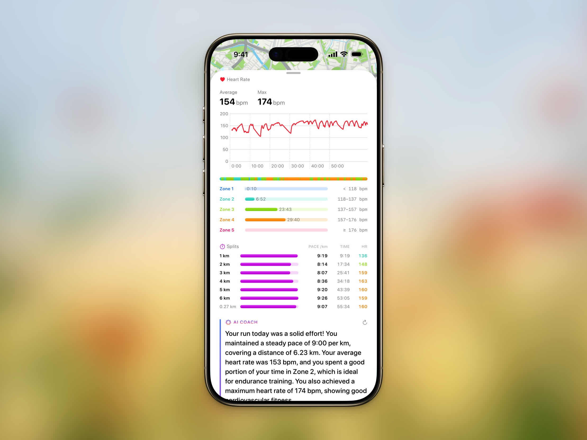
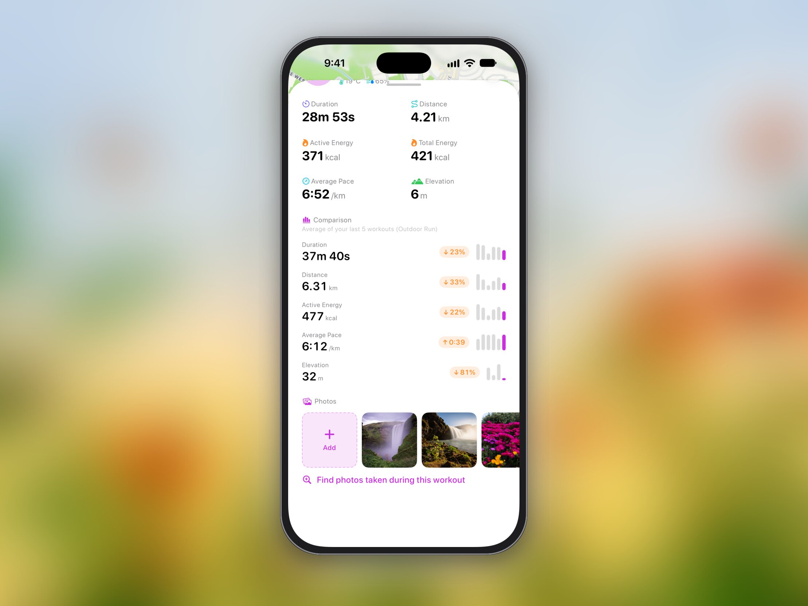
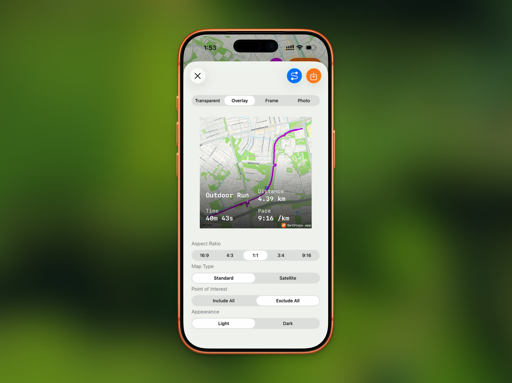
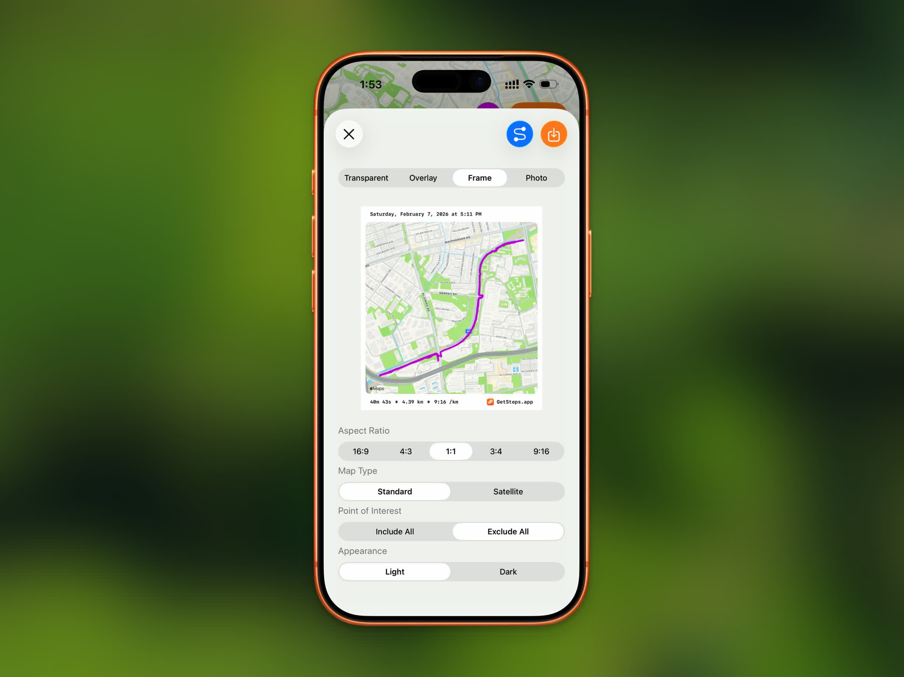
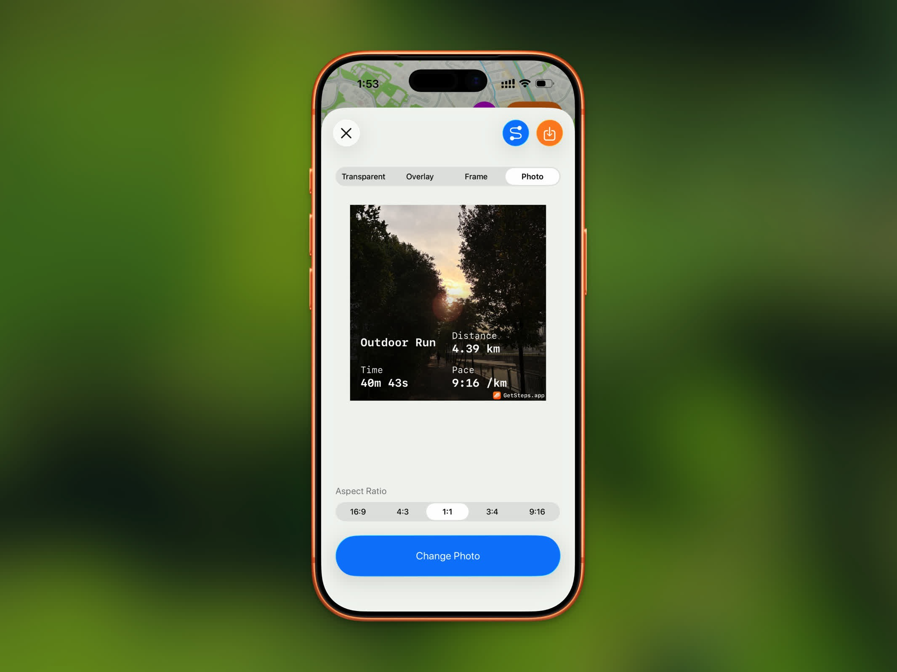

La vue Détail de l'activité vous offre une analyse complète de tout entraînement enregistré, incluant votre itinéraire, vos statistiques, vos photos et vos options de partage.

## Carte de l'itinéraire

<Frame caption="Vue détaillée de l'activité avec la carte de l'itinéraire GPS et les statistiques d'entraînement">
  
</Frame>

Pour les entraînements extérieurs, une carte affiche votre itinéraire GPS tracé dans la couleur de l'entraînement. Vous pouvez basculer entre :

- Vue de carte **Standard**
- Vue par **Satellite**

## Statistiques d'entraînement

Chaque vue détaillée d'entraînement affiche :

- **Durée** - Temps total d'entraînement
- **Distance** - Distance totale parcourue
- **Allure** - Allure moyenne (pour la marche et la course)
- **Dénivelé positif** - Montée totale pendant l'entraînement
- **Fréquence cardiaque** - Fréquence cardiaque moyenne et maximale
- **Calories** - Énergie active brûlée
- **Météo** - Température et humidité pendant l'entraînement

Le pied de page de la feuille de statistiques indique l'appareil qui a enregistré l'entraînement, comme votre iPhone ou Apple Watch. Les entraînements qui ont un lieu mais pas d'itinéraire tracé affichent tout de même une épingle sur la carte.

## Comparaison

Lorsque vous avez au moins deux entraînements antérieurs du même type, la section **Comparaison** montre comment celui-ci se situe par rapport à la moyenne de vos derniers. Les séances intérieures et extérieures sont comparées séparément. Chaque ligne affiche la moyenne récente, la différence pour cet entraînement, et une petite tendance où la dernière barre est cette séance.

Les métriques comparées peuvent inclure la durée, la distance, l'énergie active, l'allure, la fréquence cardiaque moyenne et l'[effort](#effort). La section se masque lorsqu'il n'y a pas assez d'historique pour calculer une moyenne.

## Effort

Notez à quel point l'entraînement vous a semblé difficile sur une échelle de **1 à 10**. Le score est enregistré dans Apple Health, afin de rester synchronisé avec l'app Fitness. Les bandes correspondent aux noms d'Apple :

| Score | Bande |
|-------|-------|
| **1–3** | Easy |
| **4–6** | Moderate |
| **7–8** | Hard |
| **9–10** | All Out |

<Note>Les notes d'effort nécessitent iOS 18 ou une version ultérieure, et Steps a besoin de l'autorisation de mettre à jour Effort dans l'app Santé. Si une autre app détient déjà la note, modifiez-la là ou dans Santé.</Note>

## Fréquence cardiaque et zones

<Frame caption="Graphique de fréquence cardiaque avec la répartition du temps dans les zones">
  
</Frame>

Lorsqu'un entraînement comporte des données de fréquence cardiaque, la section **Fréquence cardiaque** affiche votre moyenne et votre maximum, ainsi qu'un graphique de votre fréquence cardiaque tout au long de la séance. La courbe est colorée selon vos zones de fréquence cardiaque d'Apple Health. Pendant un entraînement sur Apple Watch, ces zones se mettent à jour en direct.

Sous le graphique, la répartition **Temps dans les zones** indique combien de temps vous avez passé dans chacune des cinq zones de fréquence cardiaque, de l'effort facile à l'effort maximal :

| Zone | Effort |
|------|--------|
| **Zone 1** | Très léger |
| **Zone 2** | Léger |
| **Zone 3** | Modéré |
| **Zone 4** | Intense |
| **Zone 5** | Maximal |

Chaque zone affiche le temps qui y a été passé et sa plage de fréquence cardiaque en bpm.

## Fractionnés

<Frame caption="Répartition par fractionné avec l'allure, le temps et la fréquence cardiaque moyenne">
  
</Frame>

Pour les entraînements basés sur la distance, le tableau **Fractionnés** décompose votre entraînement par distance — une ligne par kilomètre ou mile, selon votre réglage d'unité. Chaque fractionné affiche :

- **Allure** (ou **Vitesse** pour le cyclisme)
- **Temps** — Temps écoulé cumulé à la fin du fractionné
- **FC** — Fréquence cardiaque moyenne du fractionné, lorsqu'elle est disponible

Une barre à côté de chaque fractionné permet de comparer facilement vos segments les plus rapides et les plus lents d'un coup d'œil.

## Lecture de l'itinéraire

<Note>La lecture de l'itinéraire est une fonctionnalité Pro.</Note>

<Frame caption="Lecture d'itinéraire en 3D suivant l'itinéraire avec une caméra cinématique">
  <video
    autoPlay
    muted
    loop
    playsInline
    className="w-full aspect-video rounded-xl"
    src="/videos/route-3d.mp4"
  ></video>
</Frame>

Rejouez votre itinéraire d'entraînement en 3D pour revivre la façon dont vous vous êtes déplacé pendant votre session. Une caméra de suivi cinématique plonge sur la scène puis glisse le long de votre trajet, lissant chaque virage tout en suivant votre position.

Ouvrez **Réglages de la carte** pour personnaliser la lecture :

- **Style de carte** — basculez entre **Standard** et **Satellite**. Les deux affichent un relief réaliste pendant la lecture pour une véritable vue 3D.
- **Couleur de l'itinéraire** — choisissez la couleur du trajet.
- **Durée de lecture** — de **15 à 180 secondes**. Steps choisit une valeur par défaut adaptée à la distance de votre entraînement.
- **Nord en haut** — laissez la carte orientée au nord pendant toute la lecture, ou laissez la caméra suivre la direction dans laquelle vous avanciez.

## Photos

<Frame caption="Photos ajoutées à un entraînement, à la fin de la feuille de statistiques">
  
</Frame>

Ajoutez à n'importe quel entraînement les photos que vous avez prises en chemin. La section **Photos** se trouve à la fin de la feuille de statistiques.

- **Ajouter** — choisissez n'importe quelles photos de votre photothèque, jusqu'à 20 à la fois
- **Rechercher les photos prises pendant cet entraînement** — Steps recherche dans votre photothèque les photos prises entre l'heure de début et l'heure de fin de l'entraînement. Les suggestions apparaissent sous **Prises pendant cet entraînement** ; appuyez sur l'une d'elles pour l'ajouter, ou appuyez sur **Tout ajouter**

Les photos ajoutées apparaissent aussi sous forme d'épingles sur la carte de l'itinéraire, placées selon le moment (ou l'endroit) où vous les avez prises, et s'affichent en chemin lorsque le marqueur les atteint pendant la [lecture de l'itinéraire](#lecture-de-l-itinéraire). Appuyez sur une photo pour l'afficher en plein écran.

Pour retirer une photo, maintenez-la enfoncée et choisissez **Supprimer la photo**. Steps conserve sa propre copie de chaque photo : la retirer d'un entraînement ne supprime donc jamais l'original de votre photothèque.

<Note>La recherche des photos prises pendant un entraînement nécessite l'accès à votre photothèque. Si vous ne l'avez pas autorisé, Steps affiche un bouton pour ouvrir les Réglages. L'ajout de photos avec **Ajouter** fonctionne sans accès complet à la photothèque.</Note>

## Partager votre entraînement

Partagez votre entraînement sous forme d'image stylisée. Steps propose quatre styles de partage :

<Tabs>
  <Tab title="Transparent">
    <Frame>
      
    </Frame>
  </Tab>
  <Tab title="Superposition">
    <Frame>
      
    </Frame>
  </Tab>
  <Tab title="Cadre">
    <Frame>
      
    </Frame>
  </Tab>
  <Tab title="Photo">
    <Frame>
      
    </Frame>
  </Tab>
</Tabs>

| Style | Description |
|-------|-------------|
| **Transparent** | Statistiques sur un fond transparent |
| **Superposition** | Statistiques superposées sur votre carte d'itinéraire |
| **Cadre** | Carte de l'itinéraire avec un cadre de statistiques bordé |
| **Photo** | Statistiques superposées sur une photo de votre bibliothèque |

**Superposition** et **Cadre** fonctionnent pour un itinéraire GPS tracé, et aussi pour un entraînement qui n'a qu'un lieu enregistré. L'aperçu transparent affiche un damier pour que vous puissiez voir ce qui restera transparent.

Vous pouvez également choisir parmi cinq formats d'image : 16:9, 4:3, 1:1, 3:4 et 9:16.

Pour les styles basés sur la carte, des options supplémentaires incluent l'apparence de la carte (clair/sombre), la visibilité des points d'intérêt et le style d'altitude.

Voir [Partage](/fr/features/sharing) pour tous les détails.

## Export GPX

<Note>L'export GPX est une fonctionnalité Pro.</Note>

Exportez votre itinéraire d'entraînement en tant que fichier `.gpx` pour l'utiliser dans d'autres applications de fitness ou outils de cartographie. Appuyez sur le bouton de partage et sélectionnez l'export GPX pour enregistrer ou envoyer le fichier.

## Supprimer un entraînement

Pour supprimer un entraînement, appuyez sur le bouton de menu (⋯) dans le coin supérieur droit et choisissez **Supprimer**. Une confirmation vous sera demandée, car cela supprime l'entraînement à la fois de Steps et d'Apple Santé.

<Warning>Supprimer un entraînement le supprime également d'Apple Santé, et cela ne peut pas être annulé.</Warning>
