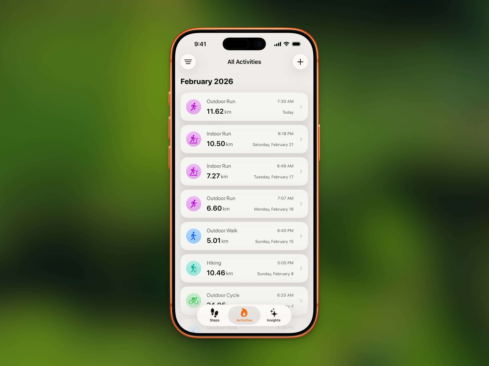

La Lista attività mostra tutti i tuoi allenamenti registrati in un unico posto, organizzati per mese per una navigazione semplice.

## Visualizzazione degli allenamenti

<Frame caption="Lista attività che mostra gli allenamenti raggruppati per mese">
  
</Frame>

I tuoi allenamenti sono raggruppati per mese, con i più recenti in cima. Ogni mese ha un riepilogo dei giorni allenati e dei totali. Su un layout ampio, quel riepilogo resta fisso mentre le schede scorrono. Ogni voce mostra:

- Tipo di allenamento e icona
- Durata
- Data e ora
- Distanza (per gli allenamenti all'aperto)

In una lista a tre colonne ampia, la data si trova sotto il nome dell'allenamento.

## Cerca

Il campo di ricerca in cima ad Attività accetta una frase, non solo una parola chiave. Steps trasforma la frase in filtri con Apple Intelligence. Il placeholder cicla esempi come **Corse del mattino**, **Corse oltre 5k**, **Giri lunghi questo mese** e **I miei allenamenti più lunghi**.

Una riga in linguaggio naturale sotto il campo ti rilegge i filtri, così puoi vedere cosa ha capito la ricerca. Su iOS 27, l'interpretazione può usare Private Cloud Compute quando è disponibile, e Siri può aprire questa ricerca per te. Vedi [Siri Shortcuts](/it/features/siri-shortcuts).

## Filtri

Tocca il pulsante dei filtri nella barra degli strumenti per restringere l'elenco:

- **Tipo di allenamento** — mostra solo tipi specifici, tra cui camminata, corsa, ciclismo, escursionismo, allenamento della forza, yoga, HIIT e gli altri tipi che Steps legge da Apple Health
- **Anno** — mostra gli allenamenti di un solo anno

Questo ti aiuta a trovare rapidamente un allenamento specifico quando hai una lunga cronologia. Ricerca e filtri lavorano insieme: una ricerca imposta i filtri corrispondenti, e puoi comunque modificarli a mano dal menu dei filtri.

## Limiti della cronologia

| Piano | Accesso alla cronologia |
|-------|------------------------|
| **Gratuito** | Ultimi 3 mesi |
| **Pro** | Cronologia illimitata |

<Note>Passa a Steps Pro per accedere alla cronologia completa degli allenamenti oltre gli ultimi 3 mesi.</Note>

## Dettagli dell'allenamento

Tocca qualsiasi allenamento nell'elenco per aprire la sua vista [Dettaglio attività](/it/features/activity-detail) con statistiche complete, mappa del percorso e opzioni di condivisione.
