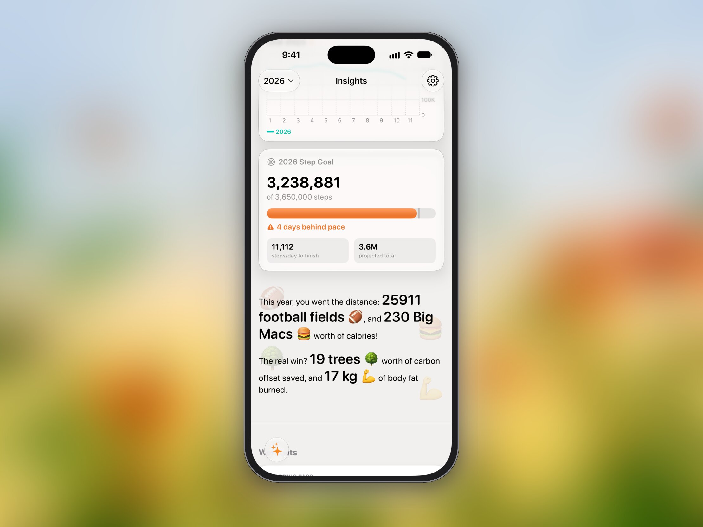

Le Statistiche ti offrono un riepilogo annuale — o di un singolo mese — dei tuoi dati di passi e allenamenti con statistiche, record e confronti divertenti.

## Analisi dei passi

<Frame caption="Ricevuta annuale delle Statistiche con passi totali, distanza e calorie">
  
</Frame>

Il tuo riepilogo annuale dei passi include:

- **Ricevuta annuale** - Passi totali, distanza e calorie per l'anno
- **Media giornaliera** - La tua media di passi al giorno
- **Giorno migliore** - Il tuo conteggio passi più alto in un singolo giorno e la data
- **Mese migliore** - Il mese con il maggior numero totale di passi
- **Ora di punta** - L'ora del giorno in cui sei più attivo
- **Distribuzione per giorno della settimana** - Grafico che confronta i passi per giorno della settimana, con medie nei giorni feriali rispetto al fine settimana
- **Obiettivi raggiunti** - Numero totale di giorni in cui hai raggiunto il tuo obiettivo di passi
- **Miglior serie** - La tua serie consecutiva più lunga in giorni

## Anno su anno

Un grafico a linee confronta i tuoi totali mensili tra gli anni, così puoi vedere se quest'anno sei avanti rispetto al precedente. Passa dal grafico **Passi totali** a **Distanza totale** e usa i pulsanti **−** e **+** per mostrare meno o più anni. Quando visualizzi un singolo mese, il grafico diventa, ad esempio, **Settembre negli anni** e confronta quel mese giorno per giorno.

## Obiettivo annuale di passi

<Frame caption="Scheda obiettivo annuale di passi con barra di progresso e totale previsto">
  
</Frame>

Se hai impostato un [obiettivo annuale di passi](/it/features/yearly-goal), una scheda di progresso mostra i tuoi passi finora quest'anno, una barra di progresso sfumata e se sei in linea. Per l'anno corrente prevede anche il tuo totale di fine anno in base al tuo ritmo; per gli anni passati mostra la percentuale dell'obiettivo che hai raggiunto e la tua media giornaliera. La scheda è nascosta quando visualizzi un singolo mese.

## Equivalenti divertenti

<Frame caption="Equivalenti reali divertenti per i tuoi dati annuali di passi">
  
</Frame>

Steps converte i tuoi totali annuali in confronti reali divertenti per distanza, calorie, CO2 risparmiata e altro ancora. Scopri come la tua camminata si confronta con le attività quotidiane.

## Analisi degli allenamenti

Se hai registrato allenamenti, vedrai anche:

- **Biglietto aereo degli allenamenti** - Allenamenti totali, tempo di allenamento, distanza e calorie
- **Distribuzione degli allenamenti** - Tipo di allenamento più comune, conteggi all'aperto rispetto al coperto, attività nei giorni feriali rispetto al fine settimana

## Record personali

<Frame caption="Griglia dei record personali che mostra i migliori risultati di tutti i tempi">
  
</Frame>

Una griglia scorrevole mostra i tuoi 8 record personali per l'anno o il mese che stai visualizzando:

| Record | Cosa monitora |
|--------|---------------|
| **Più veloce** | Miglior ritmo |
| **Più calorie bruciate** | Più calorie in un singolo allenamento |
| **Il più mattiniero** | Orario di inizio allenamento più anticipato |
| **Più salita** | Maggiore dislivello positivo |
| **Più lungo** | Durata più lunga dell'allenamento |
| **Più lontano** | Maggiore distanza dell'allenamento |
| **Il più serale** | Orario di inizio allenamento più tardivo |
| **FC massima** | Frequenza cardiaca più alta registrata |

Tocca un record per evidenziare quell'allenamento su una mappa sotto la griglia, poi tocca la scheda per aprire il dettaglio completo dell'allenamento.

## Orologio allenamento

<Frame caption="Orologio allenamento che mostra quando di solito inizi gli allenamenti">
  
</Frame>

L'orologio allenamento mappa gli orari di inizio dei tuoi allenamenti lungo la settimana, una riga per giorno della settimana e colonne per l'ora. Nomina il pattern — early bird, morning mover, lunch-break athlete, after-work athlete o night owl — in base alle ore in cui ti alleni davvero.

## Periodo

Il menu nella barra degli strumenti passa tra un **Anno intero** e qualsiasi mese singolo di quell'anno. L'anno corrente offre solo i mesi fino a oggi. Un mese sostituisce **Mese migliore** con **Settimana migliore**.

Usa lo stesso menu per passare da un anno all'altro e confrontare la tua attività nel tempo.
