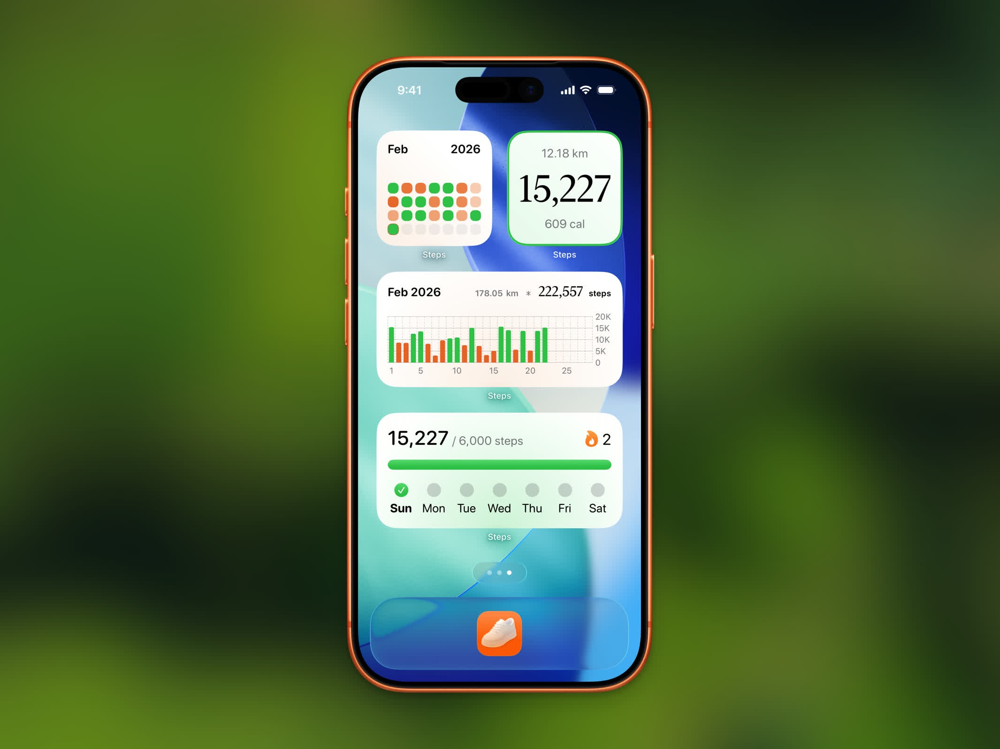
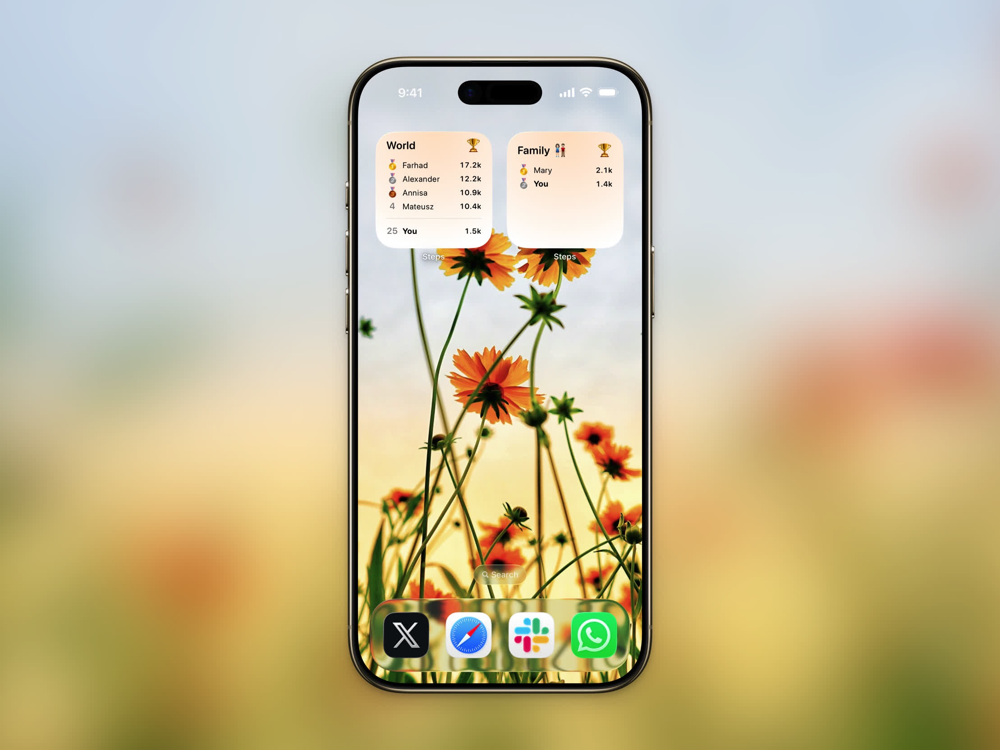
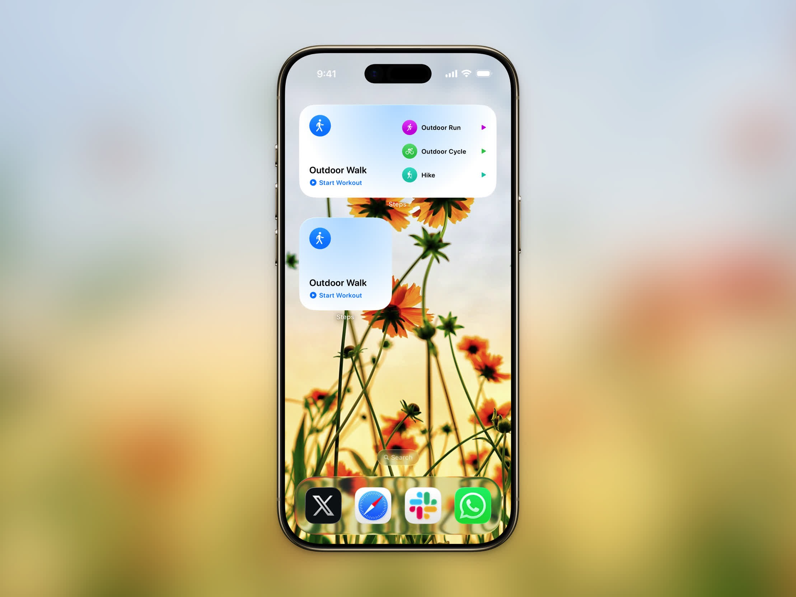

Steps offre una varietà di widget per visualizzare il conteggio dei passi, le serie e i dati degli allenamenti senza aprire l'app.

## Tipi di widget

<Frame caption="Widget di Steps sulla schermata Home">
  
</Frame>

| Widget | Dimensioni | Piano | Descrizione |
|--------|-----------|-------|-------------|
| **Passi di oggi** | Piccolo, Schermata di blocco (rettangolare, in linea, circolare) | Gratuito | Conteggio passi attuale e progresso verso l'obiettivo |
| **Serie** | Piccolo, Medio | Gratuito | Conteggio serie attuale e progresso obiettivo settimanale |
| **Classifica Stepboard** | Piccolo | Gratuito | I primi 5 di oggi nella classifica più la tua posizione |
| **Avvia allenamento** | Piccolo | Gratuito | Inizia direttamente un tipo di allenamento con un solo tocco (iOS 26+) |
| **Allenamenti ad avvio rapido** | Medio | Gratuito | Il tuo allenamento principale più scorciatoie per altri tre tipi (iOS 26+) |
| **Grafico orario** | Medio | Pro | Grafico a barre dei passi per ora di oggi |
| **Grafico settimanale** | Piccolo, Medio | Pro | Grafico a barre dei passi degli ultimi 7 giorni |
| **Grafico mensile** | Medio | Pro | Grafico a barre dei passi del mese corrente |
| **Calendario mensile** | Piccolo | Pro | Griglia calendario che mostra il completamento dell'obiettivo giornaliero per il mese |
| **Calendario annuale** | Medio, Grande | Pro | Calendario annuale con mappa di calore del completamento obiettivo |
| **Obiettivo annuale** | Piccolo, Medio | Pro | Progresso verso il tuo obiettivo annuale di passi con stato e statistiche |
| **Highlights allenamento** | Piccolo | Pro | Le statistiche del tuo allenamento più recente |
| **Calendario allenamenti** | Medio, Grande, Extra Large | Pro | Giorni allenati contrassegnati con l'attività di quel giorno |

<Note>I widget Pro si possono aggiungere anche senza abbonamento: mostrano un invito a sbloccare Steps Pro finché non effettui l'upgrade.</Note>

## Widget Classifica Stepboard

<Frame caption="Widget Classifica Stepboard che mostra i primi 5 di oggi e la tua posizione">
  
</Frame>

Il widget Classifica Stepboard mette la tua [Stepboard](/it/features/stepboard) sulla schermata Home. Mostra i 5 migliori camminatori di oggi con emoji medaglia per i leader, più la tua posizione se sei fuori dai primi 5. Quando aggiungi il widget, puoi scegliere quale tabellone visualizza — il tabellone World, il tabellone del tuo paese o qualsiasi gruppo a cui ti sei unito. Tocca il widget per saltare direttamente in quel tabellone.

## Widget Avvia allenamento

<Frame caption="Widget Avvia allenamento per il monitoraggio degli allenamenti con un solo tocco">
  
</Frame>

I widget Avvia allenamento ti permettono di iniziare a monitorare un [allenamento](/it/features/workout-session) direttamente dalla tua schermata Home. Toccane uno e Steps si apre direttamente su quel tipo di allenamento — senza menu da scorrere. Entrambi richiedono iOS 26 o versioni successive.

- **Avvia allenamento** (piccolo) — un singolo tipo di allenamento configurabile con un pulsante Avvia
- **Allenamenti ad avvio rapido** (medio) — il tuo allenamento principale più scorciatoie di avvio rapido per altri tre tipi

Quando aggiungi il widget, scegli quale tipo di allenamento avvia. Sono disponibili gli stessi tipi che puoi avviare nell'app, inclusi allenamento della forza, HIIT, yoga e il resto dell'[elenco allenamenti](/it/features/workout-session#tipi-di-allenamento). Se un allenamento è già in corso, toccando il widget si apre invece la sessione attiva.

## Widget Calendario allenamenti

Il widget Calendario allenamenti contrassegna ogni giorno in cui ti sei allenato con l'attività di quel giorno, così un mese di corsa, camminata e forza si legge a colpo d'occhio.

- **Medio** e **Grande** sono disponibili su ogni iPhone supportato
- **Extra Large** è disponibile su iOS 27

<Note>Il widget Calendario allenamenti è una funzionalità Pro.</Note>

## Widget Obiettivo annuale

Il widget Obiettivo annuale monitora il tuo progresso verso il tuo [obiettivo annuale di passi](/it/features/yearly-goal). Mostra una barra di progresso, se sei in linea o in ritardo, e statistiche di supporto. È disponibile nelle dimensioni piccolo e medio.

## Live Activity

Durante un allenamento attivo, una Live Activity appare sulla tua schermata di blocco e nel Dynamic Island (iOS 26+). Mostra:

- Icona del tipo di allenamento
- Tempo trascorso
- Distanza percorsa
- Calorie bruciate
- Ritmo attuale

Il Dynamic Island alterna tra le statistiche ogni 30 secondi. Su iOS 27, un allenamento attivo appare anche nel Dynamic Island in landscape e in StandBy.

## Aggiunta dei widget

<Steps>
  <Step title="Tieni premuta la schermata Home">
    Tocca e tieni premuta un'area vuota nella schermata Home finché le app iniziano a ondeggiare.
  </Step>
  <Step title="Tocca il pulsante +">
    Tocca il pulsante **+** nell'angolo in alto a sinistra per aprire la galleria dei widget.
  </Step>
  <Step title="Cerca Steps">
    Digita "Steps" nella barra di ricerca per trovare tutti i widget disponibili.
  </Step>
  <Step title="Scegli un widget">
    Seleziona il tipo e la dimensione del widget che desideri, poi tocca **Aggiungi widget**.
  </Step>
</Steps>

## Widget per la schermata di blocco

<Frame caption="Widget di Steps per la schermata di blocco in tre stili">
  
</Frame>

Il widget Passi di oggi è disponibile anche per la schermata di blocco in tre stili:

- **Rettangolare** - Mostra il conteggio passi e la barra di progresso
- **In linea** - Conteggio passi compatto nella riga della data
- **Circolare** - Conteggio passi in un misuratore rotondo

<Tip>I tuoi widget si aggiornano automaticamente con i dati dei passi più recenti e riflettono il tema colore scelto.</Tip>

## Mantenere i widget aggiornati

I widget dei passi leggono i passi di oggi e di ieri direttamente da Apple Health ogni volta che si aggiornano, così restano aggiornati anche se non apri Steps da un po'. Anche le serie restano precise a cavallo della mezzanotte.

<Note>I dati di Apple Health non possono essere letti mentre il tuo iPhone è bloccato. In quel periodo, i widget mostrano gli ultimi passi registrati da Steps e si rimettono in pari al primo aggiornamento dopo lo sblocco.</Note>

<Tip>Tenere attivo l'**Aggiornamento app in background** per Steps (**Impostazioni → Generali → Aggiornamento app in background**) permette all'app di sincronizzare tutta la cronologia in background, mantenendo aggiornati anche i grafici e i widget calendario.</Tip>
