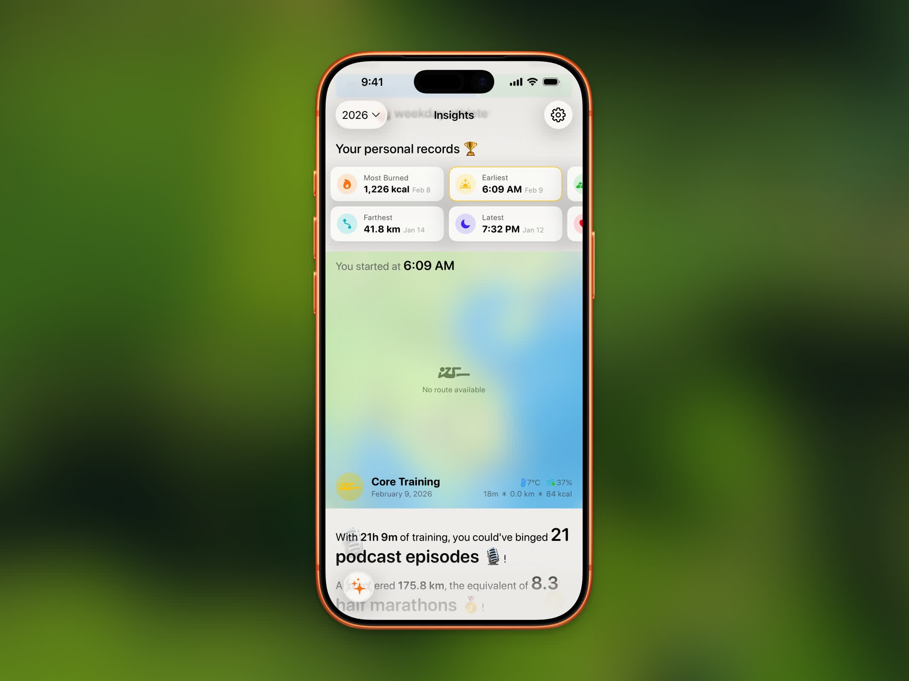
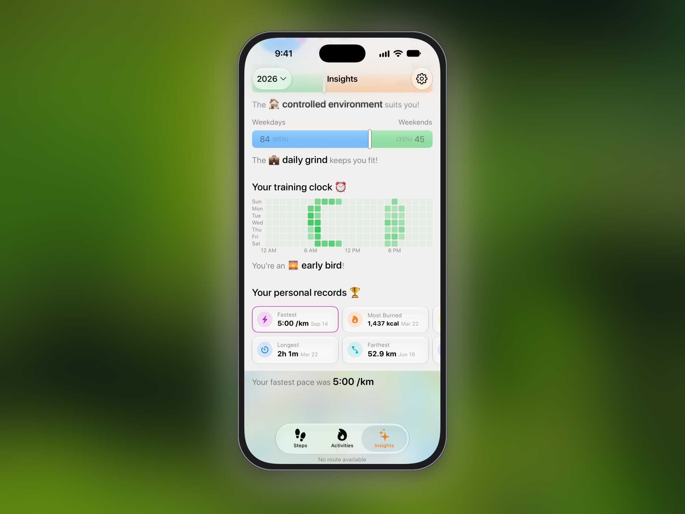

インサイトでは、歩数とワークアウトデータの年間レビュー（または特定の1か月）を、統計、記録、楽しい比較とともに確認できます。

## 歩数分析

<Frame caption="合計歩数、距離、カロリーを含むインサイト年間レシート">
  
</Frame>

年間歩数サマリーには以下が含まれます：

- **年間レシート** - 年間の合計歩数、距離、カロリー
- **1日の平均** - 1日あたりの平均歩数
- **ベストデイ** - 1日の最高歩数とその日付
- **ベストマンス** - 合計歩数が最も多かった月
- **ピークアワー** - 最も活動的な時間帯
- **曜日別内訳** - 曜日別の歩数比較チャート、平日と週末の平均値
- **目標達成日数** - 歩数目標を達成した合計日数
- **ベストストリーク** - 最長の連続達成日数

## 前年比

折れ線グラフで月ごとの合計を年ごとに比較できるので、今年が昨年を上回っているかどうかがわかります。グラフは**総歩数**と**総距離**で切り替えられ、**−**と**+**ボタンで表示する年数を増減できます。特定の1か月を表示している場合、グラフはたとえば**9月の年別比較**になり、その月を日ごとに比較します。

## 年間歩数目標

<Frame caption="プログレスバーと予測合計を備えた年間歩数目標カード">
  
</Frame>

[年間歩数目標](/ja/features/yearly-goal)を設定している場合、プログレスカードに今年これまでの歩数、グラデーションのプログレスバー、順調かどうかが表示されます。今年については、ペースに基づいて年末の合計も予測されます。過去の年については、達成した目標の割合と1日の平均が表示されます。特定の1か月を表示している場合、このカードは非表示になります。

## 楽しい換算

<Frame caption="年間歩数データの楽しい実世界換算">
  
</Frame>

Stepsは年間合計を、距離、カロリー、CO2削減量などの楽しい実世界の比較に変換します。あなたのウォーキングが日常の活動と比べてどれくらいかを確認しましょう。

## ワークアウト分析

ワークアウトを記録している場合、以下も表示されます：

- **ワークアウトフライトチケット** - ワークアウト合計回数、運動時間、距離、カロリー
- **ワークアウト内訳** - 最も多いワークアウトタイプ、屋外vs屋内の回数、平日vs週末のアクティビティ

## パーソナルレコード

<Frame caption="オールタイムベストを表示するパーソナルレコードグリッド">
  
</Frame>

スクロール可能なグリッドに、表示中の年または月の8つのパーソナルレコードが表示されます：

| レコード | 記録内容 |
|----------|----------|
| **最速** | ベストペース |
| **最多消費** | 1回のワークアウトでの最多カロリー消費 |
| **最早** | 最も早いワークアウト開始時刻 |
| **最多上昇** | 最大の獲得標高 |
| **最長** | 最長のワークアウト時間 |
| **最遠** | 最大のワークアウト距離 |
| **最遅** | 最も遅いワークアウト開始時刻 |
| **最大心拍数** | 記録された最高心拍数 |

レコードをタップするとグリッドの下の地図でそのワークアウトがハイライトされ、カードをタップするとワークアウトの詳細を確認できます。

## トレーニングクロック

<Frame caption="通常ワークアウトを開始する時間帯を示すトレーニングクロック">
  
</Frame>

トレーニングクロックは、曜日ごとに1行、時間ごとに列を持ち、週を通したワークアウト開始時刻をマッピングします。実際にトレーニングした時間帯から、早朝型、モーニングムーバー、昼休みアスリート、アフターワークアスリート、夜型などのパターン名を付けます。

## 期間

ツールバーのメニューで、**全年**とその年の任意の単一月を切り替えられます。今年は今日までの月だけが選べます。月を選ぶと、**ベストマンス**の代わりに**ベストウィーク**が表示されます。

同じメニューで年を切り替え、アクティビティを比較できます。
