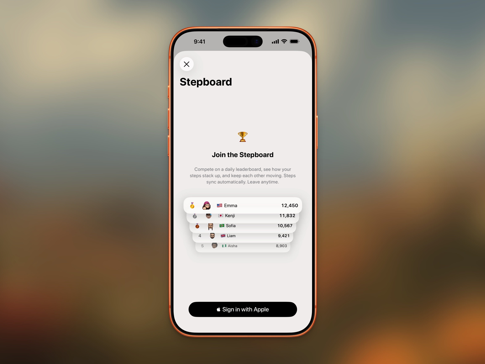
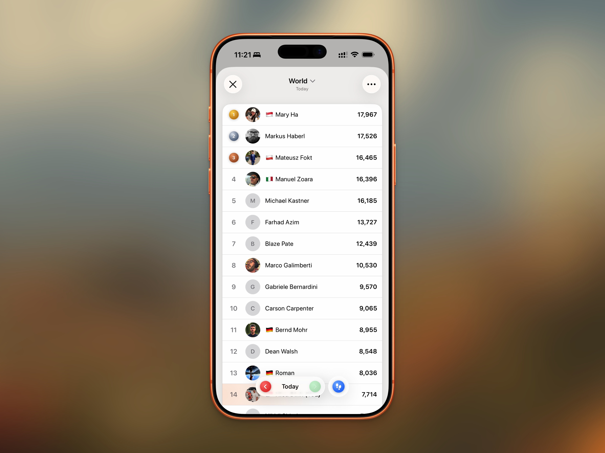
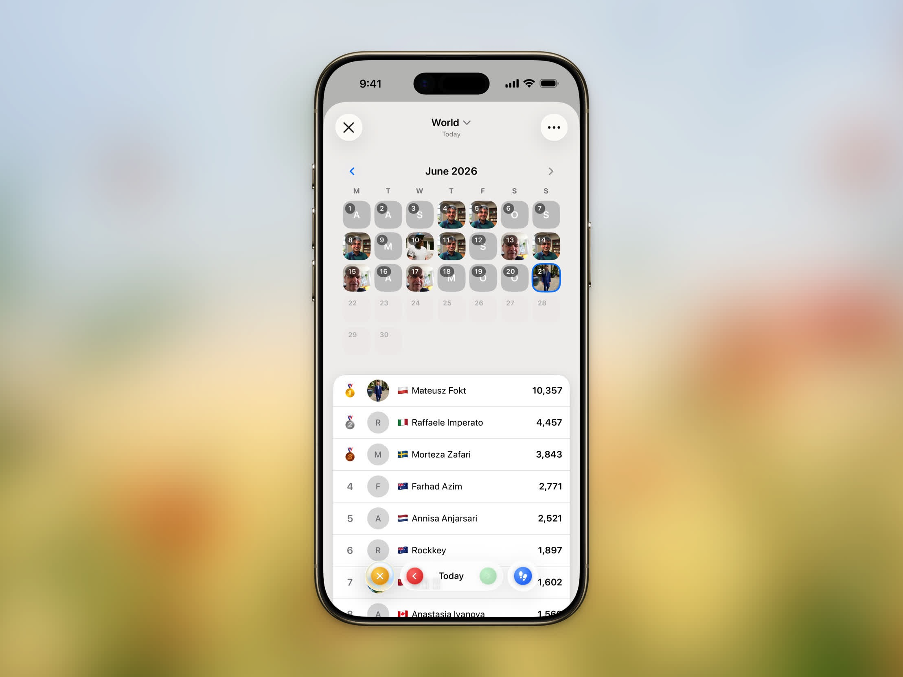

ステップボードは、世界中のウォーカーや自分の国のウォーカーと競い合うデイリーリーダーボードです。招待した人たちとのプライベートグループで競うこともできます。自分の歩数がどの位置にあるか確認し、ランキングを上げ、モチベーションを維持しましょう。いつでも参加・退出できます。

## 参加方法

<Frame caption="デイリーリーダーボードに参加するためにステップボードに参加しましょう">
  
</Frame>

<Steps>
  <Step title="Appleでサインイン">
    ホームダッシュボードのトロフィーアイコンをタップするか、オンボーディング中に参加してください。サインインしていない場合、ボタンは**サインインして参加**と表示され、Appleでサインインが始まります。すでにサインイン済みなら**ステップボードに参加**、すでにメンバーなら**続ける**と表示されます。ピッチには、利用可能な場合は同じ国のウォーカー数、そうでなければ世界中のウォーカー数が示されます。
  </Step>
  <Step title="ステップボードに参加">
    **ステップボードに参加**をタップして、デイリーリーダーボードに参加しましょう。歩数はAppleヘルスケアから自動的に同期されます。
  </Step>
  <Step title="プロフィールの設定">
    表示名、アバター写真、国を追加してください。国は名前の横に国旗の絵文字として表示されます。すべての項目は任意です。名前を設定しない場合は「Anonymous」と表示されます。
  </Step>
</Steps>

## リーダーボード

<Frame caption="歩数でランキングされたトップウォーカーのデイリーリーダーボード">
  
</Frame>

期間を**デイリー**と**月初からの月間**の間で切り替えられます。デイリーは単一日付のランキング、月初からの月間はその月1日からの累計ランキングです。選択は記憶されます。

デイリーボードでは、炎バッジがチャンピオンストリーク中の人を示します。少なくとも2日連続で1位の人です。バッジにはそのストリークの日数が表示されます。

リーダーボードは、選んだ期間のトップ100ウォーカーをランキング表示します。各エントリーには以下が表示されます：

- **順位** — トップ3にはメダルアイコン（🥇🥈🥉）、それ以外は数字で表示
- **アバター** — プロフィール写真またはイニシャルのプレースホルダー
- **名前と国** — 国旗の絵文字付きの表示名
- **歩数** — 千の位区切り付きの1日の歩数

自分のエントリーはハイライト表示されるので、自分の順位をすぐに確認できます。

## ボード

ステップボード上部に並ぶチップで、ワンタップでボードを切り替えられます：

- **World** — ステップボードに参加しているすべての人
- **自分の国** — プロフィールの国が同じウォーカーのみ。Worldボードに参加し、プロフィールで国を設定すると表示されます
- **グループ** — 所属している各プライベートグループ（[グループ](#グループ)を参照）

国別ボードはWorldと同じように機能します。期間、歩数または距離によるランキング、優勝者カレンダーも同じなので、より身近な範囲で自分の位置を確認できます。

## 歩数または距離でランキング

下部バーの日付の横にあるトグルを使って、**歩数**または**距離**（単位設定に応じてキロメートルまたはマイル）でランキングできます。選択は記憶され、すべてのボードに適用されます。

## 月間優勝者カレンダー

<Frame caption="その月の各日に1位を獲得した人を表示するカレンダーオーバーレイ">
  
</Frame>

下部バーにあるカレンダーボタンをタップすると、**優勝者カレンダー**が開きます。その月の各日には、その日に1位を獲得した人のアバターが表示されるため、連続記録が形成されていく様子や王冠が移り変わる様子をひと目で確認できます。過去の任意の日をタップすると、その日の完全なリーダーボードを表示できます。矢印を使って月を移動できますが、現在の月より先は表示できません。

## World Stats

Worldボードにいるときにメニュー（⋯）を開き、**World stats**をタップすると、Stepsコミュニティ全体の動きを確認できます。全期間の合計、あなたのグローバルランクとパーセンタイル、歩数によるトップ国などがわかります。詳しくは[World Stats](/ja/features/world-stats)をご覧ください。

## プロフィール

プロフィールをタップすると、いつでも表示名、アバター写真、国を編集できます。変更はリーダーボードに即座に反映されます。

- **表示名** — 最大50文字。設定しない場合は「Anonymous」と表示
- **アバター** — 写真を撮影、ライブラリから選択、または削除
- **国** — 名前の横に国旗の絵文字として表示

## 日付ナビゲーション

下部バーの日付コントロールを使って過去のリーダーボードを閲覧できます。左右の矢印をタップして日付を移動するか、日付ラベルをタップして日付ピッカーで特定の日付にジャンプできます。

<Tip>過去のリーダーボードはいつでも閲覧できますが、未来の日付は表示できません。</Tip>

## 同期

歩数はAppleヘルスケアから自動的に同期されます。各日のデータはその日が終了した後、夜間に同期されるため、前日の最終ランキングは翌朝に確認できます。リーダーボードを下に引いてリフレッシュすると、最新のデータを取得できます。

## ステップボードからの退出

退出するには、右上のメニューボタン（⋯）をタップし、**ステップボードを退出**を選択してください。リーダーボードからデータが削除されます。いつでも再参加できますが、以前の履歴は復元されません。

## プライバシー

ステップボードは完全にオプトイン方式です。他のユーザーに表示されるのは以下の情報のみです：

- 表示名（または「Anonymous」）
- アバター写真（設定した場合）
- 国旗（設定した場合）
- 1日の歩数と距離

<Tip>個人情報を共有したくない場合は、名前とアバターの設定をスキップしてください。「Anonymous」として汎用プレースホルダーとともに表示されます。</Tip>

その他の健康データ、位置情報、個人情報は一切共有されません。

## グループ

グループは、ステップボードを友人・家族・同僚専用のプライベートリーダーボードに変えます。各グループはWorldボードとは別に独自の日々のランキングを持ち、ステップボード上部のボードチップで切り替えられます。

### グループを作成する

<Steps>
  <Step title="ステップボードメニューを開く">
    右上のメニューボタン（⋯）をタップし、**グループを作成**を選択します。
  </Step>
  <Step title="グループ名をつける">
    名前を入力して**作成**をタップします。まだサインインしていない場合はAppleでサインインするよう求められます。
  </Step>
  <Step title="招待を共有する">
    4文字のユニークな招待コードが生成されます。コードをコピーするか、リンクを友人に共有しましょう。
  </Step>
</Steps>

グループの作成や利用にWorldリーダーボードへの参加は必要ありません。

### グループに参加する

参加方法は2つあります：

- **招待リンク** — 友人から共有された `getsteps.app/join/<code>` リンクをタップします。アプリがグループ名・メンバー数・招待者を表示するプレビューを開きます。**参加**をタップして加入します。
- **招待コード** — ステップボードメニューを開き、**グループに参加**をタップして4文字のコードを入力します。

### グループのリーダーボード

各グループには独自の日々のリーダーボードがあります。メンバーは、Worldボード用に選択したのと同じ指標（歩数または距離）でランキングされます。下部バーで指標を変更すると、すべての場所に適用されます。ステップボード上部のチップ（**World**、自分の国、所属しているすべてのグループ）でボードを切り替えられます。

### メンバーの管理

グループを表示中にメニュー（⋯）をタップし、**グループを管理**を選ぶと次の操作ができます：

- **グループ名の変更** — 管理者のみ
- **招待コードとリンクのコピー・共有**
- **すべてのメンバーを表示** — アバター、表示名、国旗付き
- **メンバーの削除** — 管理者のみ

### 招待を共有する

ステップボードメニューの**グループを共有**、またはグループ管理の共有ボタンを使って、`getsteps.app/join/<code>` リンクをメッセージ、メール、その他の共有シートの宛先経由で送信できます。すでにStepsをインストールしている受信者は、参加プレビューに直接ジャンプします。

### グループを退出または削除する

**グループを管理**を開き、次のいずれかをタップします：

- **グループを退出** — 同じ招待コードで後から再参加できます
- **グループを削除** — 管理者のみ。全メンバーを削除しグループを終了します

<Tip>グループの招待コードは非公開です。コードを持つ誰でも参加できるため、信頼できる人にのみ共有してください。</Tip>

## よくある質問

<AccordionGroup>
  <Accordion title="ステップボードを使うにはアカウントが必要ですか？">
    はい、ステップボードまたはグループに参加するにはAppleでサインインする必要があります。これはリーダーボード上でユーザーを識別するために使用されます。
  </Accordion>
  <Accordion title="グループに友人を招待するには？">
    ステップボードでグループを開き、メニュー（⋯）→**グループを共有**をタップするか、**グループを管理**を開いて**リンクを共有**をタップします。Stepsがインストールされたiphoneでリンクを開くと、プレビューが表示され、ワンタップで参加できます。
  </Accordion>
  <Accordion title="国別ボードが表示されないのはなぜですか？">
    国別ボードは、Worldボードに参加し、プロフィールで国を設定すると表示されます。ステップボードでプロフィールをタップして国を選択してください。
  </Accordion>
  <Accordion title="複数のグループに所属できますか？">
    はい。ステップボード上部のチップでグループ間—およびWorldボードと国別ボード—を切り替えられます。
  </Accordion>
  <Accordion title="リーダーボードには何人表示されますか？">
    リーダーボードには、選んだ期間（1日または月初からの月間）のトップ100が表示され、歩数または距離のどちらか選んだ指標でランキングされます。
  </Accordion>
  <Accordion title="他の人に個人情報が見えますか？">
    表示名、アバター、国旗、1日の歩数と距離のみが表示されます。その他の健康データや個人情報は共有されません。
  </Accordion>
  <Accordion title="退出して再参加するとどうなりますか？">
    最初からのスタートになります。以前のリーダーボード履歴は削除され、再参加しても復元されません。
  </Accordion>
  <Accordion title="今日の完全なデータが表示されないのはなぜですか？">
    今日の歩数はまだ集計中のため、リーダーボードは各日の最終データを夜間に同期します。完全なランキングは明日確認してください。
  </Accordion>
</AccordionGroup>
