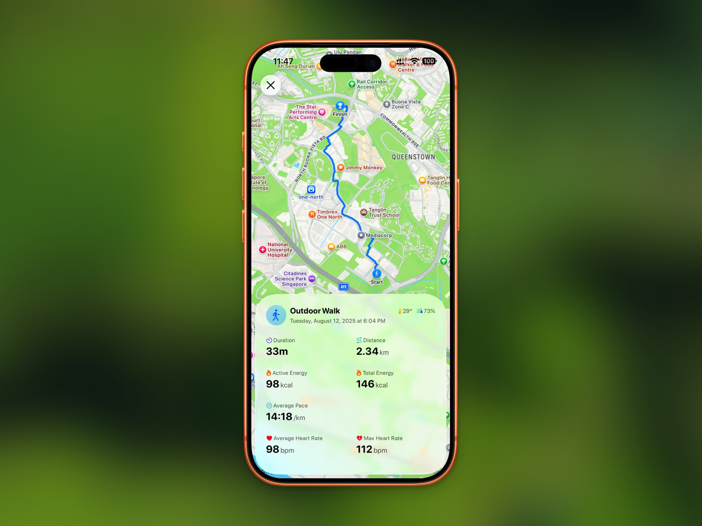
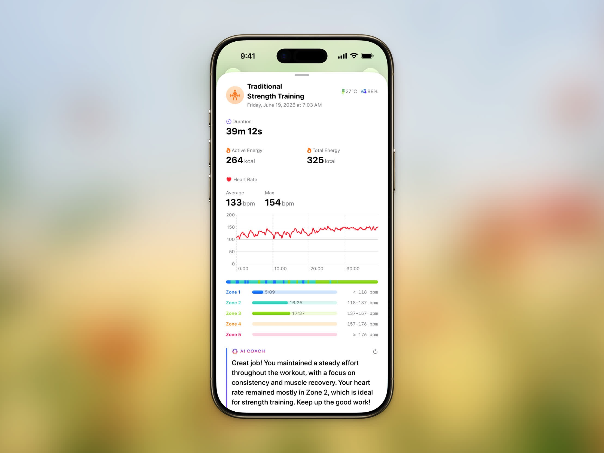
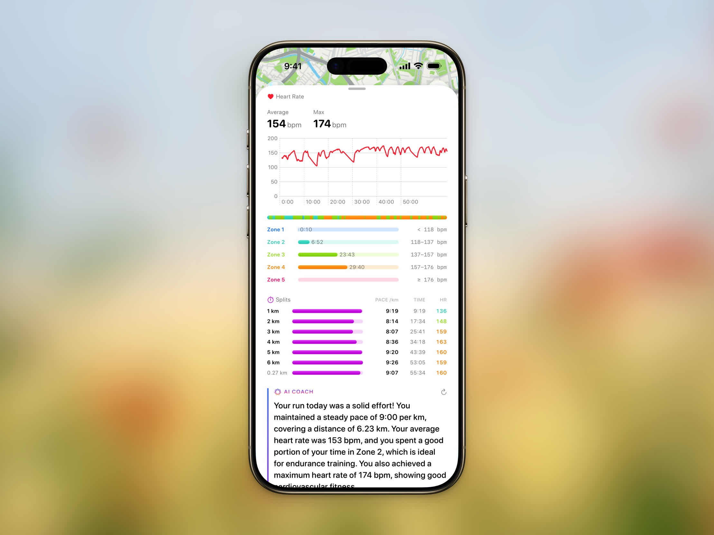
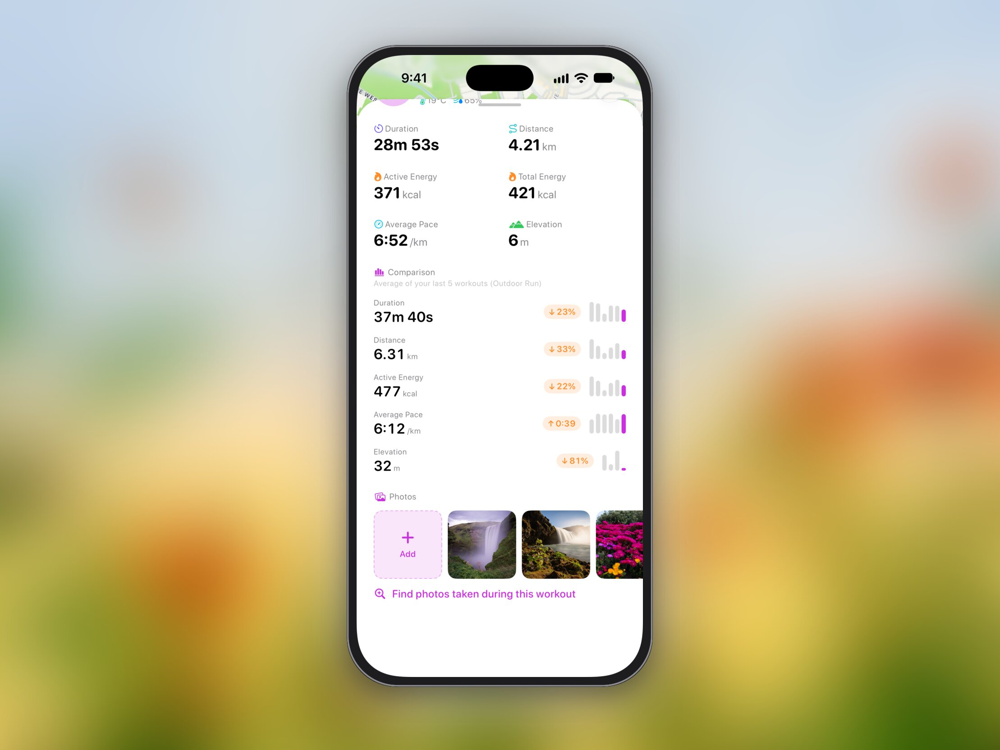
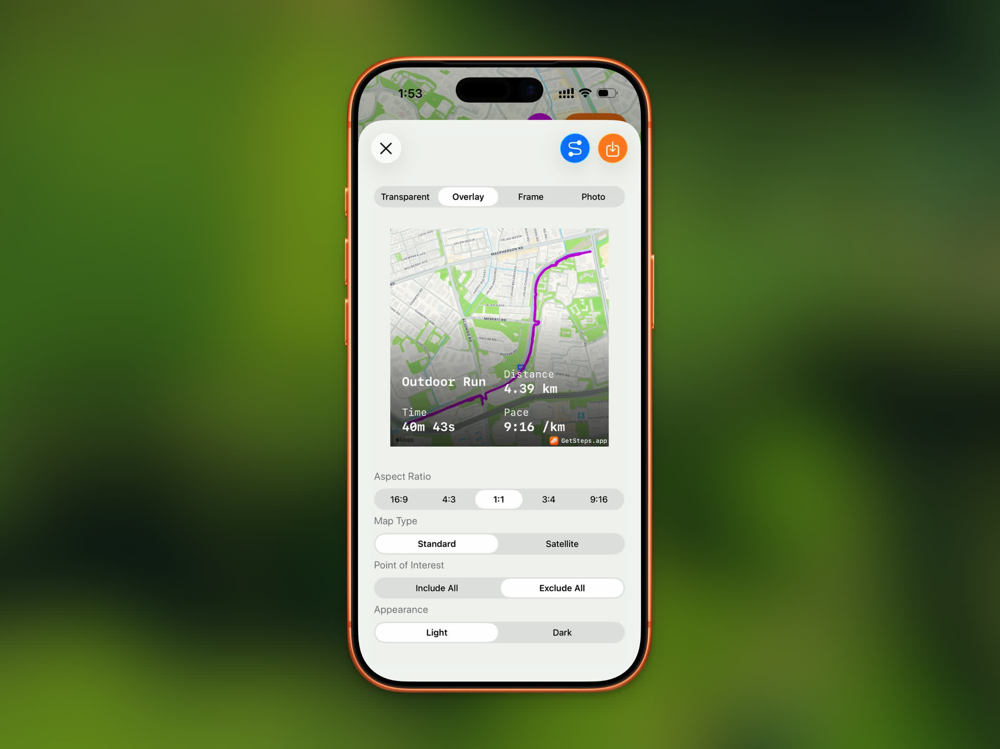
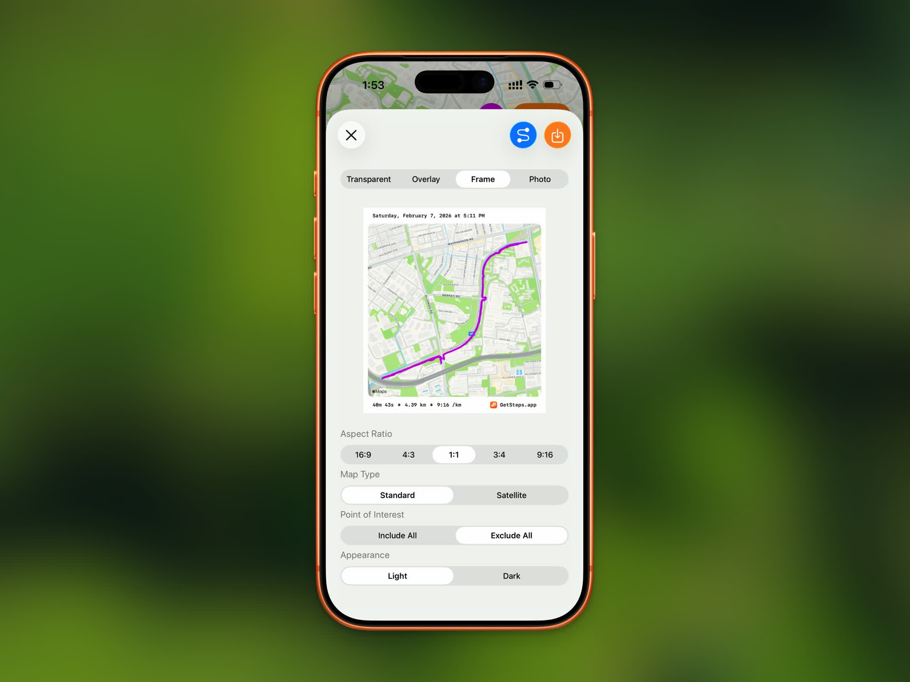
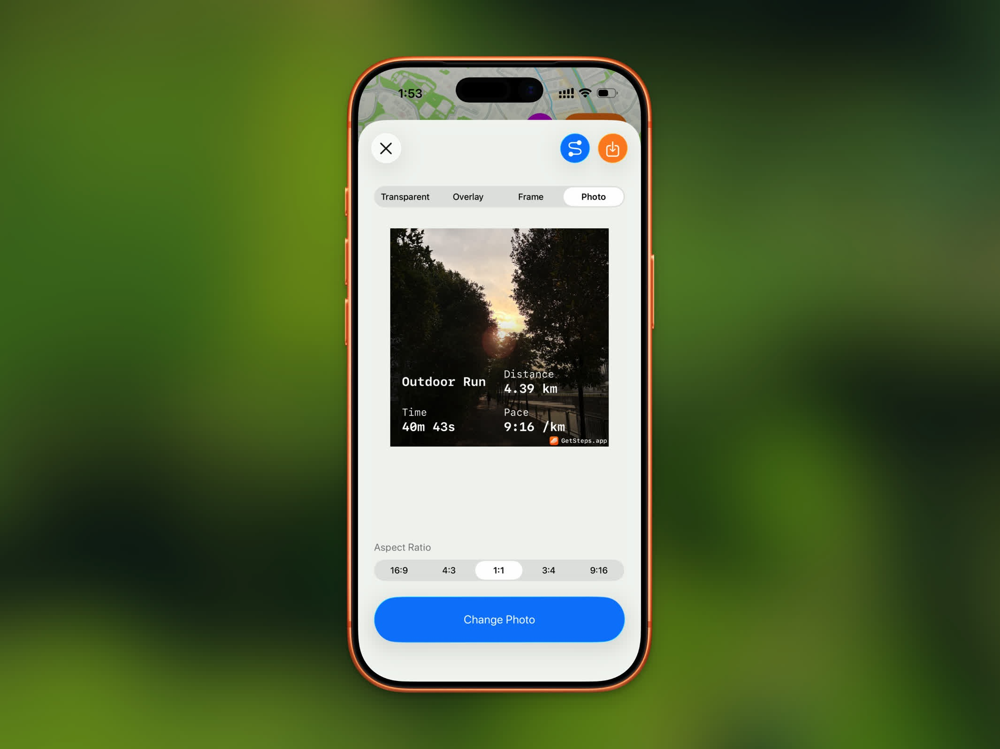

활동 세부 정보 화면에서는 기록된 운동의 경로, 통계, 사진, 공유 옵션을 포함한 전체 분석을 제공합니다.

## 경로 지도

<Frame caption="GPS 경로 지도와 운동 통계가 있는 활동 세부 정보 화면">
  
</Frame>

실외 운동의 경우, 지도에 운동 색상으로 GPS 경로가 표시됩니다. 다음 사이를 전환할 수 있습니다:

- **표준** 지도 보기
- **위성** 이미지 보기

## 운동 통계

모든 운동 세부 정보 화면에는 다음이 표시됩니다:

- **시간** - 총 운동 시간
- **거리** - 총 이동 거리
- **페이스** - 평균 페이스 (걷기 및 달리기용)
- **고도 상승** - 운동 중 총 상승 고도
- **심박수** - 평균 및 최대 심박수
- **칼로리** - 소모된 활성 에너지
- **날씨** - 운동 중 기온 및 습도

통계 시트 푸터에는 운동을 기록한 기기 이름(iPhone 또는 Apple Watch 등)이 표시됩니다. 경로 없이 장소만 있는 운동도 지도에 핀이 표시됩니다.

## 비교

같은 유형의 이전 운동이 최소 두 개 있으면 **비교** 섹션에서 최근 몇 번의 평균과 이번 운동을 대조합니다. 실내와 실외 세션은 따로 비교됩니다. 각 행에는 최근 평균, 이번 운동과의 차이, 마지막 막대가 이번 세션인 작은 추세가 표시됩니다.

비교 지표에는 시간, 거리, 활성 에너지, 페이스, 평균 심박수, [노력도](#노력도)가 포함될 수 있습니다. 평균을 낼 만큼의 기록이 없으면 섹션이 숨겨집니다.

## 노력도

운동이 얼마나 힘들었는지 **1에서 10**까지 평가하세요. 점수는 Apple 건강에 저장되어 Fitness 앱과 동기화됩니다. 구간 이름은 Apple과 같습니다:

| 점수 | 구간 |
|------|------|
| **1–3** | Easy |
| **4–6** | Moderate |
| **7–8** | Hard |
| **9–10** | All Out |

<Note>노력도 평가는 iOS 18 이상이 필요하며, Steps가 건강 앱에서 Effort를 업데이트할 권한이 있어야 합니다. 다른 앱이 이미 평가를 소유한 경우 그쪽이나 건강에서 변경하세요.</Note>

## 심박수 및 구간

<Frame caption="구간별 시간 분석이 있는 심박수 차트">
  
</Frame>

운동에 심박수 데이터가 있는 경우, **심박수** 섹션에는 평균과 최대 심박수가 세션 동안의 심박수 차트와 함께 표시됩니다. 트레이스는 Apple 건강의 심박수 구간별로 색칠됩니다. Apple Watch에서 운동하는 동안 해당 구간은 실시간으로 업데이트됩니다.

차트 아래의 **구간별 시간** 분석은 편안한 강도부터 최대 강도까지 다섯 가지 심박수 구간 각각에서 보낸 시간을 보여줍니다:

| 구간 | 강도 |
|------|------|
| **구간 1** | 매우 가벼움 |
| **구간 2** | 가벼움 |
| **구간 3** | 보통 |
| **구간 4** | 힘듦 |
| **구간 5** | 최대 |

각 구간에는 해당 구간에서 보낸 시간과 bpm 단위의 심박수 범위가 표시됩니다.

## 스플릿

<Frame caption="페이스, 시간, 평균 심박수가 포함된 스플릿별 분석">
  
</Frame>

거리 기반 운동의 경우, **스플릿** 표는 단위 설정에 따라 킬로미터 또는 마일당 한 행씩 거리별로 운동을 분석합니다. 각 스플릿에는 다음이 표시됩니다:

- **페이스** (사이클링의 경우 **속도**)
- **시간** — 스플릿 종료 시점의 누적 경과 시간
- **심박수** — 사용 가능한 경우 스플릿의 평균 심박수

각 스플릿 옆의 막대를 통해 가장 빠른 구간과 가장 느린 구간을 한눈에 쉽게 비교할 수 있습니다.

## 경로 재생

<Note>경로 재생은 Pro 기능입니다.</Note>

<Frame caption="시네마틱 카메라로 경로를 따라가는 3D 경로 재생">
  <video
    autoPlay
    muted
    loop
    playsInline
    className="w-full aspect-video rounded-xl"
    src="/videos/route-3d.mp4"
  ></video>
</Frame>

운동 경로를 3D로 재생하여 세션 동안 어떻게 이동했는지 다시 체험해보세요. 시네마틱 팔로우 카메라가 들어와 경로를 따라 부드럽게 활공하며, 모든 회전을 매끄럽게 처리하면서 위치를 추적합니다.

**지도 설정**을 열어 재생을 맞춤 설정하세요:

- **지도 스타일** — **표준**과 **위성** 사이를 전환하세요. 두 스타일 모두 재생 중 사실적인 고도를 렌더링하여 진정한 3D 보기를 제공합니다.
- **경로 색상** — 경로 색상을 고르세요.
- **재생 시간** — **15초에서 180초**까지. Steps는 운동 거리에 따라 적절한 기본값을 선택합니다.
- **북쪽 고정** — 재생 내내 지도를 북쪽 방향으로 두거나, 카메라가 이동 방향을 따르게 하세요.

## 사진

<Frame caption="통계 시트 마지막에 있는, 운동에 첨부된 사진">
  
</Frame>

운동 중에 찍은 사진을 어떤 운동에든 추가하세요. **사진** 섹션은 통계 시트의 맨 끝에 있습니다.

- **추가** — 라이브러리에서 원하는 사진을 한 번에 최대 20장까지 선택하세요
- **이 운동 중에 촬영한 사진 찾기** — Steps가 운동 시작부터 종료 시간 사이에 촬영된 사진을 라이브러리에서 찾아줍니다. 제안된 사진은 **이 운동 중에 촬영됨** 아래에 표시되며, 하나를 탭해 첨부하거나 **모두 추가**를 탭하세요

첨부한 사진은 경로 지도에도 핀으로 표시되며, 촬영한 시간(또는 위치)에 따라 배치됩니다. [경로 재생](#경로-재생) 중에는 마커가 해당 지점에 도달하면 사진이 나타납니다. 사진을 탭하면 전체 화면으로 볼 수 있습니다.

사진을 삭제하려면 사진을 길게 누른 다음 **사진 삭제**를 선택하세요. Steps는 각 사진의 사본을 따로 보관하므로, 운동에서 사진을 삭제해도 라이브러리의 원본은 삭제되지 않습니다.

<Note>운동 중에 촬영한 사진을 찾으려면 사진 보관함 접근 권한이 필요합니다. 권한을 허용하지 않았다면 Steps에 설정을 여는 버튼이 표시됩니다. **추가**로 사진을 추가할 때는 라이브러리 전체 접근 권한이 없어도 됩니다.</Note>

## 운동 공유

운동을 스타일이 적용된 이미지로 공유하세요. Steps는 네 가지 공유 스타일을 제공합니다:

<Tabs>
  <Tab title="투명">
    <Frame>
      
    </Frame>
  </Tab>
  <Tab title="오버레이">
    <Frame>
      
    </Frame>
  </Tab>
  <Tab title="프레임">
    <Frame>
      
    </Frame>
  </Tab>
  <Tab title="사진">
    <Frame>
      
    </Frame>
  </Tab>
</Tabs>

| 스타일 | 설명 |
|--------|------|
| **투명** | 투명 배경의 통계 |
| **오버레이** | 경로 지도 위에 겹친 통계 |
| **프레임** | 테두리가 있는 통계 프레임과 경로 지도 |
| **사진** | 라이브러리에서 선택한 사진 위의 통계 |

**오버레이**와 **프레임**은 추적된 GPS 경로뿐 아니라 저장된 장소만 있는 운동에서도 사용할 수 있습니다. 투명 미리보기는 체크무늬를 보여 주어 투명하게 남을 부분을 확인할 수 있습니다.

5가지 화면 비율도 선택할 수 있습니다: 16:9, 4:3, 1:1, 3:4, 9:16.

지도 기반 스타일의 경우, 지도 모양(밝게/어둡게), 관심 지점 표시 여부, 고도 스타일 등의 추가 옵션이 있습니다.

자세한 내용은 [공유](/ko/features/sharing)를 참조하세요.

## GPX 내보내기

<Note>GPX 내보내기는 Pro 기능입니다.</Note>

운동 경로를 `.gpx` 파일로 내보내어 다른 피트니스 앱이나 매핑 도구에서 사용하세요. 공유 버튼을 탭하고 GPX 내보내기를 선택하여 파일을 저장하거나 전송하세요.

## 운동 삭제

운동을 제거하려면 오른쪽 상단의 메뉴 버튼(⋯)을 탭하고 **삭제**를 선택하세요. 이 작업은 Steps와 Apple 건강 모두에서 운동을 제거하므로 확인을 요청합니다.

<Warning>운동을 삭제하면 Apple 건강에서도 제거되며 실행 취소할 수 없습니다.</Warning>
