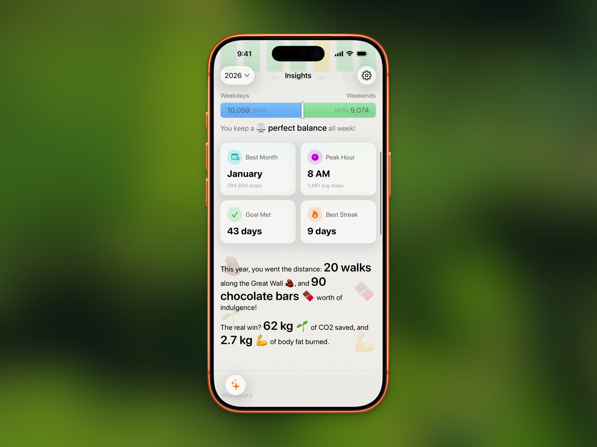

O Insights oferece uma revisão anual — ou de um único mês — dos seus dados de passos e treinos com estatísticas, recordes e comparações divertidas.

## Análises de Passos

<Frame caption="Recibo anual do Insights com total de passos, distância e calorias">
  
</Frame>

Seu resumo anual de passos inclui:

- **Recibo Anual** - Total de passos, distância e calorias do ano
- **Média Diária** - Sua média de passos por dia
- **Melhor Dia** - Sua maior contagem de passos em um único dia e a data
- **Melhor Mês** - O mês com mais passos totais
- **Hora de Pico** - A hora do dia em que você é mais ativo
- **Detalhamento por Dia da Semana** - Gráfico comparando passos por dia da semana, com médias de dias úteis versus fim de semana
- **Metas Atingidas** - Número total de dias em que você atingiu sua meta de passos
- **Melhor Sequência** - Sua sequência consecutiva mais longa em dias

## Ano a Ano

Um gráfico de linhas compara seus totais mensais ao longo dos anos, para que você veja se este ano está à frente do anterior. Alterne o gráfico entre **Total de passos** e **Distância total**, e use os botões **−** e **+** para mostrar menos ou mais anos. Quando você está visualizando um único mês, o gráfico passa a ser, por exemplo, **Setembro ao longo dos anos** e compara esse mês dia a dia.

## Meta Anual de Passos

<Frame caption="Cartão de meta anual de passos com barra de progresso e total projetado">
  
</Frame>

Se você definiu uma [meta anual de passos](/pt-BR/features/yearly-goal), um cartão de progresso mostra seus passos até agora neste ano, uma barra de progresso em gradiente e se você está dentro do ritmo. Para o ano atual, ele também projeta seu total para o fim do ano com base no seu ritmo; para anos anteriores, mostra a porcentagem da meta que você atingiu e sua média diária. O cartão fica oculto quando você está visualizando um único mês.

## Equivalências Divertidas

<Frame caption="Equivalências reais e divertidas para seus dados anuais de passos">
  
</Frame>

O Steps converte seus totais anuais em comparações divertidas do mundo real para distância, calorias, CO2 economizado e muito mais. Veja como sua caminhada se compara com atividades cotidianas.

## Análises de Treino

Se você registrou treinos, você também verá:

- **Passagem de Voo de Treino** - Total de treinos, tempo de treino, distância e calorias
- **Detalhamento de Treino** - Tipo de treino mais comum, contagens outdoor versus indoor, atividade em dias úteis versus fim de semana

## Recordes Pessoais

<Frame caption="Grade de recordes pessoais mostrando os melhores de todos os tempos">
  
</Frame>

Uma grade rolável mostra seus 8 recordes pessoais do ano ou mês que você está visualizando:

| Recorde | O Que Monitora |
|---------|----------------|
| **Mais Rápido** | Melhor ritmo |
| **Mais Calorias** | Mais calorias em um único treino |
| **Mais Cedo** | Horário de início de treino mais cedo |
| **Maior Subida** | Maior ganho de elevação |
| **Mais Longo** | Maior duração de treino |
| **Mais Distante** | Maior distância de treino |
| **Mais Tarde** | Horário de início de treino mais tarde |
| **FC Máxima** | Maior frequência cardíaca registrada |

Toque em um recorde para destacar esse treino em um mapa abaixo da grade e, em seguida, toque no cartão para abrir o detalhe completo do treino.

## Relógio de Treino

<Frame caption="Relógio de treino mostrando quando você costuma começar os treinos">
  
</Frame>

O relógio de treino mapeia os horários de início dos seus treinos ao longo da semana, uma linha por dia da semana e colunas para a hora. Ele nomeia o padrão — madrugador, movimentador matinal, atleta do intervalo do almoço, atleta pós-trabalho ou coruja noturna — a partir das horas em que você realmente treina.

## Período

O menu na barra de ferramentas alterna entre **Ano Inteiro** e qualquer mês único daquele ano. O ano atual oferece apenas os meses até hoje. Um mês substitui **Melhor Mês** por **Melhor Semana**.

Use o mesmo menu para navegar entre anos e comparar sua atividade ao longo do tempo.
