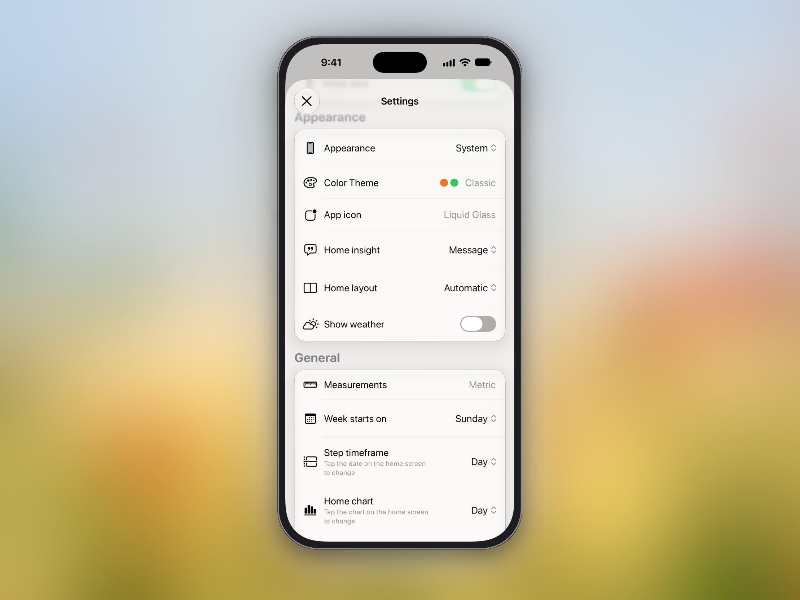

A tela de Configurações permite personalizar como o Steps aparece e funciona. Abra-a pelo botão no canto superior direito do Painel Inicial — um ícone de engrenagem, ou sua foto de perfil depois que você iniciar sessão.

## Perfil

Seu cartão de perfil aparece no topo das Configurações. Toque nele para editar seu nome de exibição, foto de avatar e país. Se você não estiver conectado, verá um convite para **Iniciar Sessão com Apple**.

Assinantes Pro veem um selo **Pro** em seu cartão de perfil.

## Aparência

<Frame caption="Configurações de aparência">
  
</Frame>

| Configuração | Opções | Notas |
|--------------|--------|-------|
| **Aparência** | Sistema, Claro, Escuro | Siga seu dispositivo ou defina manualmente |
| **Tema de Cores** | 12 predefinidos + Personalizado | Recurso Pro. Veja [Temas de Cores](/pt-BR/features/color-themes) |
| **Ícone do App** | 17 ícones | Veja [Ícone do App](/pt-BR/features/app-icon-selector) |
| **Insight Inicial** | Desligado, Mensagem, Média, Meta Anual | O que aparece abaixo da contagem de passos |
| **Linha de base da média** | Últimos 30 dias, Últimos 3 meses, Este ano, Ano passado, Todo o período | Exibido quando o Insight Inicial é Média |
| **Layout Inicial** | Automático, Cartão, Painel | iOS 26 e posteriores. Veja [Painel Inicial](/pt-BR/features/home-dashboard#layout-inicial) |
| **Exibir Clima** | Ativado, Desativado | Exibir temperatura e condições |

## Geral

| Configuração | Opções | Notas |
|--------------|--------|-------|
| **Medidas** | Unidades e temperatura | Abre uma página dedicada (veja abaixo) |
| **Semana Começa Em** | Domingo, Segunda-feira | Altera o calendário e as visualizações semanais |
| **Período dos passos** | Dia, Semana, Mês | Semana e Mês são recursos Pro. Você também pode tocar na data no Painel Inicial |
| **Gráfico inicial** | Dia, Semana, Mês | Exibido quando o Período dos passos é Dia. Semana e Mês são recursos Pro. Você também pode tocar no gráfico no Painel Inicial |
| **Meta diária** | 1.000 - 20.000 | Veja [Meta Diária](/pt-BR/features/daily-goal) |
| **Meta anual** | 500.000 - 10.000.000 | Veja [Meta Anual](/pt-BR/features/yearly-goal) |
| **Notificações** | Abre uma tela detalhada | Mostra se as notificações estão ativadas. Veja [Notificações](/pt-BR/features/notifications) |
| **Bloqueio de Apps** | Ativado, Desativado | Recurso Pro. Veja [Bloqueio de Apps](/pt-BR/features/app-lock) |
| **Idioma do App** | 10 idiomas | Abre as configurações de idioma do dispositivo |

### Medidas

A página **Medidas** (o primeiro item em Geral) controla as unidades usadas em todo o app:

- **Sistema de Unidades** — **Métrico** (km, °C) ou **Imperial** (milhas, °F)
- **Temperatura** — **Automático** (segue seu sistema de unidades), **Celsius** ou **Fahrenheit**

As alterações se aplicam a todo o app e sincronizam com seu Apple Watch automaticamente.

### Sub-configurações de Notificações

Ao tocar em Notificações, uma tela detalhada é aberta com um controle para cada tipo:

- **Meta Alcançada** — Meta atingida e marcos
- **Treino Concluído** — Quando um treino termina
- **Desbloqueio de Apps** — Quando os apps são desbloqueados
- **Lembretes Diários** — Manhã, tarde e noite
- **Humor** — Quão brincalhão o texto gerado das notificações deve soar (iOS 26 e posteriores). Veja [Notificações](/pt-BR/features/notifications#humor)
### Idiomas Suportados

O Steps está disponível em English, Deutsch, Español, Français, Italiano, 日本語, 한국어, Português (Brasil), Русский e 简体中文.

## Widgets e Dados

- **Widgets da Tela Inicial** — Guia de configuração para adicionar widgets. Veja [Widgets](/pt-BR/features/widgets)
- **Ressincronizar dados do Apple Health** — Atualize seus dados de atividade do Apple Health
- **Reiniciar Configuração Inicial** — Passar pelo fluxo de configuração novamente

## Suporte

- **Quadro de Feedback** — Envie solicitações de recursos e vote em ideias
- **Deixar uma Avaliação** — Avalie o Steps na App Store
- **Ajuda e Documentação** — [getsteps.app/docs](https://getsteps.app/docs)
- **Gerenciar Assinatura** — Altere ou cancele seu plano Pro (somente usuários Pro)
- **Termos de Serviço** — [getsteps.app/terms](https://getsteps.app/terms)
- **Política de Privacidade** — [getsteps.app/privacy](https://getsteps.app/privacy)
- **Calculadoras de Fitness** — [getsteps.app/tools](https://getsteps.app/tools)

## Sobre

- **Novidades** — Veja as últimas alterações e atualizações
- **Uma nota de Hieu** — Por que o Steps existe, além de uma forma de deixar uma avaliação ou responder
- **Créditos** — As pessoas por trás do Steps
- **Compartilhar Steps** — Compartilhe o app com amigos via QR code
- **Seguir no X** — [@hieudinh_](https://x.com/hieudinh_)
- **Blog** — [getsteps.app/blog](https://getsteps.app/blog)
