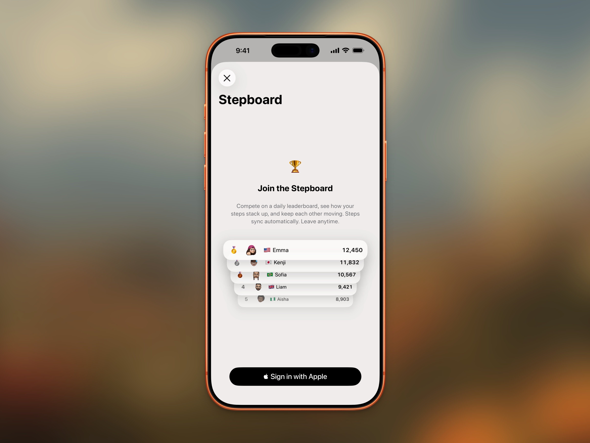
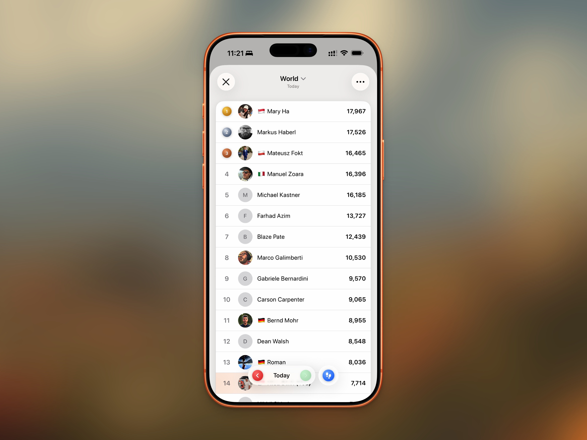
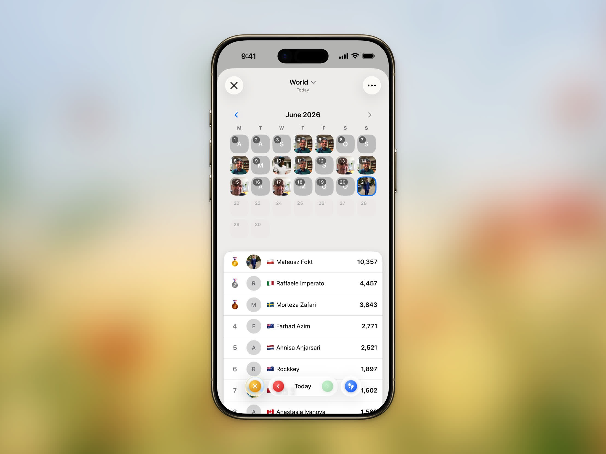

A Stepboard é um ranking diário onde você compete com caminhantes ao redor do mundo, do seu próprio país ou em grupos privados com pessoas que você convidar. Veja como seus passos se classificam, suba no ranking e mantenha-se motivado. Entre ou saia a qualquer momento.

## Como participar

<Frame caption="Entre na Stepboard para começar a competir no ranking diário">
  
</Frame>

<Steps>
  <Step title="Inicie sessão com a Apple">
    Toque no ícone de troféu no Painel Principal, ou entre durante a configuração inicial. Se você não estiver conectado, o botão diz **Iniciar sessão e Entrar** e inicia o início de sessão com a Apple. Se você já estiver conectado, diz **Entrar na Stepboard**. Se já for membro, diz **Continuar**. A apresentação informa quantos caminhantes compartilham o seu país quando essa contagem está disponível, ou quantos caminhantes há no mundo todo.
  </Step>
  <Step title="Entre na Stepboard">
    Toque em **Entrar na Stepboard** para participar do ranking diário. Seus passos são sincronizados automaticamente do Apple Health.
  </Step>
  <Step title="Configure seu perfil">
    Adicione um nome de exibição, foto de avatar e país. Seu país aparece como emoji de bandeira ao lado do seu nome. Todos os campos são opcionais — você aparecerá como "Anonymous" se pular o nome.
  </Step>
</Steps>

## O ranking

<Frame caption="Ranking diário mostrando os melhores caminhantes classificados por contagem de passos">
  
</Frame>

Alterne o período entre **Diário** e **Mês até hoje**. Diário classifica uma única data. Mês até hoje classifica o total acumulado desde o primeiro dia do mês. Sua escolha é lembrada.

Em um quadro diário, um distintivo de chama marca quem está em uma sequência de campeão — primeiro lugar por pelo menos dois dias seguidos. O distintivo mostra há quanto tempo essa sequência dura.

O ranking classifica os 100 melhores caminhantes do período que você escolheu. Cada entrada mostra:

- **Posição** — Os 3 primeiros recebem ícones de medalha (🥇🥈🥉), os demais mostram um número
- **Avatar** — Sua foto de perfil ou um placeholder com iniciais
- **Nome e País** — Nome de exibição com emoji de bandeira do país
- **Passos** — Contagem diária de passos com separadores de milhares

Sua própria entrada é destacada para que você possa encontrar rapidamente sua posição.

## Quadros

Uma fileira de chips no topo da Stepboard permite trocar de quadro com um único toque:

- **World** — todos que entraram na Stepboard
- **Seu país** — apenas caminhantes que têm o mesmo país que você no perfil. Ele aparece depois que você entra no quadro World e define um país no seu perfil
- **Grupos** — cada grupo privado do qual você faz parte (veja [Grupos](#grupos))

O quadro do seu país funciona exatamente como o World — os mesmos períodos, a mesma classificação por passos ou distância e o mesmo calendário de vencedores — para que você veja sua posição mais perto de casa.

## Classificar por passos ou distância

Use o seletor na barra inferior, ao lado da data, para classificar por **passos** ou por **distância** (quilômetros ou milhas, conforme suas unidades). Sua escolha é lembrada e se aplica a todos os quadros.

## Calendário de vencedores mensais

<Frame caption="Sobreposição de calendário mostrando quem ficou em primeiro lugar a cada dia do mês">
  
</Frame>

Toque no botão de calendário na barra inferior para abrir o **calendário de vencedores**. Cada dia do mês mostra o avatar de quem ficou em primeiro lugar naquele dia, para que você possa ver sequências se formarem e a coroa mudar de mãos rapidamente. Toque em qualquer dia passado para ver o ranking completo daquele dia. Use as setas para navegar entre os meses — você não pode olhar além do mês atual.

## Estatísticas Mundiais

Quando você estiver no quadro World, abra o menu (⋯) e toque em **Estatísticas mundiais** para ver como toda a comunidade do Steps está se movendo — totais de todos os tempos, sua classificação global e percentil, e os principais países por passos. Consulte [Estatísticas Mundiais](/pt-BR/features/world-stats) para mais detalhes.

## Seu perfil

Toque no seu perfil para editar seu nome de exibição, foto de avatar e país a qualquer momento. As alterações aparecem imediatamente no ranking.

- **Nome de exibição** — Até 50 caracteres. Mostra "Anonymous" se não definido
- **Avatar** — Tire uma foto, escolha da sua biblioteca ou remova
- **País** — Exibido como emoji de bandeira ao lado do seu nome

## Navegação por data

Navegue pelos rankings de dias anteriores usando os controles de data na barra inferior. Toque nas setas esquerda ou direita para alternar entre os dias, ou toque no rótulo da data para ir a uma data específica com o seletor de datas.

<Tip>Você pode visualizar o ranking de qualquer dia passado, mas não pode ver datas futuras.</Tip>

## Sincronização

Seus passos são sincronizados automaticamente do Apple Health. Os dados de cada dia são sincronizados durante a noite após o término do dia, então você verá as classificações finais de ontem na manhã seguinte. Puxe para baixo no ranking para atualizar e obter os dados mais recentes.

## Sair da Stepboard

Para sair, toque no botão de menu (⋯) no canto superior direito e selecione **Sair da Stepboard**. Seus dados são removidos do ranking. Você pode voltar a qualquer momento, mas seu histórico anterior não será restaurado.

## Privacidade

A Stepboard é totalmente opcional. Apenas estes detalhes são visíveis para outros usuários:

- Nome de exibição (ou "Anonymous")
- Foto de avatar (se definida)
- Bandeira do país (se definida)
- Contagem diária de passos e distância

<Tip>Se preferir não compartilhar detalhes pessoais, simplesmente pule a configuração de nome e avatar. Você aparecerá como "Anonymous" com um placeholder genérico.</Tip>

Nenhum outro dado de saúde, dado de localização ou informação pessoal é compartilhado.

## Grupos

Grupos transformam a Stepboard em um ranking privado para você e seus amigos, família ou colegas. Cada grupo tem seu próprio ranking diário ao lado do quadro World — alterne entre eles com os chips de quadros no topo da Stepboard.

### Criar um grupo

<Steps>
  <Step title="Abra o menu Stepboard">
    Toque no botão de menu (⋯) no canto superior direito e escolha **Criar grupo**.
  </Step>
  <Step title="Dê um nome ao grupo">
    Digite um nome e toque em **Criar**. Será solicitado iniciar sessão com a Apple se ainda não o fez.
  </Step>
  <Step title="Compartilhe o convite">
    Um código de convite único de 4 caracteres é gerado. Copie o código ou compartilhe o link com amigos.
  </Step>
</Steps>

Você não precisa entrar no ranking World para criar ou usar grupos.

### Entrar em um grupo

Há duas maneiras de entrar:

- **Link de convite** — Toque em um link `getsteps.app/join/<code>` compartilhado por um amigo. O app abre uma prévia mostrando o nome do grupo, número de membros e quem o convidou. Toque em **Entrar** para participar.
- **Código de convite** — Abra o menu Stepboard e toque em **Entrar em grupo**, depois digite o código de 4 caracteres.

### Ranking do grupo

Cada grupo tem seu próprio ranking diário. Os membros são classificados pela mesma métrica — passos ou distância — que você selecionou para o quadro World; altere-a na barra inferior e ela se aplica a todos os lugares. Alterne quadros com os chips no topo da Stepboard — **World**, seu país e todos os grupos aos quais você pertence.

### Gerenciar membros

Enquanto visualiza um grupo, toque no menu (⋯) e escolha **Gerenciar grupo** para:

- **Renomear o grupo** — apenas admin
- **Copiar ou compartilhar o código e link de convite**
- **Ver todos os membros** com avatares, nomes e bandeiras de país
- **Remover membros** — apenas admin

### Compartilhar convites

Use **Compartilhar grupo** no menu Stepboard, ou o botão de compartilhar em Gerenciar grupo, para enviar um link `getsteps.app/join/<code>` via Mensagens, Mail ou qualquer destino da folha de compartilhamento. Destinatários que já tenham o Steps instalado vão direto para a prévia de entrada.

### Sair ou excluir um grupo

Abra **Gerenciar grupo** e toque em:

- **Sair do grupo** — você pode entrar novamente depois com o mesmo código de convite
- **Excluir grupo** — apenas admin; remove todos os membros e encerra o grupo

<Tip>Códigos de convite de grupo são privados. Qualquer pessoa com o código pode entrar, então compartilhe apenas com pessoas de confiança.</Tip>

## Perguntas frequentes

<AccordionGroup>
  <Accordion title="Preciso de uma conta para usar a Stepboard?">
    Sim, você precisa iniciar sessão com a Apple para entrar na Stepboard ou em qualquer grupo. Isso é usado para identificar suas entradas no ranking.
  </Accordion>
  <Accordion title="Como convido amigos para um grupo?">
    Abra o grupo na Stepboard e toque no menu (⋯) → **Compartilhar grupo**, ou abra **Gerenciar grupo** e toque em **Compartilhar link**. Quem abrir o link em um iPhone com o Steps instalado verá uma prévia e poderá entrar com um toque.
  </Accordion>
  <Accordion title="Por que não vejo o quadro do meu país?">
    O quadro do país aparece depois que você entra no quadro World e define um país no seu perfil. Toque no seu perfil na Stepboard para escolher seu país.
  </Accordion>
  <Accordion title="Posso estar em vários grupos?">
    Sim. Alterne entre grupos — e os quadros World e do país — com os chips no topo da Stepboard.
  </Accordion>
  <Accordion title="Quantas pessoas aparecem no ranking?">
    O ranking mostra os 100 melhores do período que você escolheu — um dia ou o mês até hoje — classificados por passos ou por distância, conforme a métrica selecionada.
  </Accordion>
  <Accordion title="Outros podem ver minhas informações pessoais?">
    Apenas seu nome de exibição, avatar, bandeira do país e seus passos e distância diários são visíveis. Nenhum outro dado de saúde ou pessoal é compartilhado.
  </Accordion>
  <Accordion title="O que acontece se eu sair e voltar?">
    Você começa do zero. Seu histórico anterior no ranking é removido e não será restaurado quando você voltar.
  </Accordion>
  <Accordion title="Por que não vejo os dados completos de hoje?">
    Os passos de hoje ainda estão sendo contados, então o ranking sincroniza os dados finais de cada dia durante a noite. Volte amanhã para ver as classificações completas.
  </Accordion>
</AccordionGroup>
