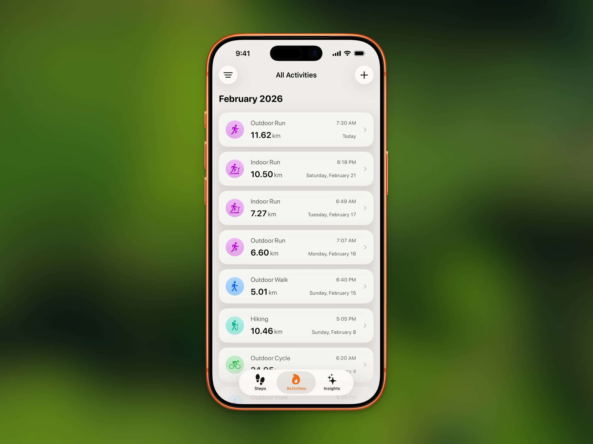

История активности показывает все ваши записанные тренировки в одном месте, сгруппированные по месяцам для удобного просмотра.

## Просмотр тренировок

<Frame caption="Список активности с тренировками, сгруппированными по месяцам">
  
</Frame>

Ваши тренировки сгруппированы по месяцам, самые последние — вверху. У каждого месяца есть сводка по тренировочным дням и итогам. На широком макете эта сводка остаётся на месте, пока прокручиваются карточки. Каждая запись показывает:

- Тип тренировки и иконку
- Длительность
- Дату и время
- Расстояние (для тренировок на улице)

В широком трёхколоночном списке дата располагается под названием тренировки.

## Поиск

Поле поиска вверху раздела «Активность» принимает фразу, а не только ключевое слово. Steps превращает её в фильтры с помощью Apple Intelligence. Плейсхолдер циклически показывает примеры вроде **Утренние пробежки**, **Пробежки больше 5k**, **Длинные заезды в этом месяце** и **Мои самые длинные тренировки**.

Строка простым языком под полем повторяет понятые фильтры, чтобы вы видели, что распознал поиск. На iOS 27 разбор может использовать Private Cloud Compute, когда он доступен, а Siri может открыть этот поиск за вас. См. [Команды Siri](/ru/features/siri-shortcuts).

## Фильтрация

Нажмите кнопку фильтра на панели инструментов, чтобы сузить список:

- **Тип тренировки** — показывать только определённые типы, включая ходьбу, бег, велосипед, поход, силовые тренировки, йогу, HIIT и другие типы, которые Steps считывает из Apple Health
- **Год** — показывать тренировки за один год

Это помогает быстро найти конкретную тренировку, когда у вас большая история. Поиск и фильтры работают вместе: поиск выставляет подходящие фильтры, а вы можете дополнительно настроить их вручную в меню фильтров.

## Ограничения истории

| План | Доступ к истории |
|------|-----------------|
| **Бесплатный** | Последние 3 месяца |
| **Pro** | Неограниченная история |

<Note>Перейдите на Steps Pro, чтобы получить доступ к полной истории тренировок за пределами последних 3 месяцев.</Note>

## Подробности тренировки

Нажмите на любую тренировку в списке, чтобы открыть [Подробности активности](/ru/features/activity-detail) с полной статистикой, картой маршрута и опциями публикации.
