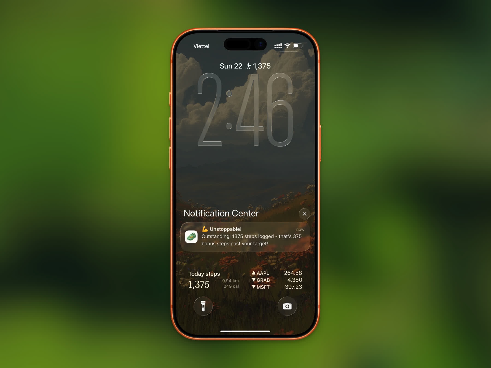

Steps отправляет уведомления, чтобы отмечать ваш прогресс и поддерживать мотивацию в течение дня.

## Типы уведомлений

<Frame caption="Уведомление Steps о достижении цели">
  
</Frame>

Каждый тип можно включить или отключить отдельно в **Настройки → Уведомления**.

### Достижение цели

Срабатывает, когда количество шагов достигает вашей ежедневной цели — поздравительное сообщение с вашим достижением. Эта настройка также отправляет обновление о прогрессе по мере приближения к цели, показывая текущий процент и количество оставшихся шагов. Каждое отправляется не чаще одного раза в день.

### Завершение тренировки

Отправляется после завершения тренировки. Включает продолжительность тренировки и пройденное расстояние. Текст сообщения зависит от типа тренировки (ходьба, бег или велосипед).

### Разблокировка приложения

Если вы используете [Блокировку приложений](/ru/features/app-lock), вы получите уведомление, когда цель по шагам будет достигнута и заблокированные приложения будут разблокированы. Отправляется не чаще одного раза в день.

### Ежедневные напоминания

Необязательные напоминания утром, днём и вечером, чтобы поддерживать ваше движение к цели.

## Юмор

На экране «Уведомления» ползунок **Юмор** задаёт тон текста, который Apple Intelligence пишет для вас. Перетащите его от тёплого к театральному:

| Уровень | Тон |
|---------|-----|
| **Kind** | Тёплый, без сарказма |
| **Gentle** | Дружелюбный, лёгкая индивидуальность |
| **Witty** | Сухой и остроумный |
| **Snarky** | Игривый сарказм |
| **Extra** | Театральный |

На карточке показывается предпросмотр образца заголовка и текста для выбранного уровня.

## Включение уведомлений

1. Откройте **Настройки** в Steps
2. Нажмите **Уведомления**
3. Включите нужные типы уведомлений — «Достижение цели», «Завершение тренировки», «Разблокировка приложения» и «Ежедневные напоминания»
4. Разрешите уведомления при запросе iOS

## Отключение уведомлений

Откройте **Настройки > Уведомления** в Steps и выключите ненужные типы. Вы также можете управлять уведомлениями Steps в **Настройки > Уведомления > Steps** на вашем iPhone.
