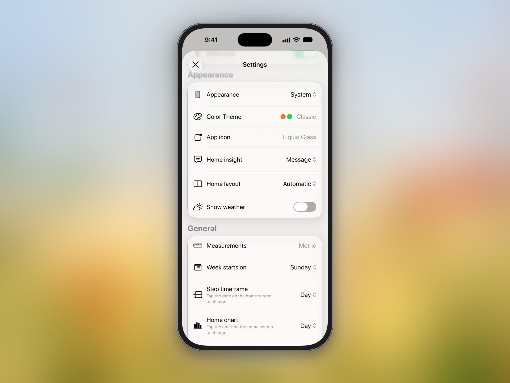

Экран настроек позволяет настроить внешний вид и поведение Steps. Откройте его кнопкой в правом верхнем углу главного экрана — это иконка шестерёнки или фото вашего профиля после входа в систему.

## Профиль

Карточка профиля отображается вверху экрана настроек. Нажмите на неё, чтобы изменить отображаемое имя, фото аватара и страну. Если вы не вошли в систему, отобразится предложение **Sign In with Apple**.

У подписчиков Pro на карточке профиля отображается значок **Pro**.

## Оформление

<Frame caption="Настройки оформления">
  
</Frame>

| Настройка | Варианты | Примечания |
|-----------|----------|------------|
| **Оформление** | Системное, Светлое, Тёмное | Следовать за устройством или задать вручную |
| **Цветовая тема** | 12 готовых + Пользовательская | Функция Pro. См. [Цветовые темы](/ru/features/color-themes) |
| **Иконка приложения** | 17 иконок | См. [Иконка приложения](/ru/features/app-icon-selector) |
| **Информация на главном экране** | Выкл., Сообщение, Среднее, Годовая цель | Что отображается под счётчиком шагов |
| **Базовый период среднего** | Последние 30 дней, Последние 3 месяца, Этот год, Прошлый год, За всё время | Показывается, когда информация на главном экране — Среднее |
| **Макет главного экрана** | Автоматически, Карточка, Дашборд | iOS 26 и новее. См. [Главный экран](/ru/features/home-dashboard#макет-главного-экрана) |
| **Показать погоду** | Вкл., Выкл. | Отображение температуры и погодных условий |

## Общие

| Настройка | Варианты | Примечания |
|-----------|----------|------------|
| **Единицы измерения** | Единицы и температура | Открывает отдельную страницу (см. ниже) |
| **Начало недели** | Воскресенье, Понедельник | Изменяет календарь и еженедельные представления |
| **Период шагов** | День, Неделя, Месяц | Неделя и Месяц — функции Pro. Также можно нажать на дату на главном экране |
| **График на главном экране** | День, Неделя, Месяц | Показывается, когда период шагов — День. Неделя и Месяц — функции Pro. Также можно нажать на график на главном экране |
| **Дневная цель** | 1 000 - 20 000 | См. [Дневная цель](/ru/features/daily-goal) |
| **Годовая цель** | 500 000 - 10 000 000 | См. [Годовая цель](/ru/features/yearly-goal) |
| **Уведомления** | Открывает экран с подробностями | Показывает, включены ли уведомления. См. [Уведомления](/ru/features/notifications) |
| **Блокировка приложения** | Вкл., Выкл. | Функция Pro. См. [Блокировка приложения](/ru/features/app-lock) |
| **Язык приложения** | 10 языков | Открывает языковые настройки устройства |

### Единицы измерения

Страница **Единицы измерения** (первый пункт в разделе «Основные») управляет единицами, используемыми во всём приложении:

- **Система единиц** — **Метрическая** (км, °C) или **Имперская** (мили, °F)
- **Температура** — **Авто** (следует за вашей системой единиц), **Цельсий** или **Фаренгейт**

Изменения применяются во всём приложении и автоматически синхронизируются с вашими Apple Watch.

### Параметры уведомлений

При нажатии на «Уведомления» открывается экран с переключателем для каждого типа:

- **Достижение цели** — достижение цели и этапы
- **Завершение тренировки** — когда тренировка завершена
- **Разблокировка приложений** — когда приложения разблокированы
- **Ежедневные напоминания** — утром, днём и вечером
- **Юмор** — насколько игривым должен звучать сгенерированный текст уведомлений (iOS 26 и новее). См. [Уведомления](/ru/features/notifications#юмор)

### Поддерживаемые языки

Steps доступен на English, Deutsch, Español, Français, Italiano, 日本語, 한국어, Português (Brasil), Русский и 简体中文.

## Виджеты и данные

- **Виджеты домашнего экрана** — руководство по добавлению виджетов. См. [Виджеты](/ru/features/widgets)
- **Повторная синхронизация данных Apple Health** — обновите данные о вашей активности из Apple Health
- **Перезапустить обучение** — пройдите процесс настройки заново

## Поддержка

- **Доска отзывов** — отправляйте запросы на функции и голосуйте за идеи
- **Оставить отзыв** — оцените Steps в App Store
- **Справка и документация** — [getsteps.app/docs](https://getsteps.app/docs)
- **Управление подпиской** — измените или отмените план Pro (только для пользователей Pro)
- **Условия обслуживания** — [getsteps.app/terms](https://getsteps.app/terms)
- **Политика конфиденциальности** — [getsteps.app/privacy](https://getsteps.app/privacy)
- **Фитнес-калькуляторы** — [getsteps.app/tools](https://getsteps.app/tools)

## О приложении

- **Что нового** — последние изменения и обновления
- **Заметка от Hieu** — зачем существует Steps, а также способ оставить отзыв или написать в ответ
- **Авторы** — люди, стоящие за Steps
- **Поделиться Steps** — поделитесь приложением с друзьями через QR-код
- **Подписаться в X** — [@hieudinh_](https://x.com/hieudinh_)
- **Блог** — [getsteps.app/blog](https://getsteps.app/blog)
