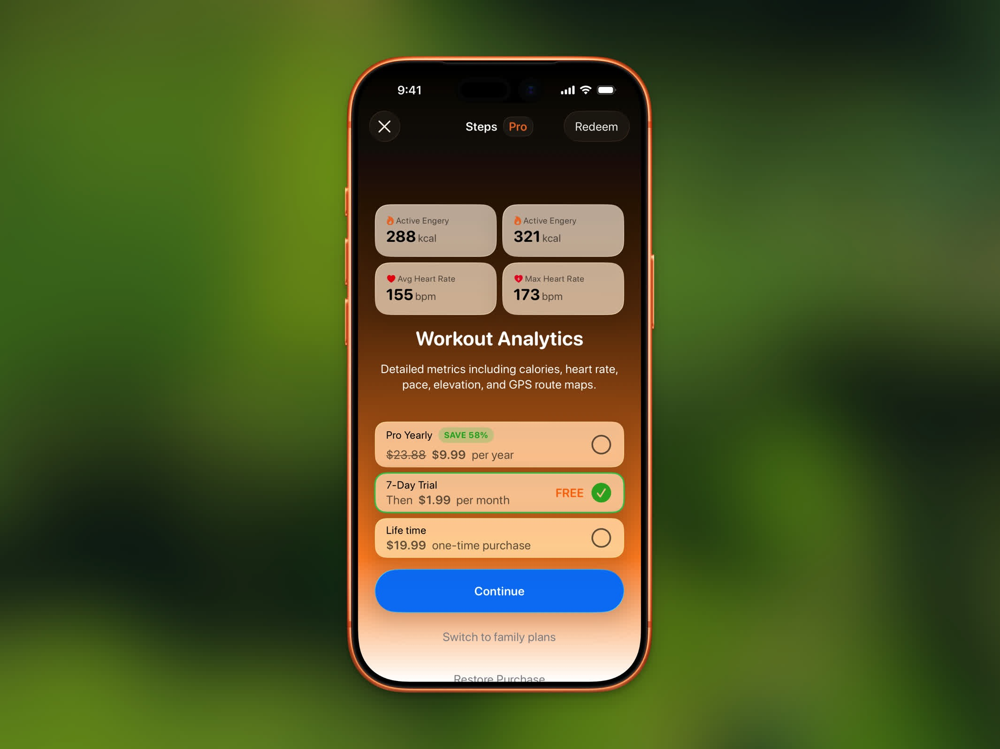

Steps Pro открывает доступ ко всему набору функций — советы ИИ-тренера, Чат о тренировке, недельные и месячные графики, расширенная аналитика тренировок, цветовые темы, блокировка приложений и многое другое.

## Функции Pro

<Frame caption="Экран подписки Steps Pro">
  
</Frame>

<CardGroup cols={2}>
  <Card title="ИИ-тренер и Чат о тренировке" icon="sparkles">
    **Советы** и **Попробуйте в следующий раз** от тренера по каждой тренировке, а также отправка сообщений в Чате о тренировке, чтобы спрашивать о вашей активности. Оценка тренера бесплатна для всех.
  </Card>
  <Card title="Недельные и месячные графики" icon="chart-bar">
    Просматривайте тенденции по шагам за неделю и месяц на главном экране.
  </Card>
  <Card title="Расширенная аналитика тренировок" icon="chart-line">
    3D-воспроизведение маршрута, экспорт GPX и сохранение изображений тренировок для публикации в Фото.
  </Card>
  <Card title="Неограниченная история" icon="calendar">
    Доступ к полной истории тренировок. В бесплатной версии видны тренировки за последние 3 месяца.
  </Card>
  <Card title="Цветовые темы" icon="palette">
    Персонализируйте приложение с помощью насыщенных цветовых пресетов помимо стандартного.
  </Card>
  <Card title="Альтернативные иконки приложения" icon="grip">
    Выбирайте из полного набора альтернативных иконок приложения.
  </Card>
  <Card title="Виджеты домашнего экрана" icon="grid-2">
    Виджеты графиков, календарей, годовой цели и тренировок для домашнего экрана. Какие виджеты бесплатны, см. в разделе [Виджеты](/ru/features/widgets).
  </Card>
  <Card title="Блокировка приложений" icon="lock">
    Блокируйте отвлекающие приложения, пока не достигнете цели по шагам.
  </Card>
</CardGroup>

## Планы подписки

Steps Pro доступен в виде индивидуальных и семейных планов:

| План | Оплата | Пробный период |
|------|--------|----------------|
| **Ежемесячный** | Ежемесячная оплата | Нет |
| **Ежегодный** | Ежегодная оплата (лучшая цена) | 1 неделя бесплатно |
| **Навсегда** | Единоразовая покупка | Нет |

<Tip>Семейные планы позволяют делиться подпиской Steps Pro с 5 членами семьи через Семейный доступ Apple.</Tip>

## Бесплатный пробный период

Ежегодный план включает **бесплатный пробный период на 1 неделю** для новых подписчиков. Оплата не будет списана до окончания пробного периода, и вы можете отменить подписку в любое время.

## Восстановление покупки

Если вы ранее приобрели Steps Pro:

1. Откройте экран Steps Pro
2. Нажмите **Восстановить покупку** внизу экрана
3. Ваша подписка будет восстановлена автоматически

## Активация промокода

Если у вас есть промокод или код предложения:

1. Откройте экран Steps Pro
2. Нажмите **Активировать**, чтобы ввести код
3. Подписка будет применена к вашей учётной записи

## Управление подпиской

Чтобы изменить или отменить подписку, перейдите в **Настройки > Управление подпиской** в приложении Steps. Это откроет страницу управления подписками Apple.
