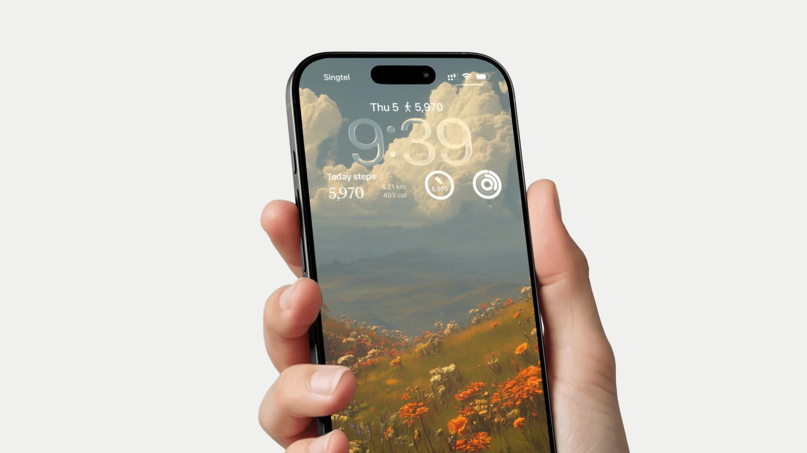

Steps предлагает множество виджетов, чтобы вы могли видеть количество шагов, серии и данные о тренировках, не открывая приложение.

## Типы виджетов

<Frame caption="Виджеты Steps на домашнем экране">
  
</Frame>

| Виджет | Размеры | План | Описание |
|--------|---------|------|----------|
| **Шаги за сегодня** | Маленький, Экран блокировки (прямоугольный, встроенный, круглый) | Бесплатно | Текущее количество шагов и прогресс к цели |
| **Серия** | Маленький, Средний | Бесплатно | Текущий счёт серии и еженедельный прогресс к цели |
| **Рейтинг Степборда** | Маленький | Бесплатно | Топ-5 в рейтинге за сегодня плюс ваше место |
| **Начать тренировку** | Маленький | Бесплатно | Переход к одному типу тренировки одним нажатием (iOS 26+) |
| **Быстрый старт тренировок** | Средний | Бесплатно | Ваша основная тренировка плюс ярлыки для ещё трёх типов (iOS 26+) |
| **Почасовой график** | Средний | Pro | Столбчатая диаграмма шагов по часам за сегодня |
| **Недельный график** | Маленький, Средний | Pro | Столбчатая диаграмма шагов за последние 7 дней |
| **Месячный график** | Средний | Pro | Столбчатая диаграмма шагов за текущий месяц |
| **Календарь за месяц** | Маленький | Pro | Сетка календаря с отметками выполнения дневной цели за месяц |
| **Календарь за год** | Средний, Большой | Pro | Годовой календарь с тепловой картой выполнения целей |
| **Годовая цель** | Маленький, Средний | Pro | Прогресс к годовой цели по шагам со статусом и статистикой |
| **Итоги тренировки** | Маленький | Pro | Статистика последней тренировки |
| **Календарь тренировок** | Средний, Большой, Очень большой | Pro | Тренировочные дни отмечены активностью того дня |

<Note>Виджеты Pro можно добавить и без подписки — до перехода на Steps Pro они показывают предложение разблокировать его.</Note>

## Виджет «Рейтинг Степборда»

<Frame caption="Виджет «Рейтинг Степборда» с топ-5 за сегодня и вашим местом">
  
</Frame>

Виджет «Рейтинг Степборда» размещает ваш [Степборд](/ru/features/stepboard) на домашнем экране. Он показывает топ-5 пешеходов за сегодня с эмодзи-медалями для лидеров, а также ваше собственное место, если вы за пределами топ-5. При добавлении виджета вы можете выбрать, какую доску он показывает — доску World, доску вашей страны или любую группу, к которой вы присоединились. Нажмите на виджет, чтобы сразу перейти к этой доске.

## Виджет «Начать тренировку»

<Frame caption="Виджет «Начать тренировку» для отслеживания тренировки одним нажатием">
  
</Frame>

Виджеты «Начать тренировку» позволяют начать отслеживание [тренировки](/ru/features/workout-session) прямо с домашнего экрана. Нажмите на один из них, и Steps откроется сразу на этом типе тренировки — не нужно искать в меню. Оба требуют iOS 26 или новее.

- **Начать тренировку** (маленький) — один настраиваемый тип тренировки с кнопкой «Начать»
- **Быстрый старт тренировок** (средний) — ваша основная тренировка плюс быстрые ярлыки для ещё трёх типов

При добавлении виджета выберите, какой тип тренировки он запускает. Доступны те же типы, что и в приложении, включая силовые тренировки, HIIT, йогу и остальные из [списка тренировок](/ru/features/workout-session#типы-тренировок). Если тренировка уже идёт, нажатие на виджет открывает активное занятие.

## Виджет «Календарь тренировок»

Виджет «Календарь тренировок» отмечает каждый день, когда вы тренировались, активностью того дня — месяц бега, ходьбы и силовых занятий читается с одного взгляда.

- **Средний** и **Большой** доступны на каждом поддерживаемом iPhone
- **Очень большой** доступен на iOS 27

<Note>Виджет «Календарь тренировок» — функция Pro.</Note>

## Виджет «Годовая цель»

Виджет «Годовая цель» отслеживает ваш прогресс к [годовой цели по шагам](/ru/features/yearly-goal). Он показывает полосу прогресса, идёте ли вы по графику или отстаёте, и вспомогательную статистику. Он доступен в маленьком и среднем размерах.

## Live Activity

Во время активной тренировки на экране блокировки и в Dynamic Island (iOS 26+) появляется Live Activity. Отображается:

- Иконка типа тренировки
- Прошедшее время
- Пройденное расстояние
- Сожжённые калории
- Текущий темп

Dynamic Island переключается между показателями каждые 30 секунд. На iOS 27 активная тренировка также отображается в горизонтальном Dynamic Island и в StandBy.

## Добавление виджетов

<Steps>
  <Step title="Нажмите и удерживайте домашний экран">
    Нажмите и удерживайте пустую область на домашнем экране, пока иконки не начнут покачиваться.
  </Step>
  <Step title="Нажмите кнопку +">
    Нажмите кнопку **+** в верхнем левом углу, чтобы открыть галерею виджетов.
  </Step>
  <Step title="Найдите Steps">
    Введите «Steps» в строке поиска, чтобы найти все доступные виджеты.
  </Step>
  <Step title="Выберите виджет">
    Выберите тип и размер виджета, затем нажмите **Добавить виджет**.
  </Step>
</Steps>

## Виджеты экрана блокировки

<Frame caption="Виджеты Steps для экрана блокировки в трёх стилях">
  
</Frame>

Виджет «Шаги за сегодня» также доступен для экрана блокировки в трёх стилях:

- **Прямоугольный** — показывает количество шагов и индикатор прогресса
- **Встроенный** — компактное количество шагов в строке даты
- **Круглый** — количество шагов в круглом индикаторе

<Tip>Ваши виджеты автоматически обновляются с последними данными о шагах и отражают выбранную цветовую тему.</Tip>

## Поддержание актуальности виджетов

Виджеты шагов при каждом обновлении считывают сегодняшние и вчерашние шаги напрямую из Apple Health, поэтому остаются актуальными, даже если вы давно не открывали Steps. Серии также остаются точными после полуночи.

<Note>Данные Apple Health нельзя прочитать, пока iPhone заблокирован. В это время виджеты показывают последние шаги, записанные Steps, и догоняют при следующем обновлении после разблокировки.</Note>

<Tip>Если оставить **Фоновое обновление контента** включённым для Steps (**Настройки → Основные → Обновление контента**), приложение сможет синхронизировать всю историю в фоновом режиме, благодаря чему графики и виджеты календаря тоже остаются актуальными.</Tip>
